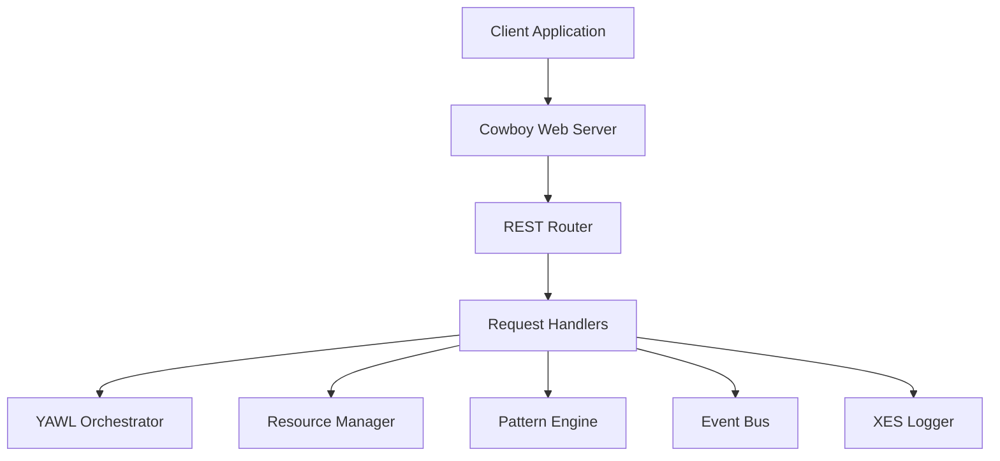

# REST API Overview

The YAWL REST API provides comprehensive access to workflow management, pattern execution, resource allocation, and monitoring capabilities.

## Base URL

```
http://localhost:8081/api
```

## API Architecture



## API Categories

### 1. Workflow Management
- Create, execute, and manage workflows
- Monitor workflow status and progress
- Control workflow lifecycle (pause, resume, cancel)

### 2. Task Management
- List and query tasks
- Complete or fail tasks
- Handle task allocation

### 3. Pattern Management
- Query available patterns
- Validate pattern configurations
- Get pattern documentation

### 4. Resource Management
- Register and manage resources
- Allocate resources to tasks
- Monitor resource utilization

### 5. Monitoring and Events
- Real-time event streaming
- Metrics and statistics
- XES log export

## Authentication

When enabled, use Bearer token authentication:

```bash
curl -H "Authorization: Bearer <token>" http://localhost:8081/api/workflows
```

## Response Format

All API responses follow a consistent JSON structure:

### Success Response
```json
{
  "status": "success",
  "data": { ... },
  "metadata": {
    "timestamp": "2024-01-01T10:00:00Z",
    "request_id": "req_123"
  }
}
```

### Error Response
```json
{
  "error_code": "workflow_not_found",
  "error_category": "not_found",
  "message": "The specified workflow does not exist",
  "http_status": 404,
  "timestamp": "2024-01-01T10:00:00Z",
  "details": {
    "workflow_id": "invalid_id",
    "suggestion": "Check the workflow ID or create a new workflow"
  }
}
```

## Common Headers

```bash
# Content-Type
Content-Type: application/json

# Request ID (for tracing)
X-Request-ID: req_abc123

# Correlation ID (for distributed tracing)
X-Correlation-ID: corr_xyz789
```

## Pagination

List endpoints support pagination:

```bash
curl "http://localhost:8081/api/workflows?page=1&per_page=50"
```

Response:
```json
{
  "data": [...],
  "pagination": {
    "page": 1,
    "per_page": 50,
    "total": 150,
    "total_pages": 3
  }
}
```

## Rate Limiting

Default rate limits (configurable):

| Endpoint Type | Limit | Window |
|--------------|-------|--------|
| Read operations | 1000/hour | 1 hour |
| Write operations | 100/hour | 1 hour |
| Event streams | 10/minute | 1 minute |

Rate limit headers are included in responses:

```bash
X-RateLimit-Limit: 100
X-RateLimit-Remaining: 95
X-RateLimit-Reset: 1704096000
```

## Versioning

The API uses URL versioning:

```
/api/v1/workflows     # Version 1 (current)
/api/v2/workflows     # Version 2 (future)
```

## CORS

Cross-Origin Resource Sharing is configurable:

```erlang
%% In application configuration
{yawl, [
    {cors_origins, ["*"]},  % Allow all origins
    {cors_methods, ["GET", "POST", "PUT", "DELETE", "OPTIONS"]},
    {cors_headers, ["Content-Type", "Authorization"]}
]}.
```

## WebSocket Support

Real-time event streaming via WebSocket:

```javascript
const ws = new WebSocket('ws://localhost:8081/api/workflows/{id}/events/ws');

ws.onmessage = (event) => {
    const data = JSON.parse(event.data);
    console.log('Event:', data);
};
```

## API Endpoints Summary

### Workflow Endpoints
| Method | Endpoint | Description |
|--------|----------|-------------|
| POST | /workflows | Create workflow |
| GET | /workflows | List workflows |
| GET | /workflows/{id} | Get workflow details |
| POST | /workflows/{id}/execute | Execute workflow |
| POST | /workflows/{id}/pause | Pause workflow |
| POST | /workflows/{id}/resume | Resume workflow |
| POST | /workflows/{id}/cancel | Cancel workflow |
| GET | /workflows/{id}/status | Get status |
| GET | /workflows/{id}/tasks | List tasks |
| GET | /workflows/{id}/history | Get history |
| GET | /workflows/{id}/xes | Export XES |

### Task Endpoints
| Method | Endpoint | Description |
|--------|----------|-------------|
| GET | /workflows/{id}/tasks | List tasks |
| GET | /workflows/{id}/tasks/{task_id} | Get task details |
| POST | /workflows/{id}/tasks/{task_id}/complete | Complete task |
| POST | /workflows/{id}/tasks/{task_id}/fail | Fail task |
| POST | /workflows/{id}/tasks/{task_id}/allocate | Allocate resource |
| POST | /workflows/{id}/tasks/{task_id}/release | Release resource |

### Pattern Endpoints
| Method | Endpoint | Description |
|--------|----------|-------------|
| GET | /patterns | List patterns |
| GET | /patterns/{name} | Get pattern info |
| POST | /patterns/{name}/validate | Validate config |

### Resource Endpoints
| Method | Endpoint | Description |
|--------|----------|-------------|
| GET | /resources | List resources |
| POST | /resources | Register resource |
| GET | /resources/{id} | Get resource details |
| DELETE | /resources/{id} | Delete resource |

### Monitoring Endpoints
| Method | Endpoint | Description |
|--------|----------|-------------|
| GET | /metrics | System metrics |
| GET | /workflows/{id}/metrics | Workflow metrics |
| GET | /workflows/{id}/events | Event log |

## Error Codes

| Code | Status | Description |
|------|--------|-------------|
| `validation_failed` | 400 | Invalid request data |
| `workflow_not_found` | 404 | Workflow doesn't exist |
| `invalid_pattern` | 400 | Pattern type invalid |
| `allocation_failed` | 500 | No resources available |
| `execution_failed` | 500 | Workflow execution error |
| `timeout` | 408 | Operation timeout |

## Quick Examples

### Create Sequential Workflow
```bash
curl -X POST http://localhost:8081/api/workflows \
  -H "Content-Type: application/json" \
  -d '{"pattern": "sequential", "name": "my_workflow"}'
```

### Execute Workflow
```bash
curl -X POST http://localhost:8081/api/workflows/{id}/execute
```

### Check Status
```bash
curl http://localhost:8081/api/workflows/{id}/status
```

---

Next: [Workflow Endpoints](workflow-endpoints.md) | [Back to Index](../index.md)
