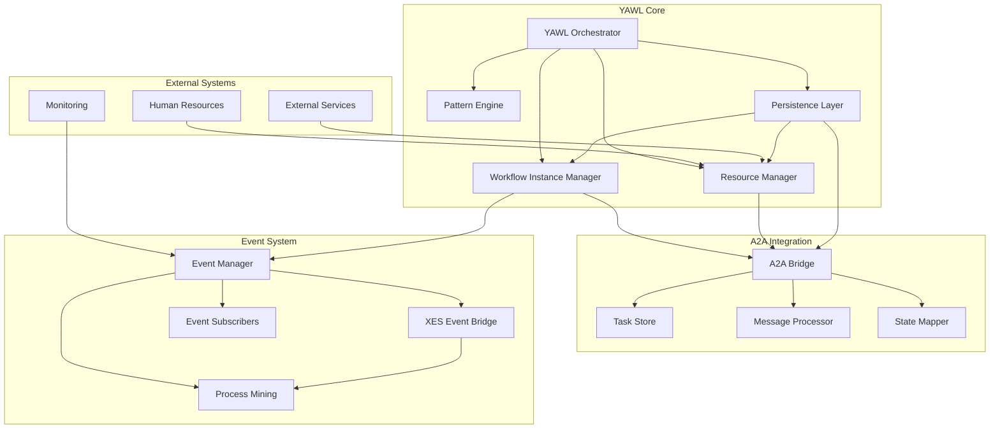
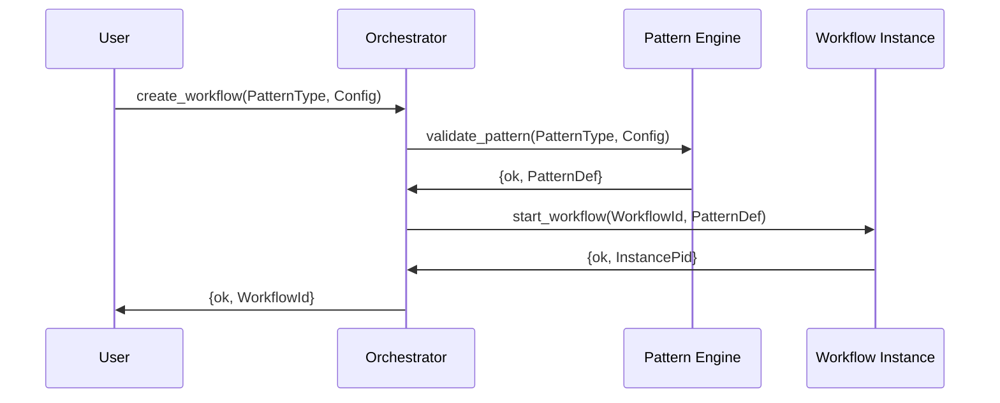
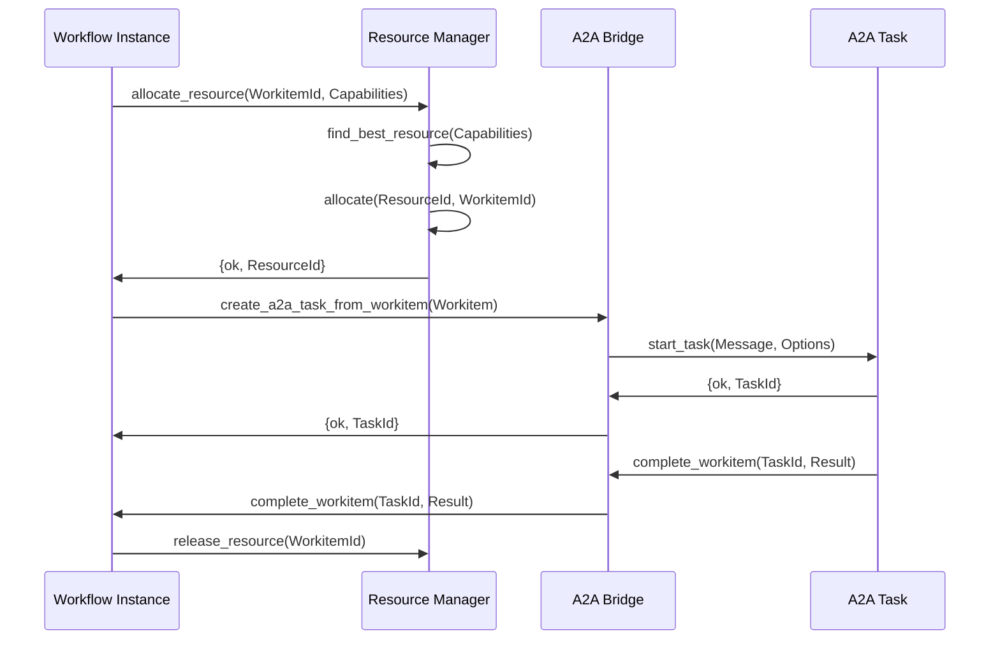
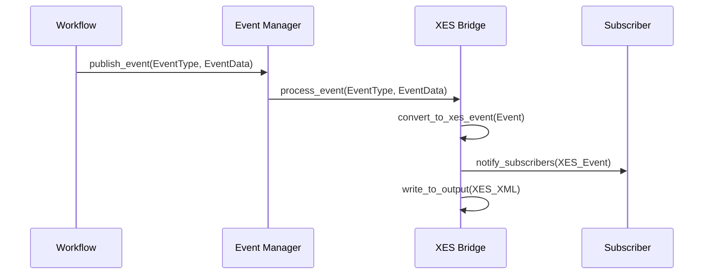
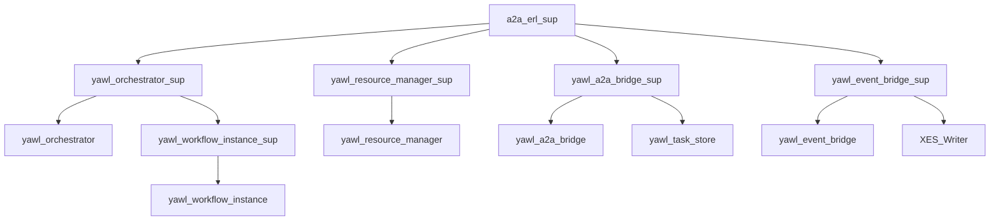

# YAWL Architecture Overview

This document provides a comprehensive overview of the YAWL system architecture, including components, data flow, and design patterns.

## System Architecture



## Core Components

### 1. YAWL Orchestrator

The central coordinator for workflow execution.

**Responsibilities:**
- Workflow lifecycle management
- Pattern validation and instantiation
- Workflow instance supervision
- Statistics and monitoring

**Key APIs:**
```erlang
% Workflow management
create_workflow/2
execute_workflow/1
get_status/1
cancel_workflow/1

% Pattern management
list_patterns/0
validate_pattern/2
get_pattern_info/1

% Workitem management
complete_workitem/3
get_workflow_instance/1
```

**Internal Structure:**
```erlang
-record(state, {
    workflows = #{},                    % workflow_id => workflow
    workflow_instances = #{},           % workflow_id => {pid, monitor_ref}
    pattern_cache = #{},               % pattern_type => pattern_def
    subscribers = #{},                  % workflow_id => [pid]
    config = #{},                      % system configuration
    statistics = #{}                   % performance metrics
}).
```

### 2. Pattern Engine

Implements all 43 YAWL workflow patterns using Petri net semantics.

**Petri Net Integration:**
- Places: Workflow states and conditions
- Transitions: Actions and events
- Tokens: Workflow flow control
- Markings: Current state representation

**Pattern Categories:**

1. **Control Flow Patterns**
   - Basic: Sequence, Parallel, Choice
   - Advanced: Interleaved, Deferred Choice
   - Iteration: Loops, Multi-Instance

2. **Cancellation Patterns**
   - Base: Cancellation, Block, Scope
   - Advanced: Thread, Subprocess, OR/AND conditions
   - After patterns: Time-based cancellation

3. **Resource Patterns**
   - With/Without allocation
   - Dynamic resource binding
   - Capability-based selection

### 3. Workflow Instance Manager

Manages individual workflow execution instances.

**Responsibilities:**
- Execute workflow patterns
- Handle workitem lifecycle
- Manage workflow state
- Handle exceptions and recovery

**State Management:**
```erlang
-record(yawl_workflow_state, {
    workflow_id :: binary(),
    pattern_type :: atom(),
    current_marking :: #{place() => [token()]},
    active_workitems :: [workitem_id()],
    completed_workitems :: [workitem_id()],
    status :: workflow_status()
}).
```

### 4. Resource Manager

Handles dynamic resource allocation for workflow tasks.

**Resource Types:**
- **Human Users**: People with specific capabilities
- **Services**: External systems and APIs
- **Systems**: Internal services and processes

**Allocation Strategies:**
- **Round Robin**: Distribute evenly
- **Least Loaded**: Choose least busy resource
- **Random**: Random selection

**Key APIs:**
```erlang
% Resource management
register_resource/2
list_resources/0
find_resources_by_capability/1

% Allocation
allocate_resource/2
release_resource/2
update_resource_status/2
```

### 5. A2A Bridge

Bidirectional integration between YAWL workflows and A2A tasks.

**Mapping Functions:**
- YAWL → A2A: Workitems become tasks
- A2A → YAWL: Task updates complete workitems

**State Synchronization:**
```erlang
-record(mapping, {
    workitem_id :: binary(),
    task_id :: binary(),
    workflow_id :: binary(),
    created_at :: integer(),
    updated_at :: integer(),
    state :: map()
}).
```

### 6. Event System

Real-time event processing and XES logging for process mining.

**Event Types:**
- Workflow events: started, completed, failed
- Workitem events: created, allocated, completed
- Resource events: allocated, released, status changed
- System events: checkpoint, restore, sync

**XES Integration:**
- Event trace generation
- Process mining support
- Performance analysis

### 7. Persistence Layer

Data persistence for workflows, workitems, and resources.

**Storage Models:**
```erlang
% Workflow persistence
-record(yawl_workflow_persist, {
    workflow_id :: binary(),
    spec_id :: binary(),
    pattern_type :: atom(),
    status :: workflow_status(),
    marking :: #{place() => [token()]},
    data :: map(),
    created_at :: integer(),
    updated_at :: integer()
}).

% Workitem persistence
-record(yawl_workitem_persist, {
    workitem_id :: binary(),
    workflow_id :: binary(),
    task_name :: binary(),
    status :: workitem_status(),
    assigned_to :: binary() | undefined,
    data :: map(),
    created_at :: integer(),
    completed_at :: integer() | undefined
}).

% Resource persistence
-record(yawl_resource_persist, {
    resource_id :: binary(),
    resource_type :: resource_type(),
    name :: binary(),
    capabilities :: [atom()],
    attributes :: map(),
    status :: resource_status(),
    current_load :: integer(),
    max_capacity :: integer(),
    last_heartbeat :: integer()
}).
```

## Data Flow Architecture

### 1. Workflow Creation Flow



### 2. Workitem Execution Flow



### 3. Event Processing Flow



## Design Patterns

### 1. Gen Server Pattern
All major components use OTP gen_server behavior for:
- Concurrent access
- Error handling
- State management
- Supervision

### 2. Supervisor Tree


### 3. Event-Driven Architecture
- Loose coupling through events
- Publish-subscribe pattern
- Async processing
- Real-time notifications

### 4. Resource Allocation Patterns
- Strategy pattern for allocation algorithms
- Factory pattern for resource creation
- Observer pattern for state changes

## Performance Considerations

### 1. Concurrency Model
- Process-per-workflow for isolation
- Resource pooling for efficiency
- Event aggregation for reduced overhead

### 2. Memory Management
- Pattern caching for fast lookup
- State optimization for large workflows
- Event buffering for batch processing

### 3. Scalability Features
- Horizontal scaling through distribution
- Load balancing for resource allocation
- Sharding for large deployments

## Fault Tolerance

### 1. Error Handling
- Process supervision and restart
- Transactional state updates
- Rollback mechanisms

### 2. Recovery Strategies
- Checkpoint and restore
- State persistence
- Automatic retry policies

### 3. Monitoring
- Health checks
- Performance metrics
- Error tracking and alerting

## Integration Points

### 1. External Systems
```erlang
% Human Resources integration
yawl_resource_manager:register_resource(UserId, human)

% External Services
yawl_resource_manager:register_service(ServiceId, endpoint)

% Monitoring systems
yawl_event_bridge:add_event_handler(MonitorModule, Args)
```

### 2. APIs
```erlang
% REST API integration
yawl_orchestrator:create_workflow(Pattern, Config)

% Message queue integration
yawl_a2a_bridge:create_workflow_from_a2a_task(TaskId, Pattern)

% Event streaming
yawl_event_bridge:subscribe_to_workflow(WorkflowId)
```

---

Next: [What is YAWL?](concepts/what-is-yawl.md) →