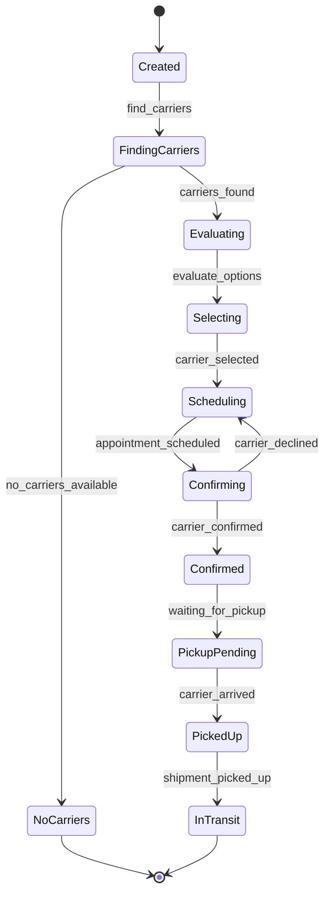

# Carrier Appointment Workflow

Logistics carrier scheduling and appointment management workflow.

## Overview

The carrier appointment workflow manages the scheduling, assignment, and coordination of freight carriers for shipping orders. This workflow demonstrates resource allocation patterns, parallel execution, and time-based patterns.

## Business Requirements

1. **Carrier Selection**: Select available carriers based on shipment requirements
2. **Appointment Scheduling**: Schedule pickup/delivery appointments
3. **Carrier Assignment**: Assign shipment to selected carrier
4. **Confirmation**: Send appointment confirmation to carrier
5. **Monitoring**: Track appointment status and carrier performance

## Workflow Diagram



## Configuration

### Carrier Selection with Parallel Evaluation

```erlang
CarrierAppointmentConfig = #{
    workflow_type => carrier_appointment,
    pattern_type => parallel_split,
    name => <<"carrier_selection">>,
    description => <<"Find and evaluate available carriers">>,
    parameters => #{
        branches => [
            #{
                task => find_carriers_by_capability,
                capabilities => [carrier_search],
                parameters => #{
                    search_criteria => [equipment_type, service_level, route]
                },
                timeout => 15000
            },
            #{
                task => check_carrier_availability,
                capabilities => [scheduling],
                parameters => #{
                    pickup_window => #{start => DateTime1, end => DateTime2}
                },
                timeout => 15000
            },
            #{
                task => get_carrier_rates,
                capabilities => [pricing],
                parameters => #{
                    shipment_details => #{
                        weight, dimensions, origin, destination
                    }
                },
                timeout => 20000
            }
        ]
    },
    join_strategy => #{
        type => n_out_of_n,
        required => 3,
        timeout => 30000
    }
}.
```

### Deferred Choice for Carrier Selection

```erlang
CarrierSelectionConfig = #{
    pattern_type => deferred_choice,
    name => <<"carrier_selection">>,
    description => <<"Select best carrier based on evaluation">>,
    parameters => #{
        options => [
            #{
                name => lowest_cost,
                evaluation => fun(Carriers) ->
                    lists:min(Carriers, fun(C1, C2) ->
                        C1#carrier.rate < C2#carrier.rate
                    end)
                end
            },
            #{
                name => fastest_delivery,
                evaluation => fun(Carriers) ->
                    lists:min(Carriers, fun(C1, C2) ->
                        C1#carrier.transit_time < C2#carrier.transit_time
                    end)
                end
            },
            #{
                name => highest_rating,
                evaluation => fun(Carriers) ->
                    lists:max(Carriers, fun(C1, C2) ->
                        C1#carrier.rating > C2#carrier.rating
                    end)
                end
            }
        ],
        selection_criteria => #{
            primary => lowest_cost,
            constraints => #{
                max_transit_time => 72,  % hours
                min_rating => 4.0
            }
        }
    }
}.
```

## Data Structures

### Carrier Record

```erlang
-record(carrier, {
    id :: binary(),
    name :: binary(),
    type :: carrier_type(),
    capabilities :: [carrier_capability()],
    service_area :: [binary()],
    rating :: float(),
    on_time_rate :: float(),
    contact :: carrier_contact(),
    status :: carrier_status(),
    metadata :: map()
}).

-type carrier_type() :: ltl | ftl | parcel | intermodal | drayage.
-type carrier_capability() :: refrigerated | hazardous | flatbed |
                               liftgate | inside_delivery | appointment_only.
-type carrier_status() :: available | busy | inactive | suspended.

-type carrier_contact() :: #{
    phone := binary(),
    email := binary(),
    dispatcher := binary(),
    portal_url := binary()
}.
```

### Appointment Record

```erlang
-record(carrier_appointment, {
    id :: binary(),
    shipment_id :: binary(),
    carrier_id :: binary(),
    appointment_type :: appointment_type(),
    scheduled_window :: time_window(),
    status :: appointment_status(),
    confirmation_number :: binary() | undefined,
    created_at :: integer(),
    confirmed_at :: integer() | undefined,
    completed_at :: integer() | undefined,
    notes :: binary() | undefined,
    metadata :: map()
}).

-type appointment_type() :: pickup | delivery.
-type appointment_status() :: scheduled | confirmed | declined |
                                in_progress | completed | cancelled.
-type time_window() :: #{
    start := integer(),  % Unix timestamp
    end := integer(),
    timezone := binary()
}.
```

### Shipment Requirements

```erlang
-record(shipment_requirements, {
    equipment_type :: equipment_type(),
    weight :: float(),
    dimensions :: dimensions(),
    origin :: location(),
    destination :: location(),
    pickup_window :: time_window() | undefined,
    delivery_window :: time_window() | undefined,
    special_requirements :: [binary()]
}).

-type equipment_type() :: dry_van | refrigerated | flatbed | tanker |
                          container | chassis.
-type dimensions() :: #{
    length := float(),
    width := float(),
    height := float()
}.
```

## Implementation

### Carrier Finder

```erlang
-module(carrier_finder).

-export([find_carriers/2, check_availability/2, get_rates/2]).

-spec find_carriers(shipment_requirements(), [binary()]) ->
    {ok, [carrier()]} | {error, term()}.
find_carriers(Requirements, PreferredCarriers) ->
    Criteria = #{
        equipment_type => Requirements#shipment_requirements.equipment_type,
        service_area => [
            Requirements#shipment_requirements.origin#region,
            Requirements#shipment_requirements.destination#region
        ],
        capabilities => Requirements#shipment_requirements.special_requirements
    },

    AllCarriers = case PreferredCarriers of
        [] -> carrier_store:get_all();
        _ -> carrier_store:get_by_ids(PreferredCarriers)
    end,

    MatchingCarriers = lists:filter(fun(Carrier) ->
        matches_criteria(Carrier, Criteria)
    end, AllCarriers),

    ActiveCarriers = lists:filter(fun(C) ->
        C#carrier.status =:= available
    end, MatchingCarriers),

    {ok, ActiveCarriers}.

-spec check_availability(carrier(), time_window()) ->
    {ok, boolean()} | {error, term()}.
check_availability(Carrier, Window) ->
    case carrier_calendar:get_availability(Carrier#carrier.id, Window) of
        {ok, []} -> {ok, true};  % No conflicts
        {ok, _} -> {ok, false};  % Has conflicts
        {error, Reason} -> {error, Reason}
    end.

-spec get_rates([carrier()], shipment_requirements()) ->
    {ok, [{carrier(), float()}]} | {error, term()}.
get_rates(Carriers, Requirements) ->
    Results = lists:map(fun(Carrier) ->
        case rate_engine:get_rate(Carrier#carrier.id, Requirements) of
            {ok, Rate} -> {Carrier, Rate};
            {error, _} -> {Carrier, undefined}
        end
    end, Carriers),

    ValidRates = lists:filter(fun({_, Rate}) -> Rate =/= undefined end, Results),
    {ok, ValidRates}.

%% Internal: Check if carrier matches criteria
matches_criteria(Carrier, Criteria) ->
    EquipMatch = lists:member(Carrier#carrier.equipment_type,
                              maps:get(equipment_type, Criteria, [])),
    CapMatch = lists:all(fun(Cap) ->
        lists:member(Cap, Carrier#carrier.capabilities)
    end, maps:get(capabilities, Criteria, [])),
    AreaMatch = lists:any(fun(Region) ->
        lists:member(Region, Carrier#carrier.service_area)
    end, maps:get(service_area, Criteria, [])),

    EquipMatch andalso CapMatch andalso AreaMatch.
```

### Appointment Scheduler

```erlang
-module(appointment_scheduler).

-export([schedule_appointment/3, confirm_appointment/2, cancel_appointment/2]).

-spec schedule_appointment(binary(), binary(), time_window()) ->
    {ok, carrier_appointment()} | {error, term()}.
schedule_appointment(ShipmentId, CarrierId, Window) ->
    AppointmentId = yawl_utils:generate_id(appt),

    %% Check if window is still available
    case carrier_calendar:reserve_slot(CarrierId, Window) of
        {ok, ReservationId} ->
            Appointment = #carrier_appointment{
                id = AppointmentId,
                shipment_id = ShipmentId,
                carrier_id = CarrierId,
                appointment_type = pickup,
                scheduled_window = Window,
                status = scheduled,
                created_at = erlang:system_time(millisecond)
            },
            ok = appointment_store:save(Appointment),
            ok = notify_carrier(AppointmentId, CarrierId, scheduled),
            {ok, Appointment};
        {error, Reason} ->
            {error, Reason}
    end.

-spec confirm_appointment(binary(), binary()) ->
    ok | {error, term()}.
confirm_appointment(AppointmentId, ConfirmationNumber) ->
    case appointment_store:get(AppointmentId) of
        {ok, #carrier_appointment{status = scheduled} = Appointment) ->
            Updated = Appointment#carrier_appointment{
                status = confirmed,
                confirmation_number = ConfirmationNumber,
                confirmed_at = erlang:system_time(millisecond)
            },
            ok = appointment_store:save(Updated),
            ok = notify_shipper(AppointmentId, confirmed),
            ok;
        {ok, #carrier_appointment{status = Status}} ->
            {error, {invalid_status, Status}};
        {error, Reason} ->
            {error, Reason}
    end.

-spec cancel_appointment(binary(), binary()) -> ok | {error, term()}.
cancel_appointment(AppointmentId, Reason) ->
    case appointment_store:get(AppointmentId) of
        {ok, #carrier_appointment{
            status = Status,
            carrier_id = CarrierId,
            scheduled_window = Window
        } = Appointment} when Status =:= scheduled;
                                Status =:= confirmed ->
            %% Release the reserved time slot
            ok = carrier_calendar:release_slot(CarrierId, Window),

            %% Update appointment status
            Updated = Appointment#carrier_appointment{
                status = cancelled,
                notes = Reason
            },
            ok = appointment_store:save(Updated),

            %% Notify carrier
            ok = notify_carrier(AppointmentId, CarrierId, cancelled),
            ok;
        {ok, #carrier_appointment{status = Status}} ->
            {error, {invalid_status, Status}};
        {error, Reason} ->
            {error, Reason}
    end.

%% Notify carrier of appointment
notify_carrier(AppointmentId, CarrierId, Status) ->
    case appointment_store:get(AppointmentId) of
        {ok, Appointment} ->
            Message = #{
                type => appointment_notification,
                appointment_id => AppointmentId,
                status => Status,
                window => Appointment#carrier_appointment.scheduled_window,
                shipment_id => Appointment#carrier_appointment.shipment_id
            },
            carrier_notification:send(CarrierId, Message);
        {error, _} ->
            {error, appointment_not_found}
    end.

%% Notify shipper of appointment status
notify_shipper(AppointmentId, Status) ->
    case appointment_store:get(AppointmentId) of
        {ok, #carrier_appointment{shipment_id = ShipmentId}} ->
            shipment_notification:notify(ShipmentId, #{
                type => appointment_status,
                appointment_id => AppointmentId,
                status => Status
            });
        {error, _} ->
            {error, appointment_not_found}
    end.
```

### Carrier Selection Logic

```erlang
-module(carrier_selector).

-export([select_carrier/3]).

-type selection_strategy() :: lowest_cost | fastest | highest_rating | balanced.
-type selection_result() :: {ok, carrier()} | {error, term()}.

-spec select_carrier([carrier()], shipment_requirements(), selection_strategy()) ->
    selection_result().
select_carrier(Carriers, Requirements, Strategy) ->
    case Carriers of
        [] ->
            {error, no_carriers_available};
        _ ->
            %% Apply constraints first
            Eligible = apply_constraints(Carriers, Requirements),
            case Eligible of
                [] ->
                    {error, no_eligible_carriers};
                _ ->
                    %% Score and rank carriers
                    Scored = score_carriers(Eligible, Requirements, Strategy),
                    %% Select best carrier
                    Best = lists:foldl(fun({C1, S1}, {C2, S2}) ->
                        case S1 > S2 of
                            true -> {C1, S1};
                            false -> {C2, S2}
                        end
                    end, hd(Scored), tl(Scored)),
                    {ok, element(1, Best)}
            end
    end.

%% Apply business constraints
apply_constraints(Carriers, Requirements) ->
    lists:filter(fun(Carrier) ->
        meets_constraints(Carrier, Requirements)
    end, Carriers).

meets_constraints(Carrier, Requirements) ->
    %% Check rating constraint
    RatingOK = Carrier#carrier.rating >= 4.0,

    %% Check on-time rate constraint
    OnTimeOK = Carrier#carrier.on_time_rate >= 0.85,

    %% Check special requirements
    CapsOK = lists:all(fun(Req) ->
        lists:member(Req, Carrier#carrier.capabilities)
    end, Requirements#shipment_requirements.special_requirements),

    RatingOK andalso OnTimeOK andalso CapsOK.

%% Score carriers based on strategy
score_carriers(Carriers, Requirements, Strategy) ->
    lists:map(fun(Carrier) ->
        Score = calculate_score(Carrier, Requirements, Strategy),
        {Carrier, Score}
    end, Carriers).

calculate_score(Carrier, Requirements, Strategy) ->
    {ok, Rates} = carrier_finder:get_rates([Carrier], Requirements),
    {_, Rate} = hd(Rates),

    case Strategy of
        lowest_cost ->
            %% Lower cost = higher score
            1000 / (Rate + 1);
        fastest ->
            %% Faster transit = higher score
            1000 / (Carrier#carrier.avg_transit_time + 1);
        highest_rating ->
            Carrier#carrier.rating * 100;
        balanced ->
            %% Weighted combination
            (1000 / (Rate + 1)) * 0.4 +
            (1000 / (Carrier#carrier.avg_transit_time + 1)) * 0.3 +
            Carrier#carrier.rating * 100 * 0.3
    end.
```

## REST API Usage

### Create Carrier Appointment Workflow

```bash
curl -X POST http://localhost:8081/api/workflows \
  -H "Content-Type: application/json" \
  -d '{
    "pattern": "parallel_split",
    "name": "carrier_appointment",
    "input_data": {
      "shipment_id": "shipment_123",
      "requirements": {
        "equipment_type": "dry_van",
        "weight": 15000,
        "dimensions": {"length": 53, "width": 8, "height": 9},
        "origin": {
          "address": "123 Main St",
          "city": "Chicago",
          "state": "IL",
          "zip": "60601"
        },
        "destination": {
          "address": "456 Oak Ave",
          "city": "Detroit",
          "state": "MI",
          "zip": "48201"
        },
        "pickup_window": {
          "start": "2024-01-02T08:00:00Z",
          "end": "2024-01-02T12:00:00Z"
        }
      },
      "preferred_carriers": ["carrier_1", "carrier_2"]
    }
  }'
```

### Confirm Appointment

```bash
curl -X POST http://localhost:8081/api/workflows/{workflow_id}/tasks/{task_id}/complete \
  -H "Content-Type: application/json" \
  -d '{
    "result": {
      "status": "confirmed",
      "confirmation_number": "CONF-2024-001",
      "carrier_id": "carrier_1"
    }
  }'
```

## Testing

```erlang
carrier_appointment_test_() ->
    {setup,
     fun setup/0,
     fun cleanup/1,
     [
      fun find_available_carriers/0,
      fun select_best_carrier/0,
      fun schedule_appointment/0,
      fun confirm_appointment/0
     ]}.

find_available_carriers() ->
    Requirements = #shipment_requirements{
        equipment_type = dry_van,
        weight = 15000,
        origin = #location{region = <<"midwest">>},
        destination = #location{region = <<"midwest">>}
    },
    {ok, Carriers} = carrier_finder:find_carriers(Requirements, []),
    ?assert(length(Carriers) > 0).

select_best_carrier() ->
    Carriers = [#carrier{id = <<"c1">>, rating = 4.5, avg_transit_time = 24},
                 #carrier{id = <<"c2">>, rating = 4.0, avg_transit_time = 18}],
    Requirements = #shipment_requirements{},
    {ok, #carrier{id = Id}} = carrier_selector:select_carrier(
        Carriers, Requirements, highest_rating),
    ?assertEqual(<<"c1">>, Id).
```

---

Next: [Freight Transit](freight-transit.md) | [Back to Overview](overview.md)
