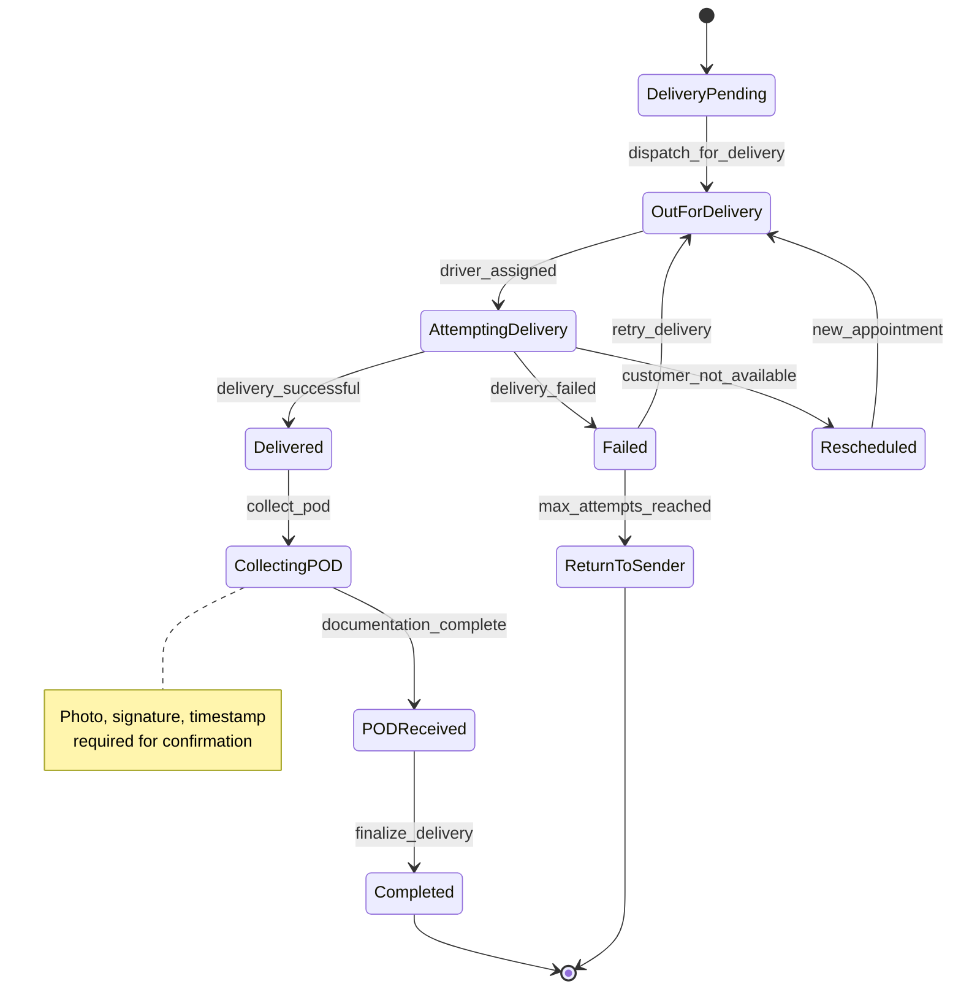

# Freight Delivered Workflow

Delivery confirmation, proof of delivery, and post-delivery processing.

## Overview

The freight delivered workflow handles the final stage of the shipping process: delivery confirmation, proof of delivery collection, customer notification, and post-delivery processing. This workflow demonstrates the cancellation pattern, milestone patterns, and integration with delivery APIs.

## Business Requirements

1. **Delivery Confirmation**: Confirm shipment has been delivered
2. **Proof of Delivery (POD)**: Collect and store delivery documentation
3. **Customer Notification**: Notify customer of successful delivery
4. **Exception Handling**: Handle delivery failures and re-delivery attempts
5. **Post-Delivery Processing**: Update inventory, complete order, trigger payment settlement

## Workflow Diagram



## Configuration

### Delivery Workflow with Milestones

```erlang
FreightDeliveredConfig = #{
    workflow_type => freight_delivered,
    pattern_type => milestone,
    name => <<"delivery_confirmation">>,
    description => <<"Confirm delivery and collect POD">>,
    parameters => #{
        steps => [
            #{
                step_id => dispatch_delivery,
                name => <<"Dispatch for Delivery">>,
                task => dispatch_to_driver,
                capabilities => [dispatch],
                timeout => 30000
            },
            #{
                step_id => attempt_delivery,
                name => <<"Attempt Delivery">>,
                task => attempt_delivery,
                capabilities => [driver_app],
                timeout => 3600000,  % 1 hour
                retry => 2
            },
            #{
                step_id => collect_pod,
                name => <<"Collect POD">>,
                task => collect_proof_of_delivery,
                capabilities => [pod_collection],
                timeout => 300000,  % 5 minutes
                milestone => true
            },
            #{
                step_id => confirm_delivery,
                name => <<"Confirm Delivery">>,
                task => confirm_delivery,
                capabilities => [confirmation],
                timeout => 30000,
                depends_on_milestone => collect_pod
            },
            #{
                step_id => post_delivery,
                name => <<"Post-Delivery Processing">>,
                task => post_delivery_processing,
                capabilities => [processing],
                timeout => 60000
            }
        ]
    },
    options => #{
        enable_cancellation => true,
        cancellation_on_failure => return_to_sender
    }
}.
```

### Delivery Failure with Cancellation

```erlang
DeliveryFailureConfig = #{
    pattern_type => cancellation_block,
    name => <<"delivery_failure_handling">>,
    description => <<"Handle delivery failures with return to sender">>,
    parameters => #{
        main_task => attempt_delivery,
        failure_conditions => [
            #{
                condition => delivery_failed,
                max_retries => 3,
                action => return_to_sender
            },
            #{
                condition => customer_not_available,
                max_retries => 2,
                action => reschedule_delivery
            },
            #{
                condition => address_incorrect,
                max_retries => 0,
                action => contact_customer
            }
        ],
        block_tasks => [
            collect_pod,
            confirm_delivery,
            post_delivery
        ]
    }
}.
```

## Data Structures

### Delivery Record

```erlang
-record(delivery, {
    id :: binary(),
    shipment_id :: binary(),
    carrier_id :: binary(),
    driver_id :: binary() | undefined,
    status :: delivery_status(),
    scheduled_time :: integer(),
    attempted_at :: [integer()],
    delivered_at :: integer() | undefined,
    failure_reasons :: [binary()],
    pod :: proof_of_delivery() | undefined,
    metadata :: map()
}).

-type delivery_status() :: pending | dispatched | out_for_delivery |
                           attempting | failed | rescheduled |
                           delivered | completed | returned.

-type proof_of_delivery() :: #{
    signature := binary() | undefined,
    photo := binary() | undefined,  % Base64 encoded
    timestamp := integer(),
    location := binary(),
    recipient_name := binary(),
    recipient_relationship := binary() | undefined,
    notes := binary() | undefined
}.
```

### Delivery Attempt

```erlang
-record(delivery_attempt, {
    id :: binary(),
    delivery_id :: binary(),
    attempt_number :: integer(),
    timestamp :: integer(),
    result :: delivery_result(),
    failure_reason :: binary() | undefined,
    gps_location :: {float(), float()} | undefined,
    photos :: [binary()],
    driver_notes :: binary() | undefined
}).

-type delivery_result() :: successful | failed | no_access |
                            refused | wrong_address | customer_not_available.
```

## Implementation

### Delivery Coordinator

```erlang
-module(delivery_coordinator).

-export([dispatch_delivery/2, attempt_delivery/2, confirm_delivery/2]).

-spec dispatch_delivery(binary(), binary()) -> {ok, delivery()} | {error, term()}.
dispatch_delivery(ShipmentId, DriverId) ->
    case shipment_store:get(ShipmentId) of
        {ok, Shipment} ->
            DeliveryId = yawl_utils:generate_id(delivery),

            %% Calculate delivery window
            {ok, Transit} = transit_store:get_by_shipment(ShipmentId),
            EstimatedArrival = Transit#freight_transit.estimated_arrival,

            Delivery = #delivery{
                id = DeliveryId,
                shipment_id = ShipmentId,
                carrier_id = Shipment#shipment.carrier_id,
                driver_id = DriverId,
                status = out_for_delivery,
                scheduled_time = EstimatedArrival
            },

            ok = delivery_store:save(Delivery),

            %% Notify driver
            ok = driver_app:notify(DriverId, #{
                type => delivery_assignment,
                delivery_id => DeliveryId,
                shipment_id => ShipmentId,
                destination => Shipment#shipment.destination
            }),

            {ok, Delivery};
        {error, Reason} ->
            {error, Reason}
    end.

-spec attempt_delivery(binary(), map()) -> {ok, delivery_attempt()} | {error, term()}.
attempt_delivery(DeliveryId, AttemptData) ->
    case delivery_store:get(DeliveryId) of
        {ok, #delivery{attempted_at = PreviousAttempts} = Delivery} ->
            AttemptNumber = length(PreviousAttempts) + 1,
            AttemptId = yawl_utils:generate_id(attempt),

            Attempt = #delivery_attempt{
                id = AttemptId,
                delivery_id = DeliveryId,
                attempt_number = AttemptNumber,
                timestamp = erlang:system_time(millisecond),
                result = maps:get(result, AttemptData),
                failure_reason = maps:get(failure_reason, AttemptData, undefined),
                gps_location = maps:get(gps_location, AttemptData, undefined),
                photos = maps:get(photos, AttemptData, []),
                driver_notes = maps:get(notes, AttemptData, undefined)
            },

            %% Update delivery record
            UpdatedDelivery = Delivery#delivery{
                attempted_at = PreviousAttempts ++ [Attempt#delivery_attempt.timestamp],
                status = case Attempt#delivery_attempt.result of
                    successful -> delivered;
                    _ -> failed
                end
            },

            ok = delivery_store:save(UpdatedDelivery),
            ok = delivery_attempt_store:save(Attempt),

            {ok, Attempt};
        {error, Reason} ->
            {error, Reason}
    end.

-spec confirm_delivery(binary(), proof_of_delivery()) -> ok | {error, term()}.
confirm_delivery(DeliveryId, POD) ->
    case delivery_store:get(DeliveryId) of
        {ok, #delivery{status = delivered} = Delivery} ->
            %% Validate POD
            case validate_pod(POD) of
                {ok, ValidPOD} ->
                    %% Update delivery with POD
                    Updated = Delivery#delivery{
                        status = completed,
                        pod = ValidPOD,
                        delivered_at = maps:get(timestamp, ValidPOD)
                    },
                    ok = delivery_store:save(Updated),

                    %% Process post-delivery tasks
                    ok = post_delivery_processor:process(DeliveryId),

                    %% Notify customer
                    ok = delivery_notification:notify_delivered(DeliveryId),

                    ok;
                {error, Reason} ->
                    {error, {invalid_pod, Reason}}
            end;
        {ok, #delivery{status = Status}} ->
            {error, {invalid_status, Status}};
        {error, Reason} ->
            {error, Reason}
    end.

%% Validate proof of delivery
validate_pod(POD) ->
    Required = [timestamp, location, recipient_name],
    Missing = [Field || Field <- Required,
                        maps:get(Field, POD, undefined) =:= undefined],

    case Missing of
        [] ->
            %% Validate timestamp is recent
            Timestamp = maps:get(timestamp, POD),
            Now = erlang:system_time(millisecond),
            Age = Now - Timestamp,
            case Age < 86400000 of  % Within 24 hours
                true ->
                    %% Validate signature or photo present
                    case maps:get(signature, POD, undefined) =/= undefined orelse
                         maps:get(photo, POD, undefined) =/= undefined of
                        true ->
                            {ok, POD};
                        false ->
                            {error, missing_signature_or_photo}
                    end;
                false ->
                    {error, invalid_timestamp}
            end;
        _ ->
            {error, {missing_fields, Missing}}
    end.
```

### POD Collection Handler

```erlang
-module(pod_collection_handler).

-export([collect_pod/2, upload_photo/2, capture_signature/2]).

-spec collect_pod(binary(), map()) -> {ok, proof_of_delivery()} | {error, term()}.
collect_pod(DeliveryId, PODData) ->
    %% Collect all POD elements
    Timestamp = maps:get(timestamp, PODData, erlang:system_time(millisecond)),
    Location = maps:get(location, PODData),
    RecipientName = maps:get(recipient_name, PODData),

    %% Process photo if provided
    Photo = case maps:get(photo, PODData, undefined) of
        undefined -> undefined;
        PhotoData ->
            {ok, PhotoUrl} = upload_photo(DeliveryId, PhotoData),
            PhotoUrl
    end,

    %% Process signature if provided
    Signature = case maps:get(signature, PODData, undefined) of
        undefined -> undefined;
        SigData ->
            {ok, SigUrl} = capture_signature(DeliveryId, SigData),
            SigUrl
    end,

    POD = #{
        signature => Signature,
        photo => Photo,
        timestamp => Timestamp,
        location => Location,
        recipient_name => RecipientName,
        recipient_relationship => maps:get(recipient_relationship, PODData, undefined),
        notes => maps:get(notes, PODData, undefined)
    },

    %% Store POD
    ok = pod_store:save(DeliveryId, POD),

    {ok, POD}.

-spec upload_photo(binary(), binary()) -> {ok, binary()} | {error, term()}.
upload_photo(DeliveryId, PhotoData) ->
    %% Decode base64 if needed
    BinaryData = case re:run(PhotoData, "^data:image/(.*);base64,") of
        {match, _} ->
            base64:decode(lists:nth(2, binary:split(PhotoData, <<",">>)));
        nomatch ->
            PhotoData
    end,

    %% Generate filename
    Filename = <<DeliveryId/binary, "_", (integer_to_binary(erlang:system_time(millisecond)))/binary, ".jpg">>,

    %% Upload to storage
    case storage:upload(<<"pod-photos">>, Filename, BinaryData, <<"image/jpeg">>) of
        {ok, Url} ->
            {ok, Url};
        {error, Reason} ->
            {error, Reason}
    end.

-spec capture_signature(binary(), binary()) -> {ok, binary()} | {error, term()}.
capture_signature(DeliveryId, SignatureData) ->
    %% Decode base64
    BinaryData = base64:decode(SignatureData),

    %% Generate filename
    Filename = <<DeliveryId/binary, "_sig_", (integer_to_binary(erlang:system_time(millisecond)))/binary, ".png">>,

    %% Upload to storage
    case storage:upload(<<"pod-signatures">>, Filename, BinaryData, <<"image/png">>) of
        {ok, Url} ->
            {ok, Url};
        {error, Reason} ->
            {error, Reason}
    end.
```

### Post-Delivery Processor

```erlang
-module(post_delivery_processor).

-export([process/1]).

-spec process(binary()) -> ok | {error, term()}.
process(DeliveryId) ->
    case delivery_store:get(DeliveryId) of
        {ok, #delivery{shipment_id = ShipmentId}} ->
            %% Update shipment status
            {ok, Shipment} = shipment_store:get(ShipmentId),
            Updated = Shipment#shipment{
                status = delivered,
                delivered_at = erlang:system_time(millisecond)
            },
            ok = shipment_store:save(Updated),

            %% Trigger parallel post-delivery tasks
            Tasks = [
                fun update_inventory/1,
                fun complete_order/1,
                fun trigger_payment_settlement/1,
                fun update_analytics/1
            ],

            lists:foreach(fun(Task) ->
                spawn(fun() -> Task(ShipmentId) end)
            end, Tasks),

            ok;
        {error, Reason} ->
            {error, Reason}
    end.

%% Update inventory
update_inventory(ShipmentId) ->
    case shipment_store:get(ShipmentId) of
        {ok, #shipment{items = Items}} ->
            lists:foreach(fun(Item) ->
                ok = inventory:deduct(Item)
            end, Items),
            ok;
        {error, _} ->
            ok
    end.

%% Complete order
complete_order(ShipmentId) ->
    case shipment_store:get(ShipmentId) of
        {ok, #shipment{order_id = OrderId}} ->
            %% Complete the order workflow
            {ok, WorkflowId} = order_workflow:get_by_order(OrderId),
            ok = yawl_orchestrator:complete_workflow(WorkflowId),
            ok;
        {error, _} ->
            ok
    end.

%% Trigger payment settlement
trigger_payment_settlement(ShipmentId) ->
    case shipment_store:get(ShipmentId) of
        {ok, #shipment{order_id = OrderId}} ->
            {ok, PaymentId} = payment_store:get_by_order(OrderId),
            ok = payment_settlement:schedule_settlement(PaymentId),
            ok;
        {error, _} ->
            ok
    end.

%% Update analytics
update_analytics(ShipmentId) ->
    {ok, Shipment} = shipment_store:get(ShipmentId),
    {ok, Delivery} = delivery_store:get_by_shipment(ShipmentId),

    analytics:track(shipment_delivered, #{
        shipment_id => ShipmentId,
        carrier_id => Shipment#shipment.carrier_id,
        delivery_attempts => length(Delivery#delivery.attempted_at),
        on_time => Delivery#delivery.delivered_at =< Delivery#delivery.scheduled_time
    }),
    ok.
```

## REST API Usage

### Attempt Delivery

```bash
curl -X POST http://localhost:8081/api/deliveries/{delivery_id}/attempt \
  -H "Content-Type: application/json" \
  -d '{
    "result": "successful",
    "gps_location": {"lat": 41.8781, "lng": -87.6298},
    "notes": "Left at front door per customer request"
  }'
```

### Submit POD

```bash
curl -X POST http://localhost:8081/api/deliveries/{delivery_id}/pod \
  -H "Content-Type: application/json" \
  -d '{
    "signature": "base64_encoded_signature",
    "photo": "base64_encoded_photo",
    "timestamp": 1704110400000,
    "location": "Front door",
    "recipient_name": "John Doe",
    "notes": "Package intact"
  }'
```

### Get Delivery Status

```bash
curl http://localhost:8081/api/deliveries/{delivery_id}/status
```

## Testing

```erlang
delivery_test_() ->
    {setup,
     fun setup/0,
     fun cleanup/1,
     [
      fun dispatch_delivery/0,
      fun attempt_delivery/0,
      fun collect_pod/0,
      fun confirm_delivery/0,
      fun post_delivery_processing/0
     ]}.

dispatch_delivery() ->
    {ok, Delivery} = delivery_coordinator:dispatch_delivery(
        <<"shipment_1">>, <<"driver_1">>
    ),
    ?assertEqual(out_for_delivery, Delivery#delivery.status).

attempt_delivery() ->
    {ok, Attempt} = delivery_coordinator:attempt_delivery(
        <<"delivery_1">>,
        #{
            result => successful,
            gps_location => {41.8781, -87.6298}
        }
    ),
    ?assertEqual(successful, Attempt#delivery_attempt.result).

collect_pod() ->
    POD = #{
        photo => <<"base64_photo_data">>,
        timestamp => erlang:system_time(millisecond),
        location => <<"Front door">>,
        recipient_name => <<"John Doe">>
    },
    {ok, _} = pod_collection_handler:collect_pod(<<"delivery_1">>, POD).
```

---

Next: [Order Fulfillment](order-fulfillment.md) | [Back to Overview](overview.md)
