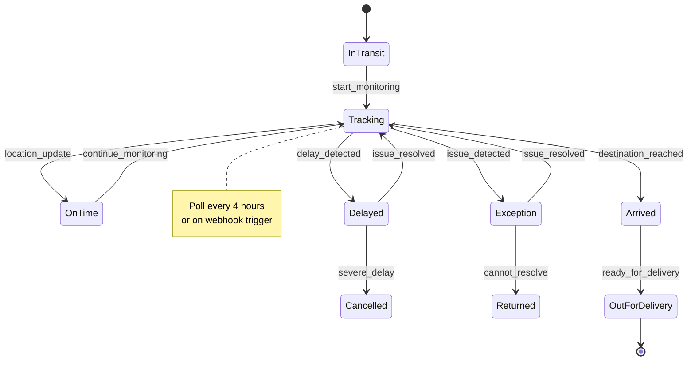

# Freight Transit Workflow

Shipping tracking and freight management during transit.

## Overview

The freight transit workflow monitors shipments while in transit, tracks location updates, handles exceptions, and manages estimated delivery updates. This workflow demonstrates iterative patterns, time-based triggers, and real-time monitoring.

## Business Requirements

1. **Transit Initiation**: Mark shipment as in transit
2. **Location Tracking**: Monitor and record location updates
3. **ETA Calculation**: Update estimated delivery times
4. **Exception Handling**: Handle delays, diversions, and other issues
5. **Status Updates**: Provide customers with tracking information
6. **Transit Completion**: Confirm arrival at destination

## Workflow Diagram



## Configuration

### Transit Monitoring with Iterative Loop

```erlang
FreightTransitConfig = #{
    workflow_type => freight_transit,
    pattern_type => iterative_loop,
    name => <<"freight_monitoring">>,
    description => <<"Monitor shipment during transit">>,
    parameters => #{
        loop_condition => fun(Data) ->
            Status = maps:get(status, Data),
            Status =:= in_transit orelse Status =:= delayed
        end,
        max_iterations => 100,
        iteration_delay => 14400000,  % 4 hours in milliseconds
        steps => [
            #{
                step_id => check_location,
                name => <<"Check Location">>,
                task => get_location_update,
                capabilities => [tracking_api],
                timeout => 30000
            },
            #{
                step_id => update_eta,
                name => <<"Update ETA">>,
                task => calculate_eta,
                capabilities => [routing_engine],
                timeout => 15000
            },
            #{
                step_id => check_exceptions,
                name => <<"Check Exceptions">>,
                task => detect_exceptions,
                capabilities => [exception_detection],
                timeout => 10000
            },
            #{
                step_id => notify_customer,
                name => <<"Notify Customer">>,
                task => send_tracking_update,
                capabilities => [notification],
                timeout => 10000
            }
        ]
    },
    options => #{
        enable_webhook => true,
        webhook_events => [location_update, delay_alert, exception_alert],
        enable_checkpoint => true
    }
}.
```

### Time-Based ETA Update

```erlang
EtaUpdateConfig = #{
    pattern_type => scheduled_execution,
    name => <<"eta_updates">>,
    description => <<"Periodic ETA updates">>,
    parameters => #{
        schedule => <<"0 */4 * * *">>,  % Every 4 hours
        timezone => <<"UTC">>,
        task => update_eta,
        parameters => #{
            conditions => [
                #{event => location_change, threshold => 50},  % miles
                #{event => delay_detected, threshold => 30}     % minutes
            ]
        }
    }
}.
```

## Data Structures

### Transit Record

```erlang
-record(freight_transit, {
    id :: binary(),
    shipment_id :: binary(),
    carrier_id :: binary(),
    status :: transit_status(),
    origin :: location(),
    destination :: location(),
    current_location :: location() | undefined,
    estimated_departure :: integer(),
    estimated_arrival :: integer(),
    actual_departure :: integer() | undefined,
    actual_arrival :: integer() | undefined,
    distance_remaining :: float() | undefined,
    exceptions :: [transit_exception()],
    checkpoints :: [checkpoint()],
    metadata :: map()
}).

-type transit_status() :: pending_departure | in_transit | delayed |
                           at_checkpoint | out_for_delivery | arrived |
                           exception | cancelled.

-type transit_exception() :: #{
    type := delay | diversion | weather | mechanical | customs,
    severity := low | medium | high | critical,
    description := binary(),
    occurred_at := integer(),
    resolved_at := integer() | undefined,
    impact_minutes := integer() | undefined
}.

-type checkpoint() :: #{
    location := binary(),
    reached_at := integer(),
    status := on_time | delayed
}.

-type location() :: #{
    lat := float(),
    lng := float(),
    address := binary() | undefined,
    city := binary() | undefined,
    state := binary() | undefined,
    country := binary(),
    timestamp := integer()
}.
```

### Tracking Event

```erlang
-record(tracking_event, {
    id :: binary(),
    transit_id :: binary(),
    event_type :: tracking_event_type(),
    location := location(),
    timestamp :: integer(),
    source :: binary(),
    metadata :: map()
}).

-type tracking_event_type() :: departed | in_transit | checkpoint_reached |
                                delay_alert | exception | out_for_delivery |
                                delivered | attempted_delivery.
```

## Implementation

### Transit Monitor

```erlang
-module(freight_transit_monitor).

-export([start_monitoring/1, check_status/1, update_location/2]).

-spec start_monitoring(binary()) -> {ok, binary()} | {error, term()}.
start_monitoring(ShipmentId) ->
    case shipment_store:get(ShipmentId) of
        {ok, Shipment} ->
            TransitId = yawl_utils:generate_id(transit),

            Transit = #freight_transit{
                id = TransitId,
                shipment_id = ShipmentId,
                carrier_id = Shipment#shipment.carrier_id,
                status = in_transit,
                origin = Shipment#shipment.origin,
                destination = Shipment#shipment.destination,
                estimated_departure = Shipment#shipment.pickup_time,
                estimated_arrival = Shipment#shipment.estimated_delivery
            },

            ok = transit_store:save(Transit),
            ok = tracking_webhook:register(TransitId),

            {ok, TransitId};
        {error, Reason} ->
            {error, Reason}
    end.

-spec check_status(binary()) -> {ok, transit_status()} | {error, term()}.
check_status(TransitId) ->
    case transit_store:get(TransitId) of
        {ok, #freight_transit{status = Status}} ->
            {ok, Status};
        {error, Reason} ->
            {error, Reason}
    end.

-spec update_location(binary(), location()) -> ok | {error, term()}.
update_location(TransitId, Location) ->
    case transit_store:get(TransitId) of
        {ok, #freight_transit{} = Transit) ->
            %% Update current location
            Updated = Transit#freight_transit{
                current_location = Location,
                checkpoints = Transit#freight_transit.checkpoints ++
                    [#checkpoint{
                        location = maps:get(city, Location, <<"Unknown">>),
                        reached_at = maps:get(timestamp, Location),
                        status = on_time
                    }]
            },

            %% Calculate remaining distance and ETA
            {Distance, NewEta} = calculate_remaining(Updated),

            UpdatedWithEta = Updated#freight_transit{
                distance_remaining = Distance,
                estimated_arrival = NewEta
            },

            ok = transit_store:save(UpdatedWithEta),

            %% Check for exceptions
            ok = detect_and_handle_exceptions(UpdatedWithEta),

            %% Notify customer
            ok = send_tracking_update(UpdatedWithEta),

            ok;
        {error, Reason} ->
            {error, Reason}
    end.

%% Calculate remaining distance and ETA
calculate_remaining(Transit) ->
    Origin = Transit#freight_transit.current_location,
    Destination = Transit#freight_transit.destination,

    Distance = routing_engine:calculate_distance(
        {maps:get(lat, Origin), maps:get(lng, Origin)},
        {maps:get(lat, Destination), maps:get(lng, Destination)}
    ),

    %% Estimate based on average speed of 50 mph
    AvgSpeed = 50,
    HoursRemaining = Distance / AvgSpeed,
    SecondsRemaining = trunc(HoursRemaining * 3600),

    NewEta = erlang:system_time(second) + SecondsRemaining,

    {Distance, NewEta}.

%% Detect and handle transit exceptions
detect_and_handle_exceptions(Transit) ->
    CurrentEta = Transit#freight_transit.estimated_arrival,
    OriginalEta = Transit#freight_transit.estimated_arrival,
    DelaySeconds = CurrentEta - OriginalEta,

    case DelaySeconds > 3600 of  % More than 1 hour delay
        true ->
            Exception = #{
                type => delay,
                severity => case DelaySeconds of
                    D when D > 14400 -> high;      % > 4 hours
                    D when D > 7200 -> medium;     % > 2 hours
                    _ -> low
                end,
                description => <<"Shipment delayed by ",
                                 (integer_to_binary(DelaySeconds div 60))/binary,
                                 " minutes">>,
                occurred_at => erlang:system_time(millisecond),
                impact_minutes => DelaySeconds div 60
            },

            %% Update transit status
            Updated = Transit#freight_transit{
                status = delayed,
                exceptions = Transit#freight_transit.exceptions ++ [Exception]
            },
            ok = transit_store:save(Updated),

            %% Notify stakeholders
            ok = send_exception_notification(Updated, Exception);
        false ->
            ok
    end.
```

### ETA Calculator

```erlang
-module(eta_calculator).

-export([calculate_eta/2, predict_delay/2, update_eta/2]).

-spec calculate_eta(freight_transit(), location()) -> {ok, integer(), integer()}.
calculate_eta(Transit, CurrentLocation) ->
    Destination = Transit#freight_transit.destination,

    %% Get distance
    Distance = routing_engine:calculate_distance(
        {maps:get(lat, CurrentLocation), maps:get(lng, CurrentLocation)},
        {maps:get(lat, Destination), maps:get(lng, Destination)}
    ),

    %% Get carrier average speed
    {ok, Carrier} = carrier_store:get(Transit#freight_transit.carrier_id),
    AvgSpeed = Carrier#carrier.avg_speed_mph,

    %% Calculate base time
    HoursNeeded = Distance / AvgSpeed,
    BaseSeconds = trunc(HoursNeeded * 3600),

    %% Add traffic factor
    TrafficFactor = get_traffic_factor(CurrentLocation, Destination),
    AdjustedSeconds = trunc(BaseSeconds * TrafficFactor),

    %% Calculate ETA
    Eta = erlang:system_time(second) + AdjustedSeconds,

    {ok, Eta, AdjustedSeconds}.

-spec predict_delay(freight_transit(), map()) -> {ok, float()} | {error, term()}.
predict_delay(Transit, Conditions) ->
    %% Use historical data and current conditions
    CarrierId = Transit#freight_transit.carrier_id,
    Route = {Transit#freight_transit.origin, Transit#freight_transit.destination},

    BaseDelay = historical_data:get_average_delay(CarrierId, Route),

    %% Adjust for current conditions
    WeatherFactor = maps:get(weather, Conditions, 1.0),
    TrafficFactor = maps:get(traffic, Conditions, 1.0),
    SeasonalFactor = get_seasonal_factor(),

    PredictedDelay = BaseDelay * WeatherFactor * TrafficFactor * SeasonalFactor,

    {ok, PredictedDelay}.

-spec update_eta(binary(), integer()) -> ok | {error, term()}.
update_eta(TransitId, NewEta) ->
    case transit_store:get(TransitId) of
        {ok, #freight_transit{} = Transit} ->
            Updated = Transit#freight_transit{estimated_arrival = NewEta},
            ok = transit_store:save(Updated),
            ok = notify_eta_change(Transit, NewEta),
            ok;
        {error, Reason} ->
            {error, Reason}
    end.

get_traffic_factor(Origin, Destination) ->
    %% Simple heuristic - in production, use real traffic API
    Now = erlang:system_time(second),
    Hour = calendar:seconds_to_daystime(Now) rem 86400 div 3600,

    %% Rush hours: 7-9 AM and 4-7 PM
    case Hour of
        H when H >= 7 andalso H =< 9 -> 1.5;
        H when H >= 16 andalso H =< 19 -> 1.5;
        _ -> 1.0
    end.

get_seasonal_factor() ->
    %% Simple heuristic for seasonal delays
    Month = element(2, erlang:localtime()),
    case Month of
        12 -> 1.3;  % Holiday season
        11 -> 1.2;  % Pre-holiday
        1 -> 1.15;
        _ -> 1.0
    end.
```

### Exception Handler

```erlang
-module(transit_exception_handler).

-export([handle_exception/2, resolve_exception/2, escalate_exception/1]).

-spec handle_exception(binary(), transit_exception()) -> ok | {error, term()}.
handle_exception(TransitId, Exception) ->
    case transit_store:get(TransitId) of
        {ok, #freight_transit{exceptions = Existing} = Transit} ->
            Severity = maps:get(severity, Exception),

            %% Add exception to record
            Updated = Transit#freight_transit{
                exceptions = Existing ++ [Exception],
                status = case Severity of
                    critical -> exception;
                    high -> delayed;
                    _ -> Transit#freight_transit.status
                end
            },
            ok = transit_store:save(Updated),

            %% Handle based on severity
            case Severity of
                critical ->
                    escalate_exception(TransitId);
                high ->
                    notify_operations(TransitId, Exception);
                medium ->
                    notify_carrier(TransitId, Exception);
                low ->
                    log_exception(TransitId, Exception)
            end,

            ok;
        {error, Reason} ->
            {error, Reason}
    end.

-spec resolve_exception(binary(), binary()) -> ok | {error, term()}.
resolve_exception(TransitId, ExceptionId) ->
    case transit_store:get(TransitId) of
        {ok, #freight_transit{exceptions = Exceptions} = Transit} ->
            %% Find and update the exception
            UpdatedExceptions = lists:map(fun(E) ->
                case maps:get(<<"id">>, E, undefined) of
                    ExceptionId ->
                        E#{resolved_at => erlang:system_time(millisecond)};
                    _ ->
                        E
                end
            end, Exceptions),

            %% Update transit status if all exceptions resolved
            AllResolved = lists:all(fun(E) ->
                maps:get(resolved_at, E, undefined) =/= undefined
            end, UpdatedExceptions),

            Updated = Transit#freight_transit{
                exceptions = UpdatedExceptions,
                status = case AllResolved of
                    true -> in_transit;
                    false -> Transit#freight_transit.status
                end
            },
            ok = transit_store:save(Updated),
            ok;
        {error, Reason} ->
            {error, Reason}
    end.

-spec escalate_exception(binary()) -> ok | {error, term()}.
escalate_exception(TransitId) ->
    case transit_store:get(TransitId) of
        {ok, #freight_transit{shipment_id = ShipmentId} = Transit} ->
            %% Get critical contacts
            {ok, Contacts} = escalation_list:get_contacts(ShipmentId),

            %% Send notifications
            lists:foreach(fun(Contact) ->
                notification:send(Contact, #{
                    type => critical_exception,
                    transit_id => TransitId,
                    shipment_id => ShipmentId,
                    exceptions => Transit#freight_transit.exceptions,
                    action_required => immediate
                })
            end, Contacts),

            %% Create support ticket
            ok = support:create_ticket(#{
                type => freight_exception,
                transit_id => TransitId,
                priority => critical,
                assigned_to => logistics_manager
            }),

            ok;
        {error, Reason} ->
            {error, Reason}
    end.
```

## REST API Usage

### Start Transit Monitoring

```bash
curl -X POST http://localhost:8081/api/workflows \
  -H "Content-Type: application/json" \
  -d '{
    "pattern": "iterative_loop",
    "name": "freight_monitoring",
    "input_data": {
      "shipment_id": "shipment_123",
      "carrier_id": "carrier_1",
      "tracking_number": "TRACK-123456"
    }
  }'
```

### Location Update Webhook

```bash
curl -X POST http://localhost:8081/api/webhooks/location-update \
  -H "Content-Type: application/json" \
  -d '{
    "transit_id": "transit_abc123",
    "location": {
      "lat": 41.8781,
      "lng": -87.6298,
      "city": "Chicago",
      "state": "IL",
      "timestamp": 1704110400000
    }
  }'
```

### Get Transit Status

```bash
curl http://localhost:8081/api/transit/{transit_id}/status
```

## Testing

```erlang
freight_transit_test_() ->
    {setup,
     fun setup/0,
     fun cleanup/1,
     [
      fun start_monitoring/0,
      fun update_location/0,
      fun calculate_eta/0,
      fun handle_exception/0
     ]}.

start_monitoring() ->
    {ok, TransitId} = freight_transit_monitor:start_monitoring(<<"shipment_1">>),
    ?assertMatch(<<"transit_", _/binary>>, TransitId).

update_location() ->
    Location = #{
        lat => 41.8781,
        lng => -87.6298,
        city => <<"Chicago">>,
        state => <<"IL">>,
        timestamp => erlang:system_time(millisecond)
    },
    ok = freight_transit_monitor:update_location(<<"transit_1">>, Location).

handle_exception() ->
    Exception = #{
        type => delay,
        severity => high,
        description => <<"Weather delay">>,
        occurred_at => erlang:system_time(millisecond),
        impact_minutes => 120
    },
    ok = transit_exception_handler:handle_exception(<<"transit_1">>, Exception).
```

---

Next: [Freight Delivered](freight-delivered.md) | [Back to Overview](overview.md)
