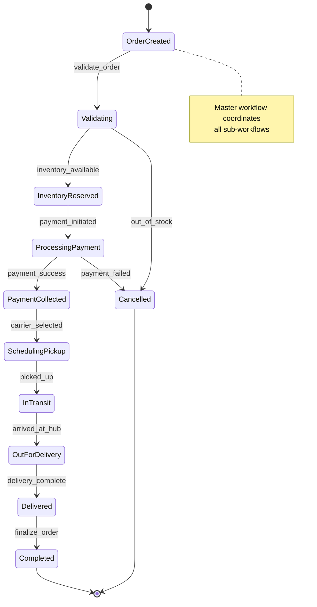

# Order Fulfillment Workflow

End-to-end order orchestration from creation to delivery.

## Overview

The order fulfillment workflow orchestrates the complete order lifecycle combining all the individual workflows: ordering, payment, carrier appointment, freight transit, and delivery. This is a master workflow demonstrating the N-out-of-N join pattern, multi-instance patterns, and complex workflow composition.

## Business Requirements

1. **Order Creation**: Create and validate customer order
2. **Inventory Check**: Verify and reserve inventory
3. **Payment Processing**: Process customer payment
4. **Carrier Selection**: Select and schedule carrier
5. **Shipment Tracking**: Monitor shipment in transit
6. **Delivery Completion**: Confirm delivery and finalize order
7. **Customer Communication**: Keep customer informed throughout

## Workflow Diagram



## Configuration

### Master Fulfillment Workflow

```erlang
OrderFulfillmentConfig = #{
    workflow_type => order_fulfillment,
    pattern_type => sequential,
    name => <<"order_fulfillment">>,
    description => <<"End-to-end order fulfillment">>,
    parameters => #{
        steps => [
            #{
                step_id => validate_order,
                name => <<"Validate Order">>,
                workflow => ordering_validation,
                parameters => #{
                    validate_customer => true,
                    validate_inventory => true,
                    validate_pricing => true
                },
                timeout => 30000
            },
            #{
                step_id => reserve_inventory,
                name => <<"Reserve Inventory">>,
                workflow => inventory_reservation,
                parameters => #{
                    reservation_duration => 86400000  % 24 hours
                },
                timeout => 15000
            },
            #{
                step_id => process_payment,
                name => <<"Process Payment">>,
                workflow => payment_processing,
                parameters => #{
                    retry => 3,
                    timeout => 30000
                },
                timeout => 90000,
                on_failure => cancel_order
            },
            #{
                step_id => select_carrier,
                name => <<"Select Carrier">>,
                workflow => carrier_appointment,
                parameters => #{
                    strategy => lowest_cost,
                    constraints => #{
                        max_transit_time => 72,
                        min_rating => 4.0
                    }
                },
                timeout => 60000
            },
            #{
                step_id => monitor_transit,
                name => <<"Monitor Transit">>,
                workflow => freight_transit,
                parameters => #{
                    monitoring_interval => 14400000,  % 4 hours
                    enable_exceptions => true
                },
                timeout => 604800000  % 7 days
            },
            #{
                step_id => confirm_delivery,
                name => <<"Confirm Delivery">>,
                workflow => freight_delivered,
                parameters => #{
                    require_pod => true
                },
                timeout => 86400000  % 24 hours
            },
            #{
                step_id => finalize_order,
                name => <<"Finalize Order">>,
                task => finalize_fulfillment,
                parameters => #{
                    update_inventory => true,
                    trigger_settlement => true,
                    send_confirmation => true
                },
                timeout => 30000
            }
        ]
    },
    options => #{
        enable_checkpoint => true,
        enable_recovery => true,
        enable_xes => true
    }
}.
```

### Parallel Fulfillment with N-out-of-N Join

```erlang
ParallelFulfillmentConfig = #{
    workflow_type => parallel_fulfillment,
    pattern_type => n_parallel_join,
    name => <<"parallel_fulfillment">>,
    description => <<"Execute fulfillment steps in parallel where possible">>,
    parameters => #{
        parallel_branches => [
            #{
                branch_id => payment_branch,
                workflow => payment_processing,
                dependencies => []
            },
            #{
                branch_id => carrier_branch,
                workflow => carrier_appointment,
                dependencies => []
            },
            #{
                branch_id => inventory_branch,
                workflow => inventory_reservation,
                dependencies => []
            }
        ],
        join_condition => #{
            type => n_out_of_n,
            required => 3,  % All 3 must complete
            timeout => 120000  % 2 minutes
        }
    }
}.
```

## Data Structures

### Fulfillment Order

```erlang
-record(fulfillment_order, {
    id :: binary(),
    order_id :: binary(),
    customer_id :: binary(),
    items :: [fulfillment_item()],
    status :: fulfillment_status(),
    workflows :: map(),  % Sub-workflow IDs
    milestones :: [fulfillment_milestone()],
    timeline :: fulfillment_timeline(),
    estimated_completion :: integer() | undefined,
    actual_completion :: integer() | undefined,
    total_cost :: float(),
    metadata :: map()
}).

-type fulfillment_item() :: #{
    product_id := binary(),
    quantity := integer(),
    reserved := boolean(),
    shipped := boolean()
}.

-type fulfillment_status() :: created | validating | reserving |
                               payment_pending | carrier_selecting |
                               in_transit | out_for_delivery |
                               delivered | completing | completed |
                               cancelled | failed.

-type fulfillment_milestone() :: #{
    name := binary(),
    status := pending | in_progress | completed | failed,
    timestamp := integer() | undefined,
    workflow_id := binary() | undefined
}.

-type fulfillment_timeline() :: #{
    created := integer(),
    validated := integer() | undefined,
    payment_collected := integer() | undefined,
    carrier_assigned := integer() | undefined,
    shipped := integer() | undefined,
    delivered := integer() | undefined
}.
```

## Implementation

### Fulfillment Orchestrator

```erlang
-module(order_fulfillment_orchestrator).

-export([start_fulfillment/1, advance_milestone/2, handle_fulfillment_event/2]).

-spec start_fulfillment(binary()) -> {ok, binary()} | {error, term()}.
start_fulfillment(OrderId) ->
    case order_store:get(OrderId) of
        {ok, Order} ->
            FulfillmentId = yawl_utils:generate_id(fulfillment),

            %% Create fulfillment record
            Fulfillment = #fulfillment_order{
                id = FulfillmentId,
                order_id = OrderId,
                customer_id = Order#order.customer_id,
                items = [#{product_id => P, quantity => Q, reserved => false, shipped => false}
                         || {P, Q} <- Order#order.items],
                status = created,
                workflows => #{},
                milestones => initialize_milestones(),
                timeline => #{created => erlang:system_time(millisecond)},
                total_cost => Order#order.total
            },

            ok = fulfillment_store:save(Fulfillment),

            %% Start validation workflow
            {ok, ValidationWorkflow} = yawl_orchestrator:create_workflow(#{
                pattern_type => sequential,
                name => <<"order_validation">>,
                input_data => #{order_id => OrderId}
            }),

            %% Update with workflow reference
            Updated = Fulfillment#fulfillment_order{
                workflows => maps:put(validation, ValidationWorkflow, Fulfillment#fulfillment_order.workflows)
            },
            ok = fulfillment_store:save(Updated),

            %% Subscribe to workflow events
            ok = yawl_event_bus:subscribe(ValidationWorkflow),

            {ok, FulfillmentId};
        {error, Reason} ->
            {error, Reason}
    end.

-spec advance_milestone(binary(), binary()) -> ok | {error, term()}.
advance_milestone(FulfillmentId, MilestoneName) ->
    case fulfillment_store:get(FulfillmentId) of
        {ok, #fulfillment_order{milestones = Milestones} = Fulfillment} ->
            %% Find and update milestone
            case lists:keyfind(MilestoneName, 1, Milestones) of
                {MilestoneName, _, _} ->
                    UpdatedMilestones = lists:map(fun
                        ({MilestoneName, _, _}) ->
                            {MilestoneName, completed, erlang:system_time(millisecond)};
                        (M) -> M
                    end, Milestones),

                    %% Determine next action based on milestone
                    NextAction = case MilestoneName of
                        validated -> start_inventory_reservation;
                        inventory_reserved -> start_payment;
                        payment_collected -> start_carrier_selection;
                        carrier_assigned -> start_transit_monitoring;
                        transit_completed -> start_delivery;
                        delivery_confirmed -> finalize;
                        _ -> noop
                    end,

                    %% Update fulfillment
                    Updated = Fulfillment#fulfillment_order{
                        milestones = UpdatedMilestones
                    },
                    ok = fulfillment_store:save(Updated),

                    %% Trigger next action
                    ok = execute_next_action(FulfillmentId, NextAction),

                    ok;
                false ->
                    {error, unknown_milestone}
            end;
        {error, Reason} ->
            {error, Reason}
    end.

-spec handle_fulfillment_event(binary(), map()) -> ok.
handle_fulfillment_event(FulfillmentId, Event) ->
    EventType = maps:get(event_type, Event),
    case EventType of
        workflow_completed ->
            WorkflowName = maps:get(workflow_name, Event),
            Milestone = workflow_to_milestone(WorkflowName),
            advance_milestone(FulfillmentId, Milestone);
        workflow_failed ->
            handle_workflow_failure(FulfillmentId, Event);
        task_completed ->
            handle_task_completion(FulfillmentId, Event);
        _ ->
            ok
    end.

%% Execute next action in fulfillment
execute_next_action(FulfillmentId, noop) ->
    ok;
execute_next_action(FulfillmentId, finalize) ->
    finalize_fulfillment(FulfillmentId);
execute_next_action(FulfillmentId, Action) ->
    %% Map action to workflow configuration
    Config = get_workflow_config(Action),
    {ok, WorkflowId} = yawl_orchestrator:create_workflow(Config),

    %% Update fulfillment with workflow reference
    {ok, Fulfillment} = fulfillment_store:get(FulfillmentId),
    Updated = Fulfillment#fulfillment_order{
        workflows = maps:put(Action, WorkflowId, Fulfillment#fulfillment_order.workflows)
    },
    ok = fulfillment_store:save(Updated),

    %% Execute workflow
    ok = yawl_orchestrator:execute_workflow(WorkflowId),

    ok.

%% Finalize fulfillment
finalize_fulfillment(FulfillmentId) ->
    case fulfillment_store:get(FulfillmentId) of
        {ok, #fulfillment_order{} = Fulfillment} ->
            %% Update inventory
            lists:foreach(fun(Item) ->
                ok = inventory:confirm_deduction(maps:get(product_id, Item))
            end, Fulfillment#fulfillment_order.items),

            %% Trigger payment settlement
            PaymentWorkflow = maps:get(payment, Fulfillment#fulfillment_order.workflows),
            ok = payment_settlement:schedule_from_workflow(PaymentWorkflow),

            %% Send completion notification
            ok = customer_notification:send(Fulfillment#fulfillment_order.customer_id, #{
                type => order_completed,
                fulfillment_id => FulfillmentId,
                order_id => Fulfillment#fulfillment_order.order_id
            }),

            %% Update status
            Updated = Fulfillment#fulfillment_order{
                status = completed,
                actual_completion = erlang:system_time(millisecond),
                timeline = maps:put(completed, erlang:system_time(millisecond),
                                   Fulfillment#fulfillment_order.timeline)
            },
            ok = fulfillment_store:save(Updated),

            ok;
        {error, Reason} ->
            {error, Reason}
    end.

%% Initialize milestones
initialize_milestones() ->
    [
        {validated, pending, undefined},
        {inventory_reserved, pending, undefined},
        {payment_collected, pending, undefined},
        {carrier_assigned, pending, undefined},
        {transit_completed, pending, undefined},
        {delivery_confirmed, pending, undefined}
    ].

%% Map workflow to milestone
workflow_to_milestone(WorkflowName) ->
    case WorkflowName of
        order_validation -> validated;
        inventory_reservation -> inventory_reserved;
        payment_processing -> payment_collected;
        carrier_appointment -> carrier_assigned;
        freight_transit -> transit_completed;
        freight_delivered -> delivery_confirmed;
        _ -> unknown
    end.
```

### Fulfillment Recovery

```erlang
-module(fulfillment_recovery).

-export([recover_from_failure/2, retry_failed_workflow/2, cancel_fulfillment/1]).

-spec recover_from_failure(binary(), term()) -> ok | {error, term()}.
recover_from_failure(FulfillmentId, FailureReason) ->
    case fulfillment_store:get(FulfillmentId) of
        {ok, #fulfillment_order{status = failed} = Fulfillment} ->
            %% Determine recovery strategy
            Strategy = determine_recovery_strategy(FailureReason),

            case Strategy of
                retry ->
                    retry_failed_workflow(FulfillmentId, FailureReason);
                partial_retry ->
                    retry_from_last_milestone(FulfillmentId);
                cancel ->
                    cancel_fulfillment(FulfillmentId);
                manual_review ->
                    escalate_for_review(FulfillmentId, FailureReason)
            end,
            ok;
        {ok, #fulfillment_order{status = Status}} ->
            {error, {invalid_status, Status}};
        {error, Reason} ->
            {error, Reason}
    end.

-spec retry_failed_workflow(binary(), term()) -> ok | {error, term()}.
retry_failed_workflow(FulfillmentId, FailureReason) ->
    case fulfillment_store:get(FulfillmentId) of
        {ok, #fulfillment_order{workflows = Workflows} = Fulfillment} ->
            %% Find failed workflow
            FailedWorkflow = find_failed_workflow(Workflows),

            case FailedWorkflow of
                {WorkflowName, WorkflowId} ->
                    %% Get original config
                    Config = get_workflow_config(WorkflowName),

                    %% Create new workflow instance
                    {ok, NewWorkflowId} = yawl_orchestrator:create_workflow(Config),

                    %% Update workflows map
                    UpdatedWorkflows = maps:put(WorkflowName, NewWorkflowId, Workflows),

                    %% Update fulfillment
                    Updated = Fulfillment#fulfillment_order{
                        workflows = UpdatedWorkflows,
                        status = created
                    },
                    ok = fulfillment_store:save(Updated),

                    %% Execute new workflow
                    ok = yawl_orchestrator:execute_workflow(NewWorkflowId),

                    ok;
                none ->
                    {error, no_failed_workflow_found}
            end;
        {error, Reason} ->
            {error, Reason}
    end.

-spec cancel_fulfillment(binary()) -> ok | {error, term()}.
cancel_fulfillment(FulfillmentId) ->
    case fulfillment_store:get(FulfillmentId) of
        {ok, #fulfillment_order{workflows = Workflows} = Fulfillment} ->
            %% Cancel all active workflows
            lists:foreach(fun({_, WorkflowId}) ->
                yawl_orchestrator:cancel_workflow(WorkflowId)
            end, maps:to_list(Workflows)),

            %% Release inventory reservations
            lists:foreach(fun(Item) ->
                case maps:get(reserved, Item, false) of
                    true ->
                        ok = inventory:release_reservation(maps:get(product_id, Item));
                    false ->
                        ok
                end
            end, Fulfillment#fulfillment_order.items),

            %% Process refund if payment collected
            case maps:is_key(payment_collected, Fulfillment#fulfillment_order.timeline) of
                true ->
                    PaymentWorkflow = maps:get(payment, Workflows),
                    ok = payment_gateway:refund_from_workflow(PaymentWorkflow);
                false ->
                    ok
            end,

            %% Update status
            Updated = Fulfillment#fulfillment_order{
                status = cancelled,
                actual_completion = erlang:system_time(millisecond)
            },
            ok = fulfillment_store:save(Updated),

            %% Notify customer
            ok = customer_notification:send(Fulfillment#fulfillment_order.customer_id, #{
                type => order_cancelled,
                fulfillment_id => FulfillmentId
            }),

            ok;
        {error, Reason} ->
            {error, Reason}
    end.

determine_recovery_strategy(FailureReason) ->
    case FailureReason of
        {payment_error, temporary} -> retry;
        {payment_error, permanent} -> manual_review;
        {carrier_error, no_carrier_available} -> partial_retry;
        {inventory_error, out_of_stock} -> cancel;
        {delivery_error, failed} -> partial_retry;
        _ -> manual_review
    end.

find_failed_workflow(Workflows) ->
    lists:keyfind(error, 2,
        [{Name, check_workflow_status(Id)} || {Name, Id} <- maps:to_list(Workflows)]).

check_workflow_status(WorkflowId) ->
    case yawl_orchestrator:workflow_status(WorkflowId) of
        {ok, #workflow_status{status = failed}} -> WorkflowId;
        _ -> ok
    end.
```

## REST API Usage

### Start Order Fulfillment

```bash
curl -X POST http://localhost:8081/api/fulfillment \
  -H "Content-Type: application/json" \
  -d '{
    "order_id": "order_123"
  }'
```

### Get Fulfillment Status

```bash
curl http://localhost:8081/api/fulfillment/{fulfillment_id}/status
```

### Response

```json
{
  "fulfillment_id": "ful_abc123",
  "order_id": "order_123",
  "status": "in_transit",
  "milestones": [
    {"name": "validated", "status": "completed", "timestamp": 1704110400000},
    {"name": "inventory_reserved", "status": "completed", "timestamp": 1704110460000},
    {"name": "payment_collected", "status": "completed", "timestamp": 1704110520000},
    {"name": "carrier_assigned", "status": "completed", "timestamp": 1704110580000},
    {"name": "transit_completed", "status": "in_progress", "timestamp": null},
    {"name": "delivery_confirmed", "status": "pending", "timestamp": null}
  ],
  "estimated_completion": 1704196800000,
  "active_workflows": {
    "transit_monitoring": "workflow_xyz789"
  }
}
```

## Testing

```erlang
order_fulfillment_test_() ->
    {setup,
     fun setup/0,
     fun cleanup/1,
     [
      fun start_fulfillment/0,
      fun advance_milestones/0,
      fun handle_payment_failure/0,
      fun complete_fulfillment/0
     ]}.

start_fulfillment() ->
    {ok, FulfillmentId} = order_fulfillment_orchestrator:start_fulfillment(<<"order_1">>),
    ?assertMatch(<<"ful_", _/binary>>, FulfillmentId).

advance_milestones() ->
    FulfillmentId = <<"ful_1">>,
    ok = order_fulfillment_orchestrator:advance_milestone(FulfillmentId, validated),
    {ok, #fulfillment_order{milestones = Milestones}} = fulfillment_store:get(FulfillmentId),
    ?assertEqual(completed, element(2, lists:keyfind(validated, 1, Milestones))).

complete_fulfillment() ->
    FulfillmentId = <<"ful_1">>,
    lists:foreach(fun(M) ->
        ok = order_fulfillment_orchestrator:advance_milestone(FulfillmentId, M)
    end, [validated, inventory_reserved, payment_collected, carrier_assigned,
          transit_completed, delivery_confirmed]),
    {ok, #fulfillment_order{status = completed}} = fulfillment_store:get(FulfillmentId).
```

---

[Back to Overview](overview.md) | [Back to Index](../index.md)
