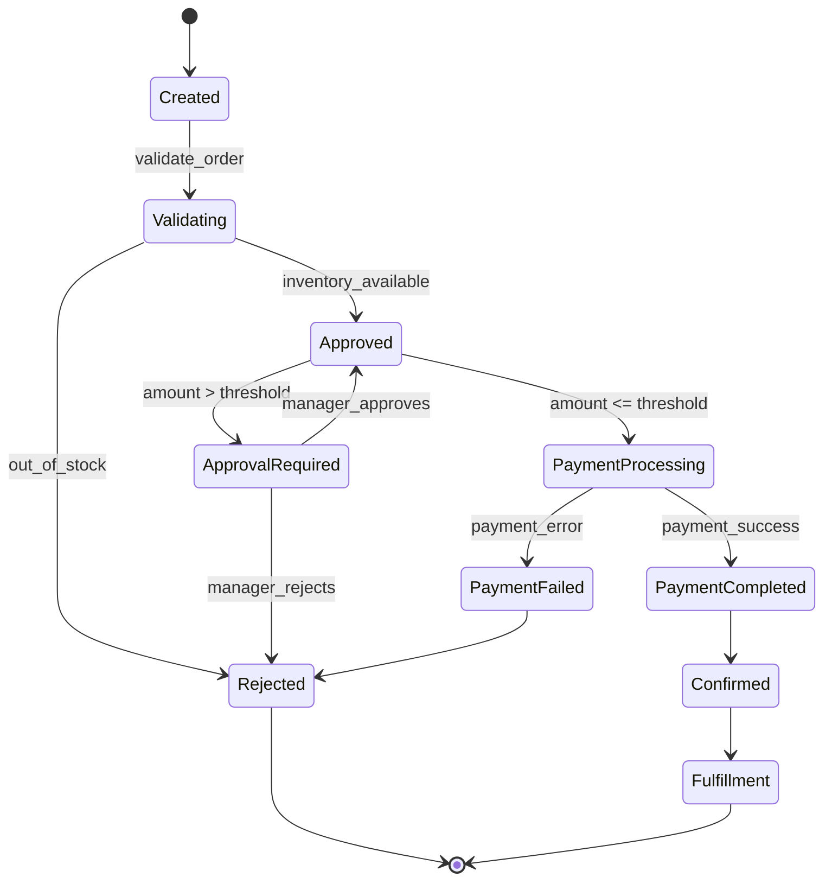

# Purchase Ordering Workflow

Complete purchase order creation, approval, and processing workflow.

## Overview

The ordering workflow manages the complete lifecycle of purchase orders from initial creation through approval and processing. This is a business-critical workflow that demonstrates sequential processing, approval routing, and human-in-the-loop patterns.

## Business Requirements

1. **Order Creation**: Customers create orders with items and quantities
2. **Validation**: Orders are validated for inventory availability and pricing
3. **Approval Routing**: High-value orders require approval
4. **Payment Processing**: Payment is collected before fulfillment
5. **Order Confirmation**: Customer receives confirmation

## Workflow Diagram



## Configuration

### Basic Sequential Ordering

```erlang
OrderingConfig = #{
    workflow_type => purchase_order,
    pattern_type => sequential,
    name => <<"order_processing">>,
    description => <<"Standard order processing workflow">>,
    parameters => #{
        steps => [
            #{
                step_id => validate_order,
                name => <<"Validate Order">>,
                task => validate_order,
                capabilities => [validation],
                timeout => 30000,
                retry => 3
            },
            #{
                step_id => check_approval,
                name => <<"Check Approval">>,
                task => check_approval_required,
                capabilities => [business_rules],
                timeout => 10000,
                retry => 1
            },
            #{
                step_id => process_payment,
                name => <<"Process Payment">>,
                task => process_payment,
                capabilities => [payment_gateway],
                timeout => 60000,
                retry => 2
            },
            #{
                step_id => confirm_order,
                name => <<"Confirm Order">>,
                task => confirm_order,
                capabilities => [notification],
                timeout => 10000,
                retry => 3
            }
        ]
    },
    options => #{
        enable_checkpoint => true,
        checkpoint_interval => 5000,
        enable_xes => true
    }
}.
```

### Approval-Based Routing

```erlang
ApprovalConfig = #{
    pattern_type => exclusive_choice,
    name => <<"approval_routing">>,
    description => <<"Route orders based on approval requirements">>,
    parameters => #{
        conditions => [
            #{
                name => auto_approve,
                condition => fun(Data) -> maps:get(amount, Data, 0) =< 100 end,
                target => immediate_payment
            },
            #{
                name => manager_approval,
                condition => fun(Data) ->
                    Amount = maps:get(amount, Data, 0),
                    Amount > 100 andalso Amount =< 1000
                end,
                target => manager_review
            },
            #{
                name => director_approval,
                condition => fun(Data) -> maps:get(amount, Data, 0) > 1000 end,
                target => director_review
            }
        ]
    }
}.
```

## Data Structures

### Order Record

```erlang
-record(purchase_order, {
    order_id :: binary(),
    customer_id :: binary(),
    items :: [order_item()],
    subtotal :: float(),
    tax :: float(),
    total :: float(),
    status :: order_status(),
    approval_status :: approval_status(),
    created_at :: integer(),
    updated_at :: integer(),
    metadata :: map()
}).

-type order_item() :: #{
    product_id := binary(),
    quantity := integer(),
    unit_price := float(),
    total := float()
}.

-type order_status() :: created | validating | approved | rejected |
                       payment_pending | payment_completed | payment_failed |
                       confirmed | cancelled.

-type approval_status() :: not_required | pending | approved | rejected.
```

### Order Validation Result

```erlang
-record(validation_result, {
    valid :: boolean(),
    errors :: [binary()],
    warnings :: [binary()],
    inventory_check :: [inventory_item_status()]
}).

-type inventory_item_status() :: #{
    product_id := binary(),
    available := boolean(),
    quantity := integer(),
    backordered := boolean()
}.
```

## Implementation

### Order Validation

```erlang
-module(order_validation).

-export([validate_order/1, check_inventory/1]).

-spec validate_order(purchase_order()) -> {ok, validation_result()} | {error, term()}.
validate_order(Order) ->
    Checks = [
        fun check_customer_status/1,
        fun check_items_valid/1,
        fun check_inventory/1,
        fun check_pricing/1
    ],

    Results = lists:map(fun(F) -> F(Order) end, Checks),
    case lists:all(fun({ok, _}) -> true; (_) -> false end, Results) of
        true ->
            {ok, #validation_result{
                valid = true,
                errors = [],
                warnings = collect_warnings(Results),
                inventory_check = extract_inventory_status(Results)
            }};
        false ->
            Errors = collect_errors(Results),
            {ok, #validation_result{
                valid = false,
                errors = Errors,
                warnings = collect_warnings(Results)
            }}
    end.

-spec check_inventory(purchase_order()) -> {ok, [inventory_item_status()]}.
check_inventory(Order) ->
    Items = Order#purchase_order.items,
    Statuses = lists:map(fun(Item) ->
        ProductId = maps:get(product_id, Item),
        Quantity = maps:get(quantity, Item),
        case inventory_system:check_availability(ProductId, Quantity) of
            {ok, Available} when Available >= Quantity ->
                #{product_id => ProductId,
                  available => true,
                  quantity => Available,
                  backordered => false};
            {ok, Available} ->
                #{product_id => ProductId,
                  available => false,
                  quantity => Available,
                  backordered => true};
            {error, _} ->
                #{product_id => ProductId,
                  available => false,
                  quantity => 0,
                  backordered => false}
        end
    end, Items),
    {ok, Statuses}.
```

### Approval Handler

```erlang
-module(order_approval).

-export([check_approval_required/1, submit_for_approval/2, process_approval/3]).

-spec check_approval_required(purchase_order()) ->
    {ok, approval_required()} | {error, term()}.
-type approval_required() :: #{
    required := boolean(),
    approver_type := manager | director | executive,
    threshold := float()
}.

check_approval_required(Order) ->
    Amount = Order#purchase_order.total,
    Thresholds = application:get_env(business, approval_thresholds, [
        {manager, 100},
        {director, 1000},
        {executive, 10000}
    ]),

    Required = case Amount of
        A when A =< 100 -> false;
        A when A > 100 andalso A =< 1000 -> {true, manager, 100};
        A when A > 1000 andalso A =< 10000 -> {true, director, 1000};
        A when A > 10000 -> {true, executive, 10000}
    end,

    case Required of
        false ->
            {ok, #{required => false}};
        {true, ApproverType, Threshold} ->
            {ok, #{
                required => true,
                approver_type => ApproverType,
                threshold => Threshold
            }}
    end.

-spec submit_for_approval(binary(), binary()) -> {ok, binary()} | {error, term()}.
submit_for_approval(OrderId, ApproverType) ->
    ApprovalId = yawl_utils:generate_id(approval),
    Approval = #approval_request{
        id = ApprovalId,
        order_id = OrderId,
        approver_type = ApproverType,
        status = pending,
        created_at = erlang:system_time(millisecond)
    },
    ok = approval_store:save(Approval),
    notify_approvers(ApprovalId, ApproverType),
    {ok, ApprovalId}.

-spec process_approval(binary(), binary(), approve | reject) -> ok | {error, term()}.
process_approval(ApprovalId, ApproverId, Decision) ->
    case approval_store:get(ApprovalId) of
        {ok, #approval_request{status = pending} = Approval} ->
            Updated = Approval#approval_request{
                status = Decision,
                approver_id = ApproverId,
                decided_at = erlang:system_time(millisecond)
            },
            ok = approval_store:save(Updated),
            notify_approval_result(ApprovalId, Decision);
        {ok, #approval_request{status = Status}} ->
            {error, {already_decided, Status}};
        {error, not_found} ->
            {error, approval_not_found}
    end.
```

### Payment Integration

```erlang
-module(order_payment).

-export([process_payment/1, refund_payment/1]).

-spec process_payment(purchase_order()) -> {ok, payment_result()} | {error, term()}.
process_payment(Order) ->
    Amount = Order#purchase_order.total,
    OrderId = Order#purchase_order.order_id,
    CustomerId = Order#purchase_order.customer_id,

    PaymentData = #{
        amount => Amount,
        order_id => OrderId,
        customer_id => CustomerId,
        currency => <<"USD">>
    },

    case payment_gateway:charge(CustomerId, PaymentData) of
        {ok, Transaction} ->
            Payment = #payment{
                id = maps:get(<<"id">>, Transaction),
                order_id = OrderId,
                amount = Amount,
                status => completed,
                transaction_id = maps:get(<<"transaction_id">>, Transaction),
                created_at = erlang:system_time(millisecond)
            },
            ok = payment_store:save(Payment),
            {ok, #payment_result{
                success = true,
                payment_id = Payment#payment.id,
                transaction_id = Payment#payment.transaction_id
            }};
        {error, Reason} ->
            {ok, #payment_result{
                success = false,
                error_code = Reason,
                message = format_payment_error(Reason)
            }}
    end.

-spec refund_payment(binary()) -> ok | {error, term()}.
refund_payment(PaymentId) ->
    case payment_store:get(PaymentId) of
        {ok, #payment{status = completed} = Payment} ->
            case payment_gateway:refund(Payment#payment.transaction_id) of
                {ok, _Refund} ->
                    Updated = Payment#payment{status = refunded},
                    ok = payment_store:save(Updated),
                    ok;
                {error, Reason} ->
                    {error, Reason}
            end;
        {ok, #payment{status = Status}} ->
            {error, {invalid_status, Status}};
        {error, not_found} ->
            {error, payment_not_found}
    end.
```

## REST API Usage

### Create Order

```bash
curl -X POST http://localhost:8081/api/workflows \
  -H "Content-Type: application/json" \
  -d '{
    "pattern": "sequential",
    "name": "order_processing",
    "input_data": {
      "customer_id": "cust_123",
      "items": [
        {"product_id": "prod_1", "quantity": 2, "unit_price": 50.00},
        {"product_id": "prod_2", "quantity": 1, "unit_price": 75.00}
      ]
    }
  }'
```

### Submit Approval

```bash
curl -X POST http://localhost:8081/api/workflows/{workflow_id}/tasks/{task_id}/complete \
  -H "Content-Type: application/json" \
  -d '{
    "result": {
      "status": "approved",
      "approver_id": "manager_1",
      "comments": "Order approved for key customer"
    }
  }'
```

### Process Payment

```bash
curl -X POST http://localhost:8081/api/workflows/{workflow_id}/tasks/{task_id}/complete \
  -H "Content-Type: application/json" \
  -d '{
    "result": {
      "status": "completed",
      "payment_method": "credit_card",
      "transaction_id": "txn_abc123"
    }
  }'
```

## Testing

### Unit Tests

```erlang
ordering_workflow_test_() ->
    {setup,
     fun setup/0,
     fun cleanup/1,
     [
      fun create_order/0,
      fun validate_order/0,
      fun approve_order/0,
      fun process_payment/0,
      fun complete_order/0
     ]}.

create_order() ->
    Config = test_order_config(),
    {ok, WorkflowId} = yawl_orchestrator:create_workflow(Config),
    ?assertMatch(<<"order_", _/binary>>, WorkflowId).

validate_order() ->
    Order = #purchase_order{
        order_id = <<"order_1">>,
        items = [
            #{product_id => <<"prod_1">>, quantity => 2, unit_price => 50.0}
        ],
        total => 100.0
    },
    {ok, Result} = order_validation:validate_order(Order),
    ?assert(Result#validation_result.valid).

approve_order() ->
    OrderId = <<"order_1">>,
    {ok, ApprovalId} = order_approval:submit_for_approval(OrderId, manager),
    ok = order_approval:process_approval(ApprovalId, <<"manager_1">>, approve),
    {ok, #approval_request{status = approve}} = approval_store:get(ApprovalId).
```

## Monitoring

### Key Metrics

- Order creation rate
- Approval latency
- Payment success rate
- Order fulfillment time
- Revenue per order

### Event Tracking

```erlang
track_order_event(EventType, OrderId, Data) ->
    Event = #{
        event_type => EventType,
        order_id => OrderId,
        timestamp => erlang:system_time(millisecond),
        data => Data
    },
    yawl_event_bus:publish(order_events, Event),
    analytics:track(Event).
```

---

Next: [Payment Workflow](payment.md) | [Back to Overview](overview.md)
