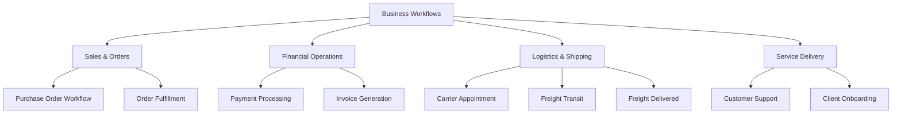

# Business Workflows Overview

Real-world workflow examples demonstrating practical YAWL applications.

## Purpose

This section provides complete, production-ready workflow examples for common business scenarios:

- **Ordering**: Purchase order creation and approval
- **Payment**: Payment processing and verification
- **Carrier Appointment**: Logistics carrier scheduling
- **Freight Transit**: Shipping tracking and management
- **Freight Delivered**: Delivery confirmation and completion
- **Order Fulfillment**: End-to-end order orchestration

## Workflow Categories



## Common Patterns Used

| Business Scenario | Primary Patterns | Secondary Patterns |
|-------------------|------------------|-------------------|
| Order Processing | Sequential, Exclusive Choice | Parallel Split, Cancellation |
| Payment | Milestone, Cancellation | Timeout, Deferred Choice |
| Logistics | Parallel Split, Multi-Instance | Iterative Loop, Timeout |
| Fulfillment | N-out-of-N Join, Resource Allocation | Cancellation, Recovery |

## Key Features Demonstrated

### 1. Human-in-the-Loop Workflows

Workflows that require human approval or intervention:

```erlang
%% Approval workflow with escalation
Config = #{
    pattern_type => exclusive_choice,
    name => <<"approval_flow">>,
    parameters => #{
        conditions => [
            #{name => auto_approve, threshold => 100},
            #{name => manager_approve, threshold => 1000},
            #{name => director_approve, threshold => 10000}
        ]
    }
}.
```

### 2. Service Integration

Workflows that integrate with external services:

```erlang
%% Payment service integration
Config = #{
    pattern_type => parallel_split,
    name => <<"payment_processing">>,
    parameters => #{
        branches => [
            #{
                task => process_payment,
                capabilities => [payment_gateway],
                timeout => 30000,
                retry => 3
            },
            #{
                task => update_inventory,
                capabilities => [inventory_system],
                timeout => 15000,
                retry => 2
            }
        ]
    }
}.
```

### 3. Timeout and Cancellation

Workflows with time constraints and cancellation patterns:

```erlang
%% Cancellation with timeout
Config = #{
    pattern_type => cancellation_scope,
    name => <<"payment_with_timeout">>,
    parameters => #{
        timeout => 30000,
        cancellation_scope => all,
        on_timeout => cancel
    }
}.
```

### 4. Resource Allocation

Workflows requiring specific resource capabilities:

```erlang
%% Resource-based task assignment
Config = #{
    pattern_type => deferred_choice_with_allocation,
    name => <<"specialist_review">>,
    parameters => #{
        options => [
            #{capabilities => [junior_reviewer], priority => low},
            #{capabilities => [senior_reviewer], priority => medium},
            #{capabilities => [expert_reviewer], priority => high}
        ]
    }
}.
```

## Business Rules Engine

YAWL's business rules support:

### Rule Types

1. **Condition Rules**: Evaluate data and route workflows
2. **Allocation Rules**: Assign tasks based on capabilities
3. **Escalation Rules**: Trigger escalation on timeout
4. **Notification Rules**: Send notifications on events

### Example: Condition Rules

```erlang
-type condition_rule() :: #{
    id := binary(),
    name := binary(),
    conditions := [condition()],
    action := action()
}.

-type condition() :: #{
    field := binary(),
    operator := 'gt' | 'lt' | 'eq' | 'ne' | 'in',
    value := term()
}.

-type action() :: #{
    type := route | approve | reject | escalate,
    target := binary()
}.
```

## Data Models

### Order Entity

```erlang
-record(order, {
    id :: binary(),
    customer_id :: binary(),
    items :: [order_item()],
    total_amount :: float(),
    status :: order_status(),
    created_at :: integer(),
    updated_at :: integer()
}).

-type order_status() :: pending | approved | processing | shipped | delivered | cancelled.
```

### Payment Entity

```erlang
-record(payment, {
    id :: binary(),
    order_id :: binary(),
    amount :: float(),
    method :: payment_method(),
    status :: payment_status(),
    transaction_id :: binary() | undefined,
    created_at :: integer()
}).

-type payment_method() :: credit_card | debit_card | bank_transfer | digital_wallet.
-type payment_status() :: pending | processing | completed | failed | refunded.
```

### Shipment Entity

```erlang
-record(shipment, {
    id :: binary(),
    order_id :: binary(),
    carrier_id :: binary(),
    tracking_number :: binary(),
    status :: shipment_status(),
    origin :: location(),
    destination :: location(),
    estimated_delivery :: integer(),
    actual_delivery :: integer() | undefined
}).

-type shipment_status() :: pending | picked_up | in_transit | delivered | failed.
-type location() :: #{
    address := binary(),
    city := binary(),
    state := binary(),
    postal_code := binary(),
    country := binary()
}.
```

## Integration Points

### External Systems

1. **ERP Systems**: Order management, inventory
2. **Payment Gateways**: Stripe, PayPal, Square
3. **Shipping Carriers**: UPS, FedEx, DHL
4. **Email Services**: Notifications, confirmations
5. **Analytics**: Event tracking, reporting

### Integration Pattern

```erlang
%% External service integration
-module(business_integration).

-export([call_external_service/3]).

call_external_service(Service, Operation, Payload) ->
    case Service of
        payment_gateway ->
            payment_gateway:call(Operation, Payload);
        inventory_system ->
            inventory_system:call(Operation, Payload);
        shipping_api ->
            shipping_api:call(Operation, Payload);
        _ ->
            {error, unknown_service}
    end.

%% With circuit breaker
call_with_circuit_breaker(Service, Operation, Payload) ->
    case circuit_breaker:check(Service) of
        closed ->
            Result = call_external_service(Service, Operation, Payload),
            circuit_breaker:record_result(Service, Result),
            Result;
        open ->
            {error, circuit_open}
    end.
```

## Error Handling Strategies

### 1. Retry with Backoff

```erlang
retry_operation(Operation, MaxRetries) ->
    retry_operation(Operation, MaxRetries, 0).

retry_operation(_Operation, MaxRetries, Attempt) when Attempt >= MaxRetries ->
    {error, max_retries_exceeded};
retry_operation(Operation, MaxRetries, Attempt) ->
    case Operation() of
        {ok, Result} ->
            {ok, Result};
        {error, Reason} ->
            Backoff = trunc(math:pow(2, Attempt) * 1000),
            timer:sleep(Backoff),
            retry_operation(Operation, MaxRetries, Attempt + 1)
    end.
```

### 2. Fallback Operations

```erlang
with_fallback(PrimaryOperation, FallbackOperation) ->
    case PrimaryOperation() of
        {ok, Result} ->
            {ok, Result};
        {error, _Reason} ->
            FallbackOperation()
    end.
```

### 3. Compensation Actions

```erlang
with_compensation(Operations) ->
    Results = execute_operations(Operations),
    case lists:any(fun is_error/1, Results) of
        true ->
            compensate_operations(Operations),
            {error, compensation_triggered};
        false ->
            {ok, Results}
    end.
```

## Monitoring and Analytics

### Business Metrics

```erlang
-record(business_metrics, {
    total_orders :: integer(),
    completed_orders :: integer(),
    cancelled_orders :: integer(),
    average_completion_time :: float(),
    revenue :: float(),
    conversion_rate :: float()
}).
```

### Event Tracking

```erlang
track_business_event(EventType, WorkflowId, Data) ->
    Event = #{
        event_type => EventType,
        workflow_id => WorkflowId,
        timestamp => erlang:system_time(millisecond),
        data => Data
    },
    yawl_event_bus:publish(business_events, Event).
```

## Quick Links

- [Ordering Workflow](ordering.md) - Purchase order creation and approval
- [Payment Workflow](payment.md) - Payment processing and verification
- [Carrier Appointment](carrier-appointment.md) - Logistics carrier scheduling
- [Freight Transit](freight-transit.md) - Shipping tracking
- [Freight Delivered](freight-delivered.md) - Delivery completion
- [Order Fulfillment](order-fulfillment.md) - End-to-end orchestration

---

Next: [Ordering Workflow](ordering.md) | [Back to Index](../index.md)
