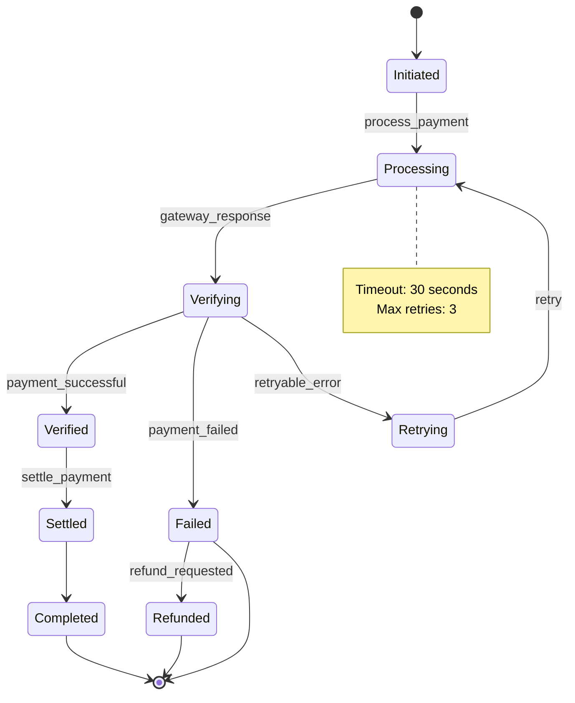

# Payment Processing Workflow

Payment processing, verification, and settlement workflow.

## Overview

The payment workflow handles all financial transactions including credit card processing, refunds, payment verification, and settlement. This workflow demonstrates the milestone pattern, cancellation patterns, and integration with payment gateways.

## Business Requirements

1. **Payment Method Selection**: Customer selects payment method
2. **Payment Processing**: Charge the payment method
3. **Verification**: Verify payment was successful
4. **Settlement**: Mark payment for settlement
5. **Error Handling**: Handle payment failures and retries
6. **Refunds**: Process refunds when needed

## Workflow Diagram



## Configuration

### Payment Processing with Milestone

```erlang
PaymentConfig = #{
    workflow_type => payment_processing,
    pattern_type => milestone,
    name => <<"payment_processing">>,
    description => <<"Process payment with verification milestone">>,
    parameters => #{
        steps => [
            #{
                step_id => select_method,
                name => <<"Select Payment Method">>,
                task => select_payment_method,
                capabilities => [payment_ui],
                timeout => 10000
            },
            #{
                step_id => process_charge,
                name => <<"Process Charge">>,
                task => process_payment_charge,
                capabilities => [payment_gateway],
                timeout => 30000,
                retry => 3
            },
            #{
                step_id => verify_payment,
                name => <<"Verify Payment">>,
                task => verify_payment,
                capabilities => [payment_verification],
                timeout => 15000,
                milestone => true
            },
            #{
                step_id => settle_payment,
                name => <<"Settle Payment">>,
                task => settle_payment,
                capabilities => [payment_settlement],
                timeout => 60000,
                depends_on_milestone => verify_payment
            }
        ]
    },
    options => #{
        enable_cancellation => true,
        cancellation_scope => process_charge,
        enable_checkpoint => true
    }
}.
```

### Payment with Cancellation on Timeout

```erlang
PaymentWithTimeoutConfig = #{
    pattern_type => cancellation_scope,
    name => <<"payment_with_timeout">>,
    description => <<"Payment processing with automatic cancellation on timeout">>,
    parameters => #{
        main_task => process_payment,
        timeout => 30000,
        cancellation_scope => all,
        on_timeout => cancel_and_refund
    }
}.
```

## Data Structures

### Payment Record

```erlang
-record(payment, {
    id :: binary(),
    order_id :: binary(),
    customer_id :: binary(),
    amount :: float(),
    currency :: binary(),
    method :: payment_method(),
    status :: payment_status(),
    gateway :: binary(),
    gateway_transaction_id :: binary() | undefined,
    gateway_response :: map() | undefined,
    failure_reason :: binary() | undefined,
    retry_count :: integer(),
    created_at :: integer(),
    processed_at :: integer() | undefined,
    settled_at :: integer() | undefined,
    metadata :: map()
}).

-type payment_method() :: #{
    type := credit_card | debit_card | bank_transfer | digital_wallet | crypto,
    details := map()
}.

-type payment_status() :: initiated | processing | verifying |
                         verified | failed | settled | refunded.

-type payment_gateway() :: stripe | paypal | square | braintree | adyen.
```

### Payment Intent

```erlang
-record(payment_intent, {
    id :: binary(),
    amount :: float(),
    currency :: binary(),
    customer_id :: binary(),
    payment_method :: payment_method(),
    description :: binary(),
    metadata :: map(),
    status :: payment_intent_status(),
    created_at :: integer()
}).

-type payment_intent_status() :: created | requiring_payment_method |
                                requiring_confirmation | requiring_action |
                                processing | requires_capture | cancelled |
                                succeeded.
```

## Implementation

### Payment Gateway Integration

```erlang
-module(payment_gateway_client).

-export([create_intent/3, confirm_payment/2, capture_payment/2,
         refund_payment/2, get_payment_status/1]).

%% Create a payment intent
-spec create_intent(float(), binary(), map()) -> {ok, map()} | {error, term()}.
create_intent(Amount, Currency, Options) ->
    Request = #{
        amount => trunc(Amount * 100),  % Convert to cents
        currency => Currency,
        automatic_payment_methods => #{enabled => true},
        metadata => maps:get(metadata, Options, #{})
    },
    case gateway_request(post, "/v1/payment_intents", Request) of
        {ok, Response} ->
            {ok, #{
                id => maps:get(<<"id">>, Response),
                client_secret => maps:get(<<"client_secret">>, Response),
                status => maps:get(<<"status">>, Response),
                amount => Amount,
                currency => Currency
            }};
        {error, Reason} ->
            {error, Reason}
    end.

%% Confirm payment with client secret
-spec confirm_payment(binary(), binary()) -> {ok, map()} | {error, term()}.
confirm_payment(PaymentIntentId, ClientSecret) ->
    Request = #{
        payment_method => maps:get(payment_method, ClientSecret),
        client_secret => ClientSecret
    },
    case gateway_request(post, "/v1/payment_intents/" ++ PaymentIntentId ++ "/confirm", Request) of
        {ok, Response} ->
            handle_payment_response(Response);
        {error, Reason} ->
            {error, Reason}
    end.

%% Capture payment
-spec capture_payment(binary(), map()) -> {ok, map()} | {error, term()}.
capture_payment(PaymentIntentId, Options) ->
    Request = #{
        amount_to_capture => maps:get(amount_to_capture, Options)
    },
    case gateway_request(post, "/v1/payment_intents/" ++ PaymentIntentId ++ "/capture", Request) of
        {ok, Response} ->
            {ok, #{
                id => maps:get(<<"id">>, Response),
                status => maps:get(<<"status">>, Response),
                amount_received => maps:get(<<"amount_received">>, Response) / 100
            }};
        {error, Reason} ->
            {error, Reason}
    end.

%% Refund payment
-spec refund_payment(binary(), map()) -> {ok, map()} | {error, term()}.
refund_payment(PaymentIntentId, Options) ->
    Request = #{
        amount => case maps:get(amount, Options, undefined) of
            undefined => undefined;
            Amount -> trunc(Amount * 100)
        end,
        reason => maps:get(reason, Options, <<"requested_by_customer">>)
    },
    case gateway_request(post, "/v1/refunds", Request) of
        {ok, Response} ->
            {ok, #{
                id => maps:get(<<"id">>, Response),
                status => maps:get(<<"status">>, Response),
                amount => maps:get(<<"amount">>, Response) / 100
            }};
        {error, Reason} ->
            {error, Reason}
    end.

%% Get payment status
-spec get_payment_status(binary()) -> {ok, payment_status()} | {error, term()}.
get_payment_status(PaymentIntentId) ->
    case gateway_request(get, "/v1/payment_intents/" ++ PaymentIntentId, #{}) of
        {ok, Response} ->
            Status = case maps:get(<<"status">>, Response) of
                <<"succeeded">> -> succeeded;
                <<"processing">> -> processing;
                <<"requires_payment_method">> -> requiring_payment_method;
                <<"requires_confirmation">> -> requiring_confirmation;
                <<"requires_action">> -> requiring_action;
                <<"canceled">> -> cancelled;
                _ -> unknown
            end,
            {ok, Status};
        {error, Reason} ->
            {error, Reason}
    end.

%% Internal gateway request handler
gateway_request(Method, Path, Payload) ->
    GatewayUrl = application:get_env(payment, gateway_url, <<"https://api.stripe.com">>),
    ApiKey = application:get_env(payment, gateway_api_key),
    Url = <<GatewayUrl/binary, Path/binary>>,
    Headers = [
        {<<"Authorization">>, <<"Bearer ", ApiKey/binary>>},
        {<<"Content-Type">>, <<"application/json">>,
        {<<"Idempotency-Key">>, idempotency_key()}
    ],
    case httpc:request(Method, {Url, Headers, <<"application/json">>, jsx:encode(Payload)}, [], []) of
        {ok, {{_, 200, _}, _, Body}} ->
            {ok, jsx:decode(Body, [return_maps])};
        {ok, {{_, StatusCode, _}, _, Body}} ->
            Error = jsx:decode(Body, [return_maps]),
            {error, #{status_code => StatusCode, error => Error}};
        {error, Reason} ->
            {error, Reason}
    end.

idempotency_key() ->
    base64:encode(crypto:strong_rand_bytes(16)).
```

### Payment Verification

```erlang
-module(payment_verification).

-export([verify_payment/1, verify_signature/2, webhook_handler/1]).

%% Verify payment status
-spec verify_payment(binary()) -> {ok, verified} | {error, term()}.
verify_payment(PaymentIntentId) ->
    case payment_gateway_client:get_payment_status(PaymentIntentId) of
        {ok, succeeded} ->
            {ok, verified};
        {ok, processing} ->
            %% Still processing, check again after delay
            timer:sleep(1000),
            verify_payment(PaymentIntentId);
        {ok, Status} ->
            {error, {unexpected_status, Status}};
        {error, Reason} ->
            {error, Reason}
    end.

%% Verify webhook signature
-spec verify_signature(binary(), binary()) -> boolean().
verify_signature(Payload, Signature) ->
    Secret = application:get_env(payment, webhook_secret),
    ExpectedSignature = compute_signature(Payload, Secret),
    constant_time_compare(Signature, ExpectedSignature).

compute_signature(Payload, Secret) ->
    Timestamp = integer_to_binary(erlang:system_time(second)),
    PayloadWithTimestamp = <<Timestamp/binary, ".", Payload/binary>>,
    Mac = crypto:hmac(sha256, Secret, PayloadWithTimestamp),
    <<Timestamp/binary, ".", (base64:encode(Mac))/binary>>.

constant_time_compare(A, B) when byte_size(A) =:= byte_size(B) ->
    Result = crypto:exor(A, B),
    lists:all(fun(0) -> true; (_) -> false end, binary_to_list(Result));
constant_time_compare(_, _) ->
    false.

%% Handle webhook events
-spec webhook_handler(map()) -> ok | {error, term()}.
webhook_handler(Event) ->
    EventType = maps:get(<<"type">>, Event),
    Data = maps:get(<<"data">>, Event),

    case EventType of
        <<"payment_intent.succeeded">> ->
            handle_payment_success(Data);
        <<"payment_intent.payment_failed">> ->
            handle_payment_failure(Data);
        <<"payment_intent.requires_action">> ->
            handle_payment_action_required(Data);
        <<"charge.refunded">> ->
            handle_refund(Data);
        _ ->
            ok
    end.

handle_payment_success(Data) ->
    PaymentIntent = maps:get(<<"object">>, Data),
    PaymentId = maps:get(<<"id">>, PaymentIntent),
    Amount = maps:get(<<"amount">>, PaymentIntent) / 100,
    ok = payment_store:update_status(PaymentId, verified),
    ok = notification:notify(<<"
        Payment succeeded: ", PaymentId/binary,
        " Amount: $", (float_to_binary(Amount))/binary
    >>).

handle_payment_failure(Data) ->
    PaymentIntent = maps:get(<<"object">>, Data),
    PaymentId = maps:get(<<"id">>, PaymentIntent),
    ErrorCode = maps:get(<<"code">>, maps:get(<<"last_payment_error">>, PaymentIntent, #{})),
    ok = payment_store:update_status(PaymentId, failed),
    ok = payment_store:set_failure_reason(PaymentId, ErrorCode).

handle_payment_action_required(Data) ->
    PaymentIntent = maps:get(<<"object">>, Data),
    PaymentId = maps:get(<<"id">>, PaymentIntent),
    NextAction = maps:get(<<"next_action">>, PaymentIntent),
    ok = payment_store:set_next_action(PaymentId, NextAction).

handle_refund(Data) ->
    Charge = maps:get(<<"object">>, Data),
    PaymentId = maps:get(<<"payment_intent">>, Charge),
    RefundAmount = maps:get(<<"amount">>, Charge) / 100,
    ok = payment_store:update_status(PaymentId, refunded),
    ok = notification:notify(<<"
        Refund processed: ", PaymentId/binary,
        " Amount: $", (float_to_binary(RefundAmount))/binary
    >>).
```

### Payment Settlement

```erlang
-module(payment_settlement).

-export([schedule_settlement/1, settle_payment/1, batch_settle/0]).

%% Schedule payment for settlement
-spec schedule_settlement(binary()) -> {ok, binary()} | {error, term()}.
schedule_settlement(PaymentId) ->
    SettlementId = yawl_utils:generate_id(settlement),
    Settlement = #settlement{
        id = SettlementId,
        payment_id => PaymentId,
        status => scheduled,
        scheduled_at => erlang:system_time(millisecond)
    },
    ok = settlement_store:save(Settlement),
    {ok, SettlementId}.

%% Settle a payment
-spec settle_payment(binary()) -> ok | {error, term()}.
settle_payment(SettlementId) ->
    case settlement_store:get(SettlementId) of
        {ok, #settlement{status = scheduled, payment_id = PaymentId}} ->
            case payment_store:get(PaymentId) of
                {ok, #payment{status = verified} = Payment} ->
                    case settle_with_gateway(Payment) of
                        {ok, Transaction} ->
                            Updated = Payment#payment{
                                status = settled,
                                settled_at = erlang:system_time(millisecond)
                            },
                            ok = payment_store:save(Updated),
                            ok = settlement_store:update_status(SettlementId, completed),
                            ok;
                        {error, Reason} ->
                            ok = settlement_store:update_status(SettlementId, failed),
                            {error, Reason}
                    end;
                {ok, #payment{status = Status}} ->
                    {error, {invalid_payment_status, Status}};
                {error, Reason} ->
                    {error, Reason}
            end;
        {ok, #settlement{status = Status}} ->
            {error, {invalid_settlement_status, Status}};
        {error, Reason} ->
            {error, Reason}
    end.

%% Settle all pending payments
-spec batch_settle() -> {ok, integer(), [binary()]}.
batch_settle() ->
    {ok, Settlements} = settlement_store:get_pending(),
    Results = lists:map(fun(#settlement{id = Id}) ->
        settle_payment(Id)
    end, Settlements),
    Successful = lists:filter(fun(ok) -> true; (_) -> false end, Results),
    Failed = [Id || {error, _} <- Results],
    {ok, length(Successful), Failed}.

settle_with_gateway(Payment) ->
    Gateway = Payment#payment.gateway,
    TransactionId = Payment#payment.gateway_transaction_id,
    case Gateway of
        stripe ->
            stripe_gateway:settle(TransactionId);
        paypal ->
            paypal_gateway:settle(TransactionId);
        square ->
            square_gateway:settle(TransactionId)
    end.
```

## REST API Usage

### Create Payment Intent

```bash
curl -X POST http://localhost:8081/api/workflows \
  -H "Content-Type: application/json" \
  -d '{
    "pattern": "milestone",
    "name": "payment_processing",
    "input_data": {
      "amount": 100.00,
      "currency": "USD",
      "customer_id": "cust_123",
      "payment_method": {
        "type": "credit_card",
        "details": {
          "card_number": "4242424242424242",
          "exp_month": 12,
          "exp_year": 2025,
          "cvc": "123"
        }
      }
    }
  }'
```

### Process Payment

```bash
curl -X POST http://localhost:8081/api/workflows/{workflow_id}/execute
```

### Verify Payment Milestone

```bash
curl -X POST http://localhost:8081/api/workflows/{workflow_id}/tasks/{task_id}/complete \
  -H "Content-Type: application/json" \
  -d '{
    "result": {
      "status": "verified",
      "gateway_status": "succeeded"
    }
  }'
```

### Refund Payment

```bash
curl -X POST http://localhost:8081/api/payments/{payment_id}/refund \
  -H "Content-Type: application/json" \
  -d '{
    "amount": 100.00,
    "reason": "requested_by_customer"
  }'
```

## Testing

### Unit Tests

```erlang
payment_processing_test_() ->
    {setup,
     fun setup/0,
     fun cleanup/1,
     [
      fun create_payment_intent/0,
      fun verify_payment/0,
      fun settle_payment/0,
      fun refund_payment/0,
      fun handle_webhook/0
     ]}.

create_payment_intent() ->
    {ok, Intent} = payment_gateway_client:create_intent(100.0, <<"USD">>, #{}),
    ?assertMatch(#{<<"id">> := _, <<"status">> := <<"created">>}, Intent).

verify_payment() ->
    PaymentId = <<"pi_test_123">>,
    {ok, verified} = payment_verification:verify_payment(PaymentId).

refund_payment() ->
    PaymentId = <<"pi_test_123">>,
    {ok, Refund} = payment_gateway_client:refund_payment(PaymentId, #{
        amount => 50.0,
        reason => <<"requested_by_customer">>
    }),
    ?assertMatch(#{<<"id">> := _, <<"status">> := <<"succeeded">>}, Refund).
```

---

Next: [Carrier Appointment](carrier-appointment.md) | [Back to Overview](overview.md)
