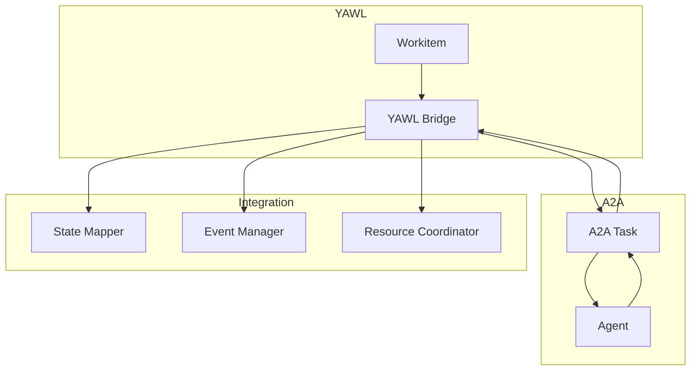

# YAWL-A2A Integration

The YAWL-A2A bridge provides seamless bidirectional integration between YAWL workflows and A2A (Agent-to-Agent) tasks. This document explains how the integration works, its key concepts, and how to use it effectively.

## Integration Overview

The YAWL-A2A bridge serves as a translation layer between YAWL's workitem-based workflow execution and A2A's agent task system. It enables:

- **YAWL → A2A**: Workitems become A2A tasks
- **A2A → YAWL**: Task updates complete workitems
- **State Synchronization**: Real-time state mapping
- **Event Coordination**: Unified event system
- **Resource Sharing**: Capability-based matching



## Key Concepts

### 1. Bidirectional Mapping

The bridge maintains mappings between YAWL and A2A entities:

```erlang
% Workitem to Task mapping
-record(mapping, {
    workitem_id :: binary(),      % YAWL workitem
    task_id :: binary(),         % A2A task
    workflow_id :: binary(),     % Parent workflow
    created_at :: integer(),     % Creation timestamp
    updated_at :: integer(),     % Last update
    state :: map()              % Current state
}).
```

### 2. State Mapping

States are synchronized between systems:

```erlang
% YAWL to A2A state mapping
yawl_state_to_a2a(pending) -> ?TASK_STATE_SUBMITTED;
yawl_state_to_a2a(allocated) -> ?TASK_STATE_SUBMITTED;
yawl_state_to_a2a(started) -> ?TASK_STATE_WORKING;
yawl_state_to_a2a(completed) -> ?TASK_STATE_COMPLETED;
yawl_state_to_a2a(failed) -> ?TASK_STATE_FAILED;
yawl_state_to_a2a(cancelled) -> ?TASK_STATE_CANCELED.

% A2A to YAWL state mapping
map_a2a_state_to_yawl(?TASK_STATE_SUBMITTED) -> pending;
map_a2a_state_to_yawl(?TASK_STATE_WORKING) -> started;
map_a2a_state_to_yawl(?TASK_STATE_COMPLETED) -> completed;
map_a2a_state_to_yawl(?TASK_STATE_FAILED) -> failed;
map_a2a_state_to_yawl(?TASK_STATE_CANCELED) -> cancelled;
```

### 3. Event Coordination

Events are translated and propagated:

```erlang
% YAWL events trigger A2A actions
yawl_a2a_bridge:create_a2a_task_from_workitem(Workitem).

% A2A events update YAWL state
yawl_a2a_bridge:complete_workitem_from_a2a_task(TaskId, Result).

% Unified event stream
publish_event(WorkflowId, {workitem_completed, Result}).
```

## APIs and Usage

### Creating Workitems from A2A Tasks

```erlang
% Create YAWL workflow from A2A task
{ok, WorkflowId} = yawl_a2a_bridge:create_workflow_from_a2a_task(
    TaskId,
    basic_sequential
).

% Link A2A task to workflow workitem
ok = yawl_a2a_bridge:link_a2a_task_to_workflow(
    TaskId,
    WorkflowId,
    WorkitemId
).
```

### Creating A2A Tasks from Workitems

```erlang
% Create A2A task from YAWL workitem
{ok, TaskId, TaskPid} = yawl_a2a_bridge:create_a2a_task_from_workitem(Workitem).

% Create with options
Options = #{handler_module => my_task_handler,
            metadata => #{priority => high}},
{ok, TaskId, TaskPid} = yawl_a2a_bridge:create_a2a_task_from_workitem(
    Workitem,
    Options
).
```

### State Synchronization

```erlang
% Sync YAWL workitem state to A2A task
ok = yawl_a2a_bridge:sync_workitem_to_a2a_task(WorkitemId, TaskId).

% Complete workitem when A2A task completes
ok = yawl_a2a_bridge:complete_workitem_from_a2a_task(TaskId, Result).

% Handle task failure
ok = yawl_a2a_bridge:fail_workitem_from_a2a_task(
    TaskId,
    WorkitemId,
    Reason
).
```

### Event Subscription

```erlang
% Subscribe to workitem events
{ok, Ref} = yawl_a2a_bridge:subscribe_to_workitem_events(WorkitemId).

% Subscribe to task events
{ok, Ref} = yawl_a2a_bridge:subscribe_to_task_events(TaskId).

% Unsubscribe from events
ok = yawl_a2a_bridge:unsubscribe_from_events(Ref).

% Publish custom events
ok = yawl_a2a_bridge:publish_event(EntityId, Event).
```

### Checkpoint Integration

```erlang
% Create checkpoint
{ok, CheckpointId} = yawl_a2a_bridge:create_checkpoint(
    WorkflowId,
    CheckpointData
).

% Restore from checkpoint
{ok, CheckpointState} = yawl_a2a_bridge:restore_from_checkpoint(
    WorkflowId,
    CheckpointId
).

% Get checkpoint state
{ok, State} = yawl_a2a_bridge:get_checkpoint_state(CheckpointId).
```

### Resource Allocation

```erlang
% Allocate resource for A2A task
{ok, ResourceId} = yawl_a2a_bridge:allocate_resource_for_task(
    TaskId,
    [capability1, capability2]
).

% Release resource
ok = yawl_a2a_bridge:release_resource_for_task(TaskId, ResourceId).

% Get allocated resource
{ok, ResourceId} = yawl_a2a_bridge:get_task_resource(TaskId).

% Sync resource state
ok = yawl_a2a_bridge:sync_resource_state(ResourceId, State).
```

## Data Flow Example

Here's a complete example showing the integration in action:

```erlang
% 1. Create YAWL workflow
Config = #{pattern_type => parallel_split,
           parameters => #{branches => 2}},
{ok, WorkflowId} = yawl_orchestrator:create_workflow(Config),
{ok, _Instance} = yawl_orchestrator:execute_workflow(WorkflowId).

% 2. Get workitems
{ok, Workitems} = yawl_persistence:list_workitems(WorkflowId).

% 3. Create A2A tasks from workitems
TaskMappings = lists:map(fun(Workitem) ->
    {ok, TaskId, TaskPid} = yawl_a2a_bridge:create_a2a_task_from_workitem(Workitem),
    % Link task to workitem
    ok = yawl_a2a_bridge:link_a2a_task_to_workflow(
        TaskId,
        WorkflowId,
        Workitem#yawl_workitem_persist.workitem_id
    ),
    {Workitem#yawl_workitem_persist.workitem_id, TaskId}
end, Workitems).

% 4. Monitor A2A task completion
lists:foreach(fun({WorkitemId, TaskId}) ->
    % Subscribe to task completion
    {ok, _Ref} = yawl_a2a_bridge:subscribe_to_task_events(TaskId),

    % Process task completion
    receive
        {yawl_a2a_event, TaskId, {completed, Result}} ->
            % Update workitem in YAWL
            ok = yawl_a2a_bridge:complete_workitem_from_a2a_task(TaskId, Result),
            % Update workflow instance
            ok = yawl_orchestrator:complete_workitem(
                WorkflowId,
                list_to_existing_atom(binary_to_list(WorkitemId)),
                Result
            )
    after 30000 ->
            io:format("Task ~p timed out~n", [TaskId])
    end
end, TaskMappings).
```

## Configuration

### Bridge Configuration

```erlang
% Start bridge with custom configuration
Config = #{
    max_concurrent_tasks => 100,
    task_timeout => 30000,
    enable_metrics => true,
    event_buffer_size => 50
},
{ok, BridgePid} = yawl_a2a_bridge:start_link(Config).
```

### Event Manager Integration

```erlang
% Configure event routing
EventConfig = #{
    enable_xes => true,
    xes_output_path => <<"/tmp/yawl_a2a_events.xes">>,
    event_handlers => [my_event_handler]
},
ok = yawl_event_bridge:configure_output(EventConfig).
```

### Resource Integration

```erlang
% Register A2A-compatible resources
{ok, HumanResource} = yawl_resource_manager:register_resource(
    <<"agent123">>,
    human,
    #{capabilities => [approval, review]}
).

{ok, ServiceResource} = yawl_resource_manager:register_resource(
    <<"payment_service">>,
    service,
    #{capabilities => [payment_processing],
      max_capacity => 10}
).
```

## Best Practices

### 1. Error Handling

```erlang
% Robust task creation with retry
create_task_with_retry(Workitem, MaxRetries) ->
    create_task_with_retry(Workitem, MaxRetries, 1).

create_task_with_retry(_Workitem, 0, _Attempt) ->
    {error, max_retries_exceeded};
create_task_with_retry(Workitem, MaxRetries, Attempt) ->
    case yawl_a2a_bridge:create_a2a_task_from_workitem(Workitem) of
        {ok, TaskId, TaskPid} ->
            {ok, TaskId, TaskPid};
        {error, Reason} when Attempt < MaxRetries ->
            timer:sleep(1000 * Attempt), % Exponential backoff
            create_task_with_retry(Workitem, MaxRetries, Attempt + 1);
        {error, Reason} ->
            {error, Reason}
    end.
```

### 2. State Consistency

```erlang
% Ensure state consistency across systems
sync_workitem_state(WorkitemId, TaskId, NewState) ->
    % Update A2A task state
    ok = yawl_a2a_bridge:sync_workitem_to_a2a_task(WorkitemId, TaskId),

    % Update YAWL workitem state
    case yawl_persistence:load_workitem(WorkitemId) of
        {ok, Workitem} ->
            UpdatedWorkitem = Workitem#yawl_workitem_persist{status = NewState},
            yawl_persistence:save_workitem(UpdatedWorkitem);
        {error, Reason} ->
            {error, Reason}
    end.
```

### 3. Resource Management

```erlang
% Efficient resource allocation
allocate_optimal_resource(TaskId, RequiredCapabilities) ->
    % Find best resource
    case yawl_resource_manager:find_resources_by_capabilities(RequiredCapabilities) of
        {ok, Resources} ->
            % Select based on allocation strategy
            case yawl_resource_manager:get_allocation_strategy() of
                least_loaded ->
                    select_least_loaded(Resources);
                round_robin ->
                    select_round_robin(Resources);
                random ->
                    select_random(Resources)
            end;
        {error, Reason} ->
            {error, Reason}
    end.

% Allocate and bind to task
allocate_and_bind(TaskId, ResourceId) ->
    case yawl_a2a_bridge:allocate_resource_for_task(TaskId, [ResourceId]) of
        {ok, _} ->
            ok;
        {error, Reason} ->
            {error, Reason}
    end.
```

## Monitoring and Observability

### Metrics Collection

```erlang
% Get bridge statistics
Stats = yawl_a2a_bridge:get_statistics().

% Key metrics:
% - total_tasks_created
% - successful_completions
% - failed_tasks
% - average_task_duration
% - resource_utilization
```

### Event Analysis

```erlang
% Analyze event patterns
{ok, Trace} = yawl_event_bridge:get_trace_summary(WorkflowId).

% Export for process mining
{ok, XESXml} = yawl_event_bridge:export_trace(WorkflowId).

% Configure event filtering
FilterFun = fun(EventType, EventData) ->
    EventType == workitem_completed orelse
    EventType == task_failed
end,
ok = yawl_event_bridge:configure_filter(FilterFun).
```

### Performance Monitoring

```erlang
% Monitor task throughput
monitor_task_throughput() ->
    receive
        after 60000 ->
            Stats = yawl_a2a_bridge:get_statistics(),
            Throughput = maps:get(tasks_completed_per_minute, Stats, 0),
            io:format("Task throughput: ~p tasks/min~n", [Throughput]),
            monitor_task_throughput()
    end.

% Monitor resource utilization
monitor_utilization() ->
    receive
        after 30000 ->
            {ok, Resources} = yawl_resource_manager:list_resources(),
            Utilization = calculate_utilization(Resources),
            io:format("Resource utilization: ~p%~n", [Utilization]),
            monitor_utilization()
    end.
```

## Troubleshooting

### Common Issues

**Task Creation Fails:**
```erlang
% Check A2A system availability
case whereis(a2a_task_sup) of
    undefined ->
        {error, a2a_system_not_available};
    _Pid ->
        % Check workitem validity
        case validate_workitem(Workitem) of
            valid -> create_task(Workitem);
            {error, Reason} -> {error, Reason}
        end
end.
```

**State Synchronization Issues:**
```erlang
% Check state consistency
check_state_consistency(WorkitemId, TaskId) ->
    case yawl_a2a_bridge:get_a2a_task_for_workitem(WorkitemId) of
        {ok, TaskId} ->
            case yawl_a2a_bridge:get_workflow_for_a2a_task(TaskId) of
                {ok, WorkflowId} ->
                    {ok, consistent};
                {error, Reason} -> {error, Reason}
            end;
        {error, Reason} -> {error, Reason}
    end.
```

**Resource Allocation Problems:**
```erlang
% Debug resource allocation
debug_resource_allocation(TaskId, Capabilities) ->
    case yawl_resource_manager:find_resources_by_capabilities(Capabilities) of
        {ok, []} ->
            io:format("No available resources for capabilities: ~p~n", [Capabilities]),
            {error, no_available_resources};
        {ok, Resources} ->
            io:format("Available resources: ~p~n", [Resources]),
            {ok, Resources}
    end.
```

## Advanced Integration Patterns

### 1. Multi-Agent Workflows

```erlang
% Complex multi-agent workflow
setup_multi_agent_workflow() ->
    % Create workflow with multiple branches
    Config = #{pattern_type => interleaved_parallelism,
              parameters => #{tasks => [data_entry, review, approval]}},
    {ok, WorkflowId} = yawl_orchestrator:create_workflow(Config),

    % Allocate specialized resources
    {ok, DataEntryAgent} = yawl_resource_manager:find_resources_by_capability(data_entry),
    {ok, ReviewAgent} = yawl_resource_manager:find_resources_by_capability(review),
    {ok, ApprovalAgent} = yawl_resource_manager:find_resources_by_capability(approval),

    % Create tasks with agent assignments
    lists:foreach(fun({Task, Agent}) ->
        {ok, TaskId, _} = yawl_a2a_bridge:create_a2a_task_from_workitem(Task),
        ok = yawl_resource_manager:allocate_resource(TaskId, [Agent])
    end, [{Task1, DataEntryAgent}, {Task2, ReviewAgent}, {Task3, ApprovalAgent}]),

    WorkflowId.
```

### 2. Event-Driven Orchestration

```erlang
% Event-driven workflow processor
event_workflow_processor(WorkflowId) ->
    subscribe_to_workflow_events(WorkflowId),

    event_loop(WorkflowId).

event_loop(WorkflowId) ->
    receive
        {yawl_a2a_event, workitem_created, EventData} ->
            handle_workitem_created(EventData),
            event_loop(WorkflowId);
        {yawl_a2a_event, task_completed, EventData} ->
            handle_task_completed(EventData),
            event_loop(WorkflowId);
        {yawl_a2a_event, task_failed, EventData} ->
            handle_task_failed(EventData),
            event_loop(WorkflowId);
        stop ->
            ok
    end.
```

### 3. Resource-Intensive Workflows

```erlang
% Resource-intensive workflow with scaling
resource_intensive_workflow() ->
    % Create workflow with high resource requirements
    Config = #{pattern_type => multi_instance,
              parameters => #{num_instances => 100, data => LargeDataSet}},
    {ok, WorkflowId} = yawl_orchestrator:create_workflow(Config),

    % Scale resources based on demand
    scale_resources(100),

    % Monitor and adjust allocation
    monitor_and_scale(WorkflowId).
```

---

Next: [Event System](event-system.md) →