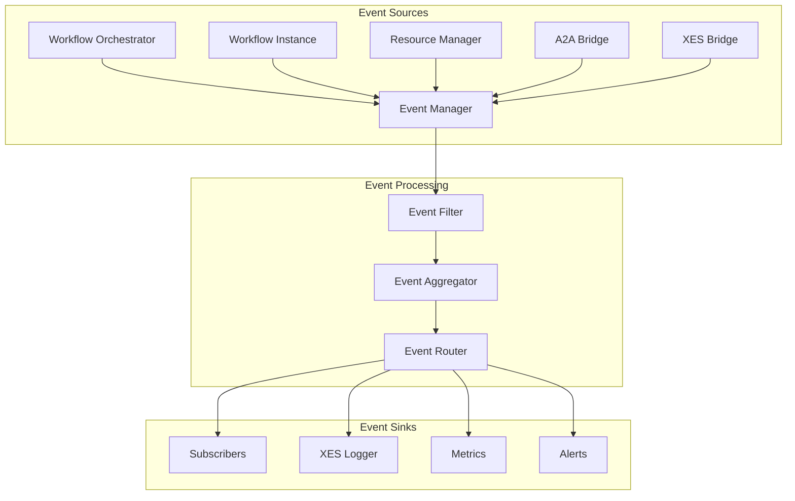

# YAWL Event System

The YAWL event system provides comprehensive real-time event processing and logging capabilities. It enables monitoring, process mining, and reactive behavior through a unified event architecture.

## Event System Overview

The YAWL event system handles three types of events:

1. **Workflow Events**: High-level workflow lifecycle events
2. **Workitem Events**: Task-level execution events
3. **System Events**: Infrastructure and resource events



## Event Types and Structure

### Event Categories

#### 1. Workflow Events
```erlang
% High-level workflow lifecycle
-record(event_workflow, {
    workflow_id :: binary(),
    event_type :: workflow_started | workflow_completed | workflow_failed | workflow_cancelled,
    timestamp :: integer(),
    metadata :: map()
}).
```

#### 2. Workitem Events
```erlang
% Task-level execution events
-record(event_workitem, {
    workitem_id :: binary(),
    workflow_id :: binary(),
    event_type :: workitem_created | workitem_allocated | workitem_started |
                 workitem_completed | workitem_failed | workitem_cancelled,
    task_id :: binary() | undefined,
    resource_id :: binary() | undefined,
    timestamp :: integer(),
    data :: map()
}).
```

#### 3. Resource Events
```erlang
% Resource allocation and state events
-record(event_resource, {
    resource_id :: binary(),
    event_type :: resource_allocated | resource_released | resource_updated,
    workitem_id :: binary() | undefined,
    timestamp :: integer(),
    data :: map()
}).
```

#### 4. System Events
```erlang
% Infrastructure events
-record(event_system, {
    event_type :: checkpoint_created | checkpoint_restored | sync_completed | sync_failed,
    entity_id :: binary(),
    timestamp :: integer(),
    data :: map()
}).
```

#### 5. A2A Integration Events
```erlang
% YAWL-A2A bridge events
-record(event_a2a, {
    workitem_id :: binary(),
    task_id :: binary(),
    event_type :: task_created | task_completed | task_failed | task_cancelled,
    timestamp :: integer(),
    data :: map()
}).
```

### Event Structure

All events follow a consistent structure:

```erlang
-record(yawl_event, {
    event_id :: binary(),           % Unique event identifier
    event_type :: atom(),           % Event category and action
    timestamp :: integer(),         % Monotonic time in milliseconds
    entity_id :: binary(),         % Primary entity (workflow, workitem, etc.)
    entity_type :: atom(),         % Type of primary entity
    workflow_id :: binary() | undefined,  % Parent workflow ID
    task_id :: binary() | undefined,      % Related task ID
    resource_id :: binary() | undefined, % Related resource ID
    data :: map(),                 % Event-specific data
    metadata :: map()              % Additional metadata
}).
```

## Event Processing Pipeline

### 1. Event Generation

Events are generated throughout the system:

```erlang
% Workflow events
generate_workflow_event(WorkflowId, EventType) ->
    Event = #yawl_event{
        event_id = generate_event_id(),
        event_type = EventType,
        timestamp = erlang:monotonic_time(millisecond),
        entity_id = WorkflowId,
        entity_type = workflow,
        workflow_id = WorkflowId,
        data = #{}
    },
    publish_event(Event).

% Workitem events
generate_workitem_event(WorkitemId, WorkflowId, EventType, Data) ->
    Event = #yawl_event{
        event_id = generate_event_id(),
        event_type = EventType,
        timestamp = erlang:monotonic_time(millisecond),
        entity_id = WorkitemId,
        entity_type = workitem,
        workflow_id = WorkflowId,
        task_id = maps:get(task_id, Data, undefined),
        data = Data
    },
    publish_event(Event).
```

### 2. Event Filtering

Events can be filtered before processing:

```erlang
% Configure event filter
FilterFun = fun(Event) ->
    case Event#yawl_event.event_type of
        workitem_completed ->
            maps:get(success, Event#yawl_event.data, true);
        task_failed ->
            maps:get(retry_count, Event#yawl_event.data, 0) < 3;
        _ -> true
    end
end.

% Apply filter
is_event_relevant(Event) ->
    case erlang:get(yawl_event_filter) of
        undefined -> true;
        FilterFun -> FilterFun(Event)
    end.
```

### 3. Event Aggregation

Multiple events can be aggregated for efficiency:

```erlang
% Aggregate events by time window
aggregate_events(Events, WindowMs) ->
    Groups = group_events_by_time(Events, WindowMs),
    lists:map(fun({Time, EventsInWindow}) ->
        aggregate_event_batch(Time, EventsInWindow)
    end, Groups).

% Aggregate statistics
aggregate_event_batch(Time, Events) ->
    Count = length(Events),
    ByType = count_events_by_type(Events),
    #{
        timestamp => Time,
        total_events => Count,
        by_type => ByType,
        duration_ms => calculate_duration(Events)
    }.
```

### 4. Event Routing

Events are routed to appropriate subscribers:

```erlang
% Event routing configuration
RoutingRules = #{
    workflow_events => [workflow_monitor, process_analyzer],
    workitem_events => [task_supervisor, performance_analyzer],
    resource_events => [resource_manager, capacity_planner],
    system_events => [alert_manager, maintenance_system]
}.

route_event(Event) ->
    EventTypes = determine_event_categories(Event),
    Subscribers = lists:flatmap(fun(Type) ->
        get_subscribers_for_type(Type)
    end, EventTypes),
    notify_subscribers(Subscribers, Event).
```

## XES Event Logging

The system exports events in XES format for process mining and analysis.

### XES Configuration

```erlang
% Configure XES output
XESConfig = #{
    type => file,
    path => <<"/var/log/yawl/events.xes">>,
    include_attributes => true,
    include_timestamps => true,
    compression => gzip
},
ok = yawl_event_bridge:configure_output(XESConfig).

% Configure event filtering for XES
XESEventFilter = fun(EventType, EventData) ->
    lists:member(EventType, [
        workflow_started, workflow_completed, workitem_created,
        workitem_completed, workitem_failed, task_completed, task_failed
    ])
end,
ok = yawl_event_bridge:configure_filter(XESEventFilter).
```

### XES Output Format

Events are converted to XES format:

```xml
<?xml version="1.0" encoding="UTF-8"?>
<log xes.version="1.0" xes.features="nested-attributes" openxes.version="1.0">
    <extension name="Lifecycle" prefix="lifecycle" uri="http://www.xes-standard.org/lifecycle.xesext"/>
    <extension name="Concept" prefix="concept" uri="http://www.xes-standard.org/concept.xesext"/>
    <extension name="Time" prefix="time" uri="http://www.xes-standard.org/time.xesext"/>

    <global scope="trace">
        <string key="concept:name" value="Workflow Instance"/>
    </global>

    <global scope="event">
        <string key="concept:name" value="Event"/>
        <string key="lifecycle:transition" value="unknown"/>
    </global>

    <trace>
        <string key="concept:name" value="wf_123"/>
        <string key="workflow:id" value="tr_456"/>

        <event>
            <string key="concept:name" value="WorkflowStarted"/>
            <string key="lifecycle:transition" value="start"/>
            <date key="time:timestamp" value="2024-01-15T10:00:00.000Z"/>
        </event>

        <event>
            <string key="concept:name" value="WorkitemCreated"/>
            <string key="lifecycle:transition" value="schedule"/>
            <date key="time:timestamp" value="2024-01-15T10:00:01.000Z"/>
            <string key="workitem_id" value="wi_789"/>
        </event>

        <event>
            <string key="concept:name" value="WorkitemCompleted"/>
            <string key="lifecycle:transition" value="complete"/>
            <date key="time:timestamp" value="2024-01-15T10:00:15.000Z"/>
            <string key="workitem_id" value="wi_789"/>
        </event>

        <event>
            <string key="concept:name" value="WorkflowCompleted"/>
            <string key="lifecycle:transition" value="complete"/>
            <date key="time:timestamp" value="2024-01-15T10:00:16.000Z"/>
        </event>
    </trace>
</log>
```

## Event APIs

### Event Management

```erlang
% Subscribe to events
{ok, SubscriptionRef} = yawl_event_bridge:subscribe_to_workflow(WorkflowId).

% Unsubscribe from events
ok = yawl_event_bridge:unsubscribe_from_workflow(WorkflowId).

% Publish custom event
ok = yawl_event_bridge:publish_event(WorkflowId, {custom_event, Data}).
```

### Event Querying

```erlang
% Get event statistics
Stats = yawl_event_bridge:get_statistics().

% Get trace summary
{ok, Summary} = yawl_event_bridge:get_trace_summary(WorkflowId).

% Export event trace
{ok, XESXml} = yawl_event_bridge:export_trace(WorkflowId).

% Export all traces
{ok, AllTraces} = yawl_event_bridge:export_all_traces().
```

### Event Configuration

```erlang
% Configure output
OutputConfig = #{
    type => file,
    path => <<"/tmp/yawl_events.xes">>,
    buffer_size => 1000,
    auto_flush => true
},
ok = yawl_event_bridge:configure_output(OutputConfig).

% Configure event filter
FilterFun = fun(EventType, EventData) ->
    EventType == workitem_completed andalso
    maps:get(success, EventData, true)
end,
ok = yawl_event_bridge:configure_filter(FilterFun).

% Clear filter
ok = yawl_event_bridge:clear_filter().
```

## Event Processing Examples

### 1. Real-time Monitoring

```erlang
% Real-time workflow monitor
start_workflow_monitor() ->
    % Subscribe to all workflow events
    {ok, _Ref} = yawl_event_bridge:add_event_handler(
        workflow_monitor,
        []
    ),

    % Start monitoring loop
    monitor_events().

monitor_events() ->
    receive
        {yawl_a2a_event, EventType, EventData} ->
            handle_monitoring_event(EventType, EventData),
            monitor_events()
    after 1000 ->
            % Periodic status update
            update_status_metrics(),
            monitor_events()
    end.

handle_monitoring_event(workflow_started, EventData) ->
    io:format("Workflow started: ~p~n", [EventData]),
    increment_counter(workflow_started);
handle_monitoring_event(workitem_completed, EventData) ->
    io:format("Workitem completed: ~p~n", [EventData]),
    increment_counter(workitem_completed);
handle_monitoring_event(workitem_failed, EventData) ->
    io:format("Workitem failed: ~p~n", [EventData]),
    increment_counter(workitem_failed),
    send_alert(EventData).
```

### 2. Performance Analysis

```erlang
% Performance analyzer
start_performance_analyzer() ->
    {ok, _Ref} = yawl_event_bridge:add_event_handler(
        performance_analyzer,
        []
    ),
    analyze_performance().

analyze_performance() ->
    receive
        after 30000 ->
            Stats = collect_performance_metrics(),
            identify_bottlenecks(Stats),
            analyze_performance()
    end.

collect_performance_metrics() ->
    {ok, Workflows} = yawl_orchestrator:list_workflows(),
    lists:map(fun(WorkflowId) ->
        {ok, Trace} = yawl_event_bridge:get_trace_summary(WorkflowId),
        Trace
    end, Workflows).

identify_bottlenecks(Stats) ->
    % Analyze execution times and identify slow operations
    SlowOperations = lists:filter(fun(Stat) ->
        maps:get(duration_ms, Stat) > 10000
    end, Stats),

    case SlowOperations of
        [] ->
            io:format("No bottlenecks detected~n");
        _ ->
            io:format("Bottlenecks detected: ~p~n", [SlowOperations])
    end.
```

### 3. Process Mining Integration

```erlang
% Process mining connector
export_for_process_mining(WorkflowId) ->
    % Export XES trace
    {ok, XESXml} = yawl_event_bridge:export_trace(WorkflowId),

    % Save to process mining system
    case save_to_process_mining_system(XESXml) of
        ok ->
            io:format("Exported ~p bytes for process mining~n", [byte_size(XESXml)]);
        {error, Reason} ->
            io:format("Export failed: ~p~n", [Reason])
    end.

analyze_workflow_patterns() ->
    % Export all traces
    {ok, AllTracesXml} = yawl_event_bridge:export_all_traces(),

    % Analyze patterns
    Patterns = extract_patterns(AllTracesXml),

    % Generate insights
    Insights = generate_insights(Patterns),

    {Patterns, Insights}.
```

### 4. Alert System

```erlang
% Event-based alert system
start_alert_system() ->
    {ok, _Ref} = yawl_event_bridge:add_event_handler(
        alert_system,
        []
    ),
    monitor_for_alerts().

monitor_for_alerts() ->
    receive
        {yawl_a2a_event, EventType, EventData} ->
            case should_trigger_alert(EventType, EventData) of
                true ->
                    Alert = create_alert(EventType, EventData),
                    send_alert(Alert);
                false ->
                    ok
            end,
            monitor_for_alerts()
    after 5000 ->
            % Check for threshold-based alerts
            check_threshold_alerts(),
            monitor_for_alerts()
    end.

should_trigger_alert(workitem_failed, EventData) ->
    RetryCount = maps:get(retry_count, EventData, 0),
    RetryCount >= 3;
should_trigger_alert(workflow_failed, _EventData) ->
    true;
should_trigger_alert(_, _) ->
    false.
```

## Event System Configuration

### System Configuration

```erlang
% Event system configuration
EventConfig = #{
    enable_metrics => true,
    enable_logging => true,
    enable_xes => true,
    xes_output_path => <<"/var/log/yawl/events.xes">>,
    buffer_size => 1000,
    auto_flush => true,
    max_retained_events => 1000000
},
% Apply configuration
lists:foreach(fun({K, V}) ->
    application:set_env(yawl, K, V)
end, maps:to_list(EventConfig)).
```

### Performance Tuning

```erlang
% Optimize for high throughput
HighThroughputConfig = #{
    event_buffer_size => 10000,
    auto_flush => false,
    flush_interval => 5000,
    async_processing => true,
    max_concurrent_handlers => 50
},

% Optimize for low latency
LowLatencyConfig = #{
    event_buffer_size => 100,
    auto_flush => true,
    flush_interval => 100,
    async_processing => false,
    max_concurrent_handlers => 10
}.
```

## Troubleshooting

### Common Issues

**Event Buffer Overflow:**
```erlang
% Monitor buffer usage
BufferStatus = yawl_event_bridge:get_status(),
BufferedEvents = maps:get(buffered_events, BufferStatus, 0),
MaxBuffer = maps:get(buffer_size, get_configuration(), 1000),

if BufferedEvents > MaxBuffer * 0.8 ->
    io:format("Warning: Event buffer ~p/~p~n", [BufferedEvents, MaxBuffer]);
true ->
    ok
end.
```

**Event Processing Delays:**
```erlang
% Check processing statistics
Stats = yawl_event_bridge:get_statistics(),
AvgProcessingTime = maps:get(average_processing_time_ms, Stats, 0),

if AvgProcessingTime > 1000 ->
    io:format("Warning: Slow event processing: ~p ms~n", [AvgProcessingTime]);
true ->
    ok
end.
```

**XES Export Issues:**
```erlang
% Validate XES output
validate_xes_export(WorkflowId) ->
    case yawl_event_bridge:export_trace(WorkflowId) of
        {ok, XESXml} ->
            case validate_xes_format(XESXml) of
                valid ->
                    ok;
                {error, Reason} ->
                    io:format("XES validation error: ~p~n", [Reason]),
                    {error, Reason}
            end;
        {error, Reason} ->
            {error, Reason}
    end.
```

### Debug Tools

```erlang
% Enable debug logging
enable_event_debugging() ->
    application:set_env(yawl, event_debug_level, debug).

% Dump event history
dump_event_history(WorkflowId) ->
    {ok, TraceSummary} = yawl_event_bridge:get_trace_summary(WorkflowId),
    io:format("Event history for ~p: ~p~n", [WorkflowId, TraceSummary]).

% Monitor event processing rates
start_event_monitor() ->
    erlang:send_after(1000, self(), check_rates),
    monitor_event_rates().

monitor_event_rates() ->
    receive
        check_rates ->
            Stats = yawl_event_bridge:get_statistics(),
            Rate = maps:get(events_per_second, Stats, 0),
            io:format("Event rate: ~p events/sec~n", [Rate]),
            erlang:send_after(1000, self(), check_rates)
    end.
```

## Advanced Features

### 1. Event Correlation

```erlang
% Correlate related events
correlate_events(Events) ->
    CorrelationRules = [
        fun correlate_workflow_and_workitems/1,
        fun correlate_tasks_and_resources/1,
        fun correlate_errors_and_retries/1
    ],

    lists:foldl(fun(Rule, Acc) ->
        Rule(Events) ++ Acc
    end, [], CorrelationRules).

correlate_workflow_and_workitems(Events) ->
    % Link workitem events to parent workflow events
    WorkflowEvents = [E || E <- Events, E#yawl_event.entity_type == workflow],
    WorkitemEvents = [E || E <- Events, E#yawl_event.entity_type == workitem],

    lists:flatmap(fun(WfEvent) ->
        WfId = WfEvent#yawl_event.entity_id,
        lists:map(fun(WiEvent) ->
            {WfEvent, WiEvent}
        end, [W || W <- WorkitemEvents, W#yawl_event.workflow_id == WfId])
    end, WorkflowEvents).
```

### 2. Event Prediction

```erlang
% Predict workflow completion based on events
predict_workflow_completion(WorkflowId) ->
    {ok, Trace} = yawl_event_bridge:get_trace_summary(WorkflowId),

    % Extract patterns from completed workitems
    CompletedEvents = [E || E <- Trace#xes_trace.events,
                          E#xes_event.lifecycle == <<"complete">>],

    % Calculate remaining work based on similar patterns
    Prediction = calculate_completion_prediction(CompletedEvents),

    Prediction.

% Detect anomalies in event patterns
detect_event_anomalies(Events) ->
    ExpectedPattern = get_expected_pattern(),
    ActualPattern = extract_pattern(Events),

    Deviation = calculate_pattern_deviation(ExpectedPattern, ActualPattern),

    case Deviation > ANOMALY_THRESHOLD of
        true -> {anomaly_detected, Deviation, ActualPattern};
        false -> {normal, Deviation}
    end.
```

### 3. Event-Driven Automation

```erlang
% Event-triggered automation
start_automation_engine() ->
    {ok, _Ref} = yawl_event_bridge:add_event_handler(
        automation_engine,
        []
    ),
    process_automation_events().

process_automation_events() ->
    receive
        {yawl_a2a_event, workitem_failed, EventData} ->
            % Auto-retry failed workitems
            handle_failed_workitem(EventData),
            process_automation_events();
        {yawl_a2a_event, workflow_completed, EventData} ->
            % Trigger post-processing
            handle_workflow_completion(EventData),
            process_automation_events();
        {yawl_a2a_event, resource_overloaded, EventData} ->
            % Scale resources automatically
            handle_resource_overload(EventData),
            process_automation_events()
    end.
```

---

Next: [Resource Management](resource-management.md) →