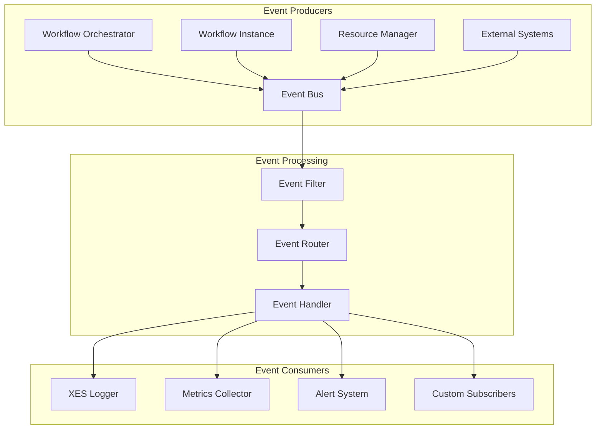

# Event Systems in YAWL

## Overview

YAWL implements a comprehensive event system using the Observer pattern, enabling real-time workflow monitoring, event processing, and reactive behavior. This document explains the event architecture and how to work with events.

## Event Architecture



## Event Types

### 1. Workflow Events

```erlang
-record(workflow_event, {
    event_id :: binary(),
    event_type :: workflow_event_type(),
    workflow_id :: binary(),
    timestamp :: integer(),
    data :: map(),
    metadata :: map()
}).

-type workflow_event_type() ::
    workflow_created |
    workflow_started |
    workflow_paused |
    workflow_resumed |
    workflow_completed |
    workflow_failed |
    workflow_cancelled |
    workflow_timeout.
```

### 2. Workitem Events

```erlang
-record(workitem_event, {
    event_id :: binary(),
    event_type :: workitem_event_type(),
    workitem_id :: binary(),
    workflow_id :: binary(),
    timestamp :: integer(),
    data :: map(),
    metadata :: map()
}).

-type workitem_event_type() ::
    workitem_created |
    workitem_allocated |
    workitem_started |
    workitem_progress |
    workitem_completed |
    workitem_failed |
    workitem_cancelled |
    workitem_timeout.
```

### 3. Resource Events

```erlang
-record(resource_event, {
    event_id :: binary(),
    event_type :: resource_event_type(),
    resource_id :: binary(),
    timestamp :: integer(),
    data :: map(),
    metadata :: map()
}).

-type resource_event_type() ::
    resource_registered |
    resource_available |
    resource_unavailable |
    resource_allocated |
    resource_released |
    resource_error |
    resource_heartbeat.
```

### 4. System Events

```erlang
-record(system_event, {
    event_id :: binary(),
    event_type :: system_event_type(),
    timestamp :: integer(),
    data :: map(),
    metadata :: map()
}).

-type system_event_type() ::
    system_started |
    system_shutdown |
    checkpoint_created |
    checkpoint_restored |
    configuration_changed |
    error_occurred.
```

## Observer Pattern Implementation

### 1. Subject Interface

```erlang
%% Subject behavior for event producers
-callback_mode() -> state_functions.

%% Subject state
-record(subject_state, {
    subject_id :: binary(),
    observers :: [pid()],
    event_history :: [event()],
    config :: map()
}).

%% Add observer
add_observer(ObserverPid, SubjectState) ->
    Observers = SubjectState#subject_state.observers,
    NewState = SubjectState#subject_state{
        observers = [ObserverPid | Observers]
    },
    {next_state, NewState}.

%% Remove observer
remove_observer(ObserverPid, SubjectState) ->
    Observers = SubjectState#subject_state.observers,
    NewState = SubjectState#subject_state{
        observers = lists:delete(ObserverPid, Observers)
    },
    {next_state, NewState}.

%% Notify observers
notify_observers(Event, SubjectState) ->
    Observers = SubjectState#subject_state.observers,
    lists:foreach(fun(ObserverPid) ->
        ObserverPid ! {yawl_event, Event}
    end, Observers),
    {next_state, SubjectState}.
```

### 2. Observer Interface

```erlang
%% Observer behavior
-callback_mode() -> state_functions.

%% Observer state
-record(observer_state, {
    observer_id :: binary(),
    event_filter :: fun((event()) -> boolean()),
    event_handler :: fun((event()) -> any()),
    processed_events :: [event()],
    config :: map()
}).

%% Handle event
handle_event({yawl_event, Event}, ObserverState) ->
    case (ObserverState#observer_state.event_filter)(Event) of
        true ->
            Result = (ObserverState#observer_state.event_handler)(Event),
            NewState = ObserverState#observer_state{
                processed_events = [Event | ObserverState#observer_state.processed_events]
            },
            {next_state, NewState, []};
        false ->
            {next_state, ObserverState, []}
    end.
```

## Event Bus Implementation

### 1. Central Event Bus

```erlang
-module(yawl_event_bus).
-behaviour(gen_server).

%% API
-export([start_link/0, subscribe/2, unsubscribe/2, publish/1]).

%% State
-record(state, {
    subscribers :: #{topic() => [pid()]},
    event_log :: [event()],
    filters :: map()
}).

%% Subscribe to events
subscribe(Topic, SubscriberPid) ->
    gen_server:call(?MODULE, {subscribe, Topic, SubscriberPid}).

%% Publish event
publish(Event) ->
    gen_server:cast(?MODULE, {publish, Event}).

%% Handle subscription
handle_call({subscribe, Topic, SubscriberPid}, _From, State) ->
    Subscribers = maps:get(Topic, State#state.subscribers, []),
    NewSubscribers = [SubscriberPid | Subscribers],
    NewState = State#state{
        subscribers = maps:put(Topic, NewSubscribers, State#state.subscribers)
    },
    {reply, ok, NewState}.

%% Handle unsubscription
handle_call({unsubscribe, Topic, SubscriberPid}, _From, State) ->
    Subscribers = maps:get(Topic, State#state.subscribers, []),
    NewSubscribers = lists:delete(SubscriberPid, Subscribers),
    NewState = State#state{
        subscribers = maps:put(Topic, NewSubscribers, State#state.subscribers)
    },
    {reply, ok, NewState}.

%% Handle publish
handle_cast({publish, Event}, State) ->
    %% Determine topic from event
    Topic = determine_topic(Event),

    %% Get subscribers for topic
    Subscribers = maps:get(Topic, State#state.subscribers, []),

    %% Filter and notify subscribers
    FilteredSubscribers = filter_subscribers(Subscribers, Event),
    lists:foreach(fun(SubscriberPid) ->
        SubscriberPid ! {yawl_event, Event}
    end, FilteredSubscribers),

    %% Log event
    NewState = State#state{
        event_log = [Event | State#state.event_log]
    },
    {noreply, NewState}.

determine_topic(Event) ->
    case Event of
        #workflow_event{} -> workflow;
        #workitem_event{} -> workitem;
        #resource_event{} -> resource;
        #system_event{} -> system
    end.

filter_subscribers(Subscribers, Event) ->
    lists:filter(fun(SubscriberPid) ->
        case get_subscription_filter(SubscriberPid) of
            undefined -> true;
            Filter -> Filter(Event)
        end
    end, Subscribers).
```

### 2. Topic-Based Routing

```erlang
%% Topic definitions
-define(TOPICS, [
    {workflow, <<"All workflow events">>},
    {workflow_created, <<"Workflow created events">>},
    {workflow_completed, <<"Workflow completion events">>},
    {workitem, <<"All workitem events">>},
    {workitem_created, <<"Workitem created events">>},
    {workitem_completed, <<"Workitem completion events">>},
    {resource, <<"All resource events">>},
    {system, <<"System events">>},
    {all, <<"All events">>}
]).

%% Subscribe to topic
subscribe_to_topic(Topic, SubscriberPid) ->
    yawl_event_bus:subscribe(Topic, SubscriberPid).

%% Subscribe with filter
subscribe_to_topic(Topic, SubscriberPid, FilterFun) ->
    yawl_event_bus:subscribe(Topic, SubscriberPid),
    set_subscription_filter(SubscriberPid, FilterFun).

%% Set subscription filter
set_subscription_filter(SubscriberPid, FilterFun) ->
    gen_server:call(yawl_event_bus, {set_filter, SubscriberPid, FilterFun}).
```

## Event Processing

### 1. Event Filtering

```erlang
%% Event filter function
-type event_filter() :: fun((event()) -> boolean()).

%% Create filter by type
filter_by_event_type(EventTypes) ->
    fun(Event) ->
        EventType = get_event_type(Event),
        lists:member(EventType, EventTypes)
    end.

%% Create filter by workflow
filter_by_workflow(WorkflowId) ->
    fun(Event) ->
        case get_workflow_id(Event) of
            undefined -> true;
            EventWorkflowId -> EventWorkflowId =:= WorkflowId
        end
    end.

%% Create filter by priority
filter_by_priority(MinPriority) ->
    fun(Event) ->
        Priority = get_event_priority(Event),
        Priority >= MinPriority
    end.

%% Compose filters
compose_filters(Filters) ->
    fun(Event) ->
        lists:all(fun(Filter) -> Filter(Event) end, Filters)
    end.

%% Apply filters
apply_filters(Event, Filters) ->
    compose_filters(Filters)(Event).
```

### 2. Event Transformation

```erlang
%% Event transformer function
-type event_transformer() :: fun((event()) -> event()).

%% Transform event data
transform_data(TransformerFun) ->
    fun(Event) ->
        Data = get_event_data(Event),
        TransformedData = TransformerFun(Data),
        set_event_data(Event, TransformedData)
    end.

%% Add metadata to event
add_metadata(Metadata) ->
    fun(Event) ->
        ExistingMetadata = get_event_metadata(Event),
        set_event_metadata(Event, maps:merge(ExistingMetadata, Metadata))
    end.

%% Enrich event with context
enrich_with_context(ContextProvider) ->
    fun(Event) ->
        Context = ContextProvider(Event),
        add_metadata(Context)(Event)
    end.
```

### 3. Event Aggregation

```erlang
%% Aggregate events by time window
aggregate_events(WindowMs) ->
    spawn_link(fun() -> aggregation_loop(WindowMs, []) end).

aggregation_loop(WindowMs, Buffer) ->
    receive
        {event, Event} ->
            aggregation_loop(WindowMs, [Event | Buffer]);
        {flush, From} ->
            From ! {aggregated, lists:reverse(Buffer)},
            aggregation_loop(WindowMs, []);
        {stop} ->
            ok
    after WindowMs ->
        case lists:reverse(Buffer) of
            [] ->
                aggregation_loop(WindowMs, []);
            Events ->
                aggregate_and_emit(Events),
                aggregation_loop(WindowMs, [])
        end
    end.

aggregate_and_emit(Events) ->
    Aggregated = aggregate_events_internal(Events),
    yawl_event_bus:publish(Aggregated).

aggregate_events_internal(Events) ->
    %% Group by type
    ByType = lists:foldl(fun(Event, Acc) ->
        Type = get_event_type(Event),
        Acc#{Type => [Event | maps:get(Type, Acc, [])]}
    end, #{}, Events),

    %% Create aggregated event
    #aggregated_event{
        event_id = generate_event_id(),
        timestamp = erlang:monotonic_time(millisecond),
        event_count = length(Events),
        by_type => maps:map(fun(L) -> length(L) end, ByType),
        events => Events
    }.
```

## Event Handlers

### 1. XES Event Handler

```erlang
-module(yawl_xes_handler).
-behaviour(gen_event_handler).

%% Handle workflow event
handle_event(#workflow_event{
    event_type = workflow_started,
    workflow_id = WorkflowId,
    timestamp = Timestamp
} = Event) ->
    CaseId = generate_case_id(WorkflowId),
    yawl_xes_logger:log_case_start(CaseId),
    yawl_xes_logger:log_event(
        CaseId,
        <<"WorkflowStarted">>,
        <<"start">>,
        #{workflow_id => WorkflowId}
    ),
    {ok, Event}.

%% Handle workitem event
handle_event(#workitem_event{
    event_type = workitem_completed,
    workitem_id = WorkitemId,
    workflow_id = WorkflowId,
    timestamp = Timestamp,
    data = Data
} = Event) ->
    CaseId = get_case_id_for_workflow(WorkflowId),
    yawl_xes_logger:log_event(
        CaseId,
        <<"WorkitemCompleted">>,
        <<"complete">>,
        Data#{workitem_id => WorkitemId}
    ),
    {ok, Event}.

%% Handle workflow completion
handle_event(#workflow_event{
    event_type = workflow_completed,
    workflow_id = WorkflowId,
    timestamp = Timestamp,
    data = Data
} = Event) ->
    CaseId = get_case_id_for_workflow(WorkflowId),
    yawl_xes_logger:log_case_complete(
        CaseId,
        #{
            duration_ms => Timestamp - get_start_time(WorkflowId),
            result => Data
        }
    ),
    {ok, Event}.
```

### 2. Metrics Handler

```eraelng
-module(yawl_metrics_handler).
-behaviour(gen_event_handler).

%% State
-record(state, {
    counters :: map(),
    gauges :: map(),
    histograms :: map()
}).

%% Initialize metrics
init() ->
    {ok, #state{
        counters = maps:new(),
        gauges = maps:new(),
        histograms = maps:new()
    }}.

%% Handle event and update metrics
handle_event(Event, State) ->
    NewState = update_metrics(Event, State),
    {ok, NewState}.

update_metrics(#workflow_event{event_type = workflow_started} = Type, workflow_id = Id}, State) ->
    Counters = maps:get(Type, State#state.counters, #{}) + 1,
    State#state{counters = maps:put(Type, Counters, State#state.counters)};

update_metrics(#workflow_event{event_type = workflow_completed}, State) ->
    Counters = maps:get(workflow_completed, State#state.counters, #{}) + 1,
    State#state{counters = maps:put(workflow_completed, Counters, State#state.counters)};

update_metrics(#workitem_event{event_type = workitem_completed, data = Data}, State) ->
    Duration = maps:get(duration_ms, Data, 0),
    Histograms = update_histogram(workitem_duration, Duration, State#state.histograms),
    State#state{histograms = Histograms};

update_metrics(_Event, State) ->
    State.

update_histogram(Key, Value, Histograms) ->
    Current = maps:get(Key, Histograms, #{}),
    %% Update histogram statistics
    NewHistogram = Current#{
        count => Current#histogram.count + 1,
        sum => Current#histogram.sum + Value,
        min => min(Current#histogram.min, Value),
        max => max(Current#histogram.max, Value)
    },
    Histograms#{Key => NewHistogram}.
```

### 3. Alert Handler

```erlang
-module(yawl_alert_handler).
-behaviour(gen_event_handler).

%% Alert configuration
-record(alert_config, {
    failure_threshold :: integer(),
    timeout_threshold :: integer(),
    error_rates :: map()
}).

%% Initialize with config
init(Config) ->
    {ok, #state{
        config = Config,
        failure_counts = #{},
        last_alert = #{}
    }}.

%% Handle event and check alerts
handle_event(#workflow_event{event_type = workflow_failed, workflow_id = Id} = Event, State) ->
    NewState = update_failure_counts(Id, State),

    case should_alert(NewState) of
        true ->
            send_alert(Event, NewState),
            {ok, NewState};
        false ->
            {ok, NewState}
    end;

handle_event(#workitem_event{event_type = workitem_failed, workitem_id = Id} = Event, State) ->
    NewState = update_failure_counts(Id, State),

    case should_alert(NewState) of
        true ->
            send_alert(Event, NewState),
            {ok, NewState};
        false ->
            {ok, NewState}
    end;

handle_event(Event, State) ->
    {ok, State}.

update_failure_counts(Id, State) ->
    Counts = State#state.failure_counts,
    Current = maps:get(Id, Counts, 0) + 1,
    State#state{failure_counts = maps:put(Id, Current, Counts)}.

should_alert(State) ->
    Threshold = State#state.config#alert_config.failure_threshold,
    Counts = State#state.failure_counts,

    %% Check if any threshold exceeded
    lists:any(fun({_, Count}) -> Count >= Threshold end, maps:to_list(Counts)).

send_alert(Event, State) ->
    Alert = #alert{
        alert_id = generate_alert_id(),
        timestamp = erlang:system_time(millisecond),
        event => Event,
        severity = calculate_severity(Event, State),
        data => format_alert_data(Event, State)
    },
    %% Send alert to notification system
    yawl_notification:send_alert(Alert).
```

## Event Publishing

### 1. Publishing Workflow Events

```erlang
%% Publish workflow created event
publish_workflow_created(WorkflowId, PatternType, Config) ->
    Event = #workflow_event{
        event_id = generate_event_id(),
        event_type = workflow_created,
        workflow_id = WorkflowId,
        timestamp = erlang:monotonic_time(millisecond),
        data = #{
            pattern_type => PatternType,
            config => Config
        },
        metadata => #{
            source => yawl_orchestrator
        }
    },
    yawl_event_bus:publish(Event).

%% Publish workflow started event
publish_workflow_started(WorkflowId) ->
    Event = #workflow_event{
        event_id = generate_event_id(),
        event_type = workflow_started,
        workflow_id = WorkflowId,
        timestamp = erlang:monotonic_time(millisecond),
        data => #{},
        metadata = #{
            source => yawl_orchestrator
        }
    },
    yawl_event_bus:publish(Event).

%% Publish workflow completed event
publish_workflow_completed(WorkflowId, Result) ->
    Event = #workflow_event{
        event_id = generate_event_id(),
        event_type = workflow_completed,
        workflow_id = WorkflowId,
        timestamp = erlang:monotonic_time(millisecond),
        data = #{
            result => Result
        },
        metadata => #{
            source => yawl_orchestrator
        }
    },
    yawl_event_bus:publish(Event).
```

### 2. Publishing Workitem Events

```erlang
%% Publish workitem created event
publish_workitem_created(WorkitemId, WorkflowId, TaskName, Data) ->
    Event = #workitem_event{
        event_id = generate_event_id(),
        event_type = workitem_created,
        workitem_id = WorkitemId,
        workflow_id = WorkflowId,
        timestamp = erlang:monotonic_time(millisecond),
        data = #{
            task_name => TaskName,
            data => Data
        },
        metadata => #{
            source => yawl_workflow_instance
        }
    },
    yawl_event_bus:publish(Event).

%% Publish workitem allocated event
publish_workitem_allocated(WorkitemId, ResourceId) ->
    Event = #workitem_event{
        event_id = generate_event_id(),
        event_type = workitem_allocated,
        workitem_id => WorkitemId,
        workflow_id => get_workflow_id_for_workitem(WorkitemId),
        timestamp = erlang:monotonic_time(millisecond),
        data => #{
            resource_id => ResourceId
        },
        metadata = #{
            source => yawl_resource_manager
        }
    },
    yawl_event_bus:publish(Event).

%% Publish workitem completed event
publish_workitem_completed(WorkitemId, Result, Duration) ->
    Event = #workitem_event{
        event_id = generate_event_id(),
        event_type = workitem_completed,
        workitem_id = WorkitemId,
        workflow_id => get_workflow_id_for_workitem(WorkitemId),
        timestamp = erlang:monotonic_time(millisecond),
        data = #{
            result => Result,
            duration_ms => Duration
        },
        metadata => #{
            source => yawl_workflow_instance
        }
    },
    yawl_event_bus:publish(Event).
```

### 3. Publishing Resource Events

```erlang
%% Publish resource allocated event
publish_resource_allocated(ResourceId, WorkitemId) ->
    Event = #resource_event{
        event_id = generate_event_id(),
        event_type = resource_allocated,
        resource_id => ResourceId,
        timestamp = erlang:monotonic_time(millisecond),
        data => #{
            workitem_id => WorkitemId
        },
        metadata => #{
            source => yawl_resource_manager
        }
    },
    yawl_event_bus:publish(Event).

%% Publish resource released event
publish_resource_released(ResourceId, WorkitemId) ->
    Event = #resource_event{
        event_id = generate_event_id(),
        event_type = resource_released,
        resource_id => ResourceId,
        timestamp = erlang:monotonic_time(millisecond),
        data => #{
            workitem_id => WorkitemId
        },
        metadata => #{
            source => yawl_resource_manager
        }
    },
    yawl_event_bus:publish(Event).
```

## Custom Event Subscribers

### 1. Creating Custom Subscribers

```erlang
%% Custom subscriber module
-module(my_workflow_subscriber).
-behaviour(gen_server).

%% Start subscriber
start_link(WorkflowId) ->
    gen_server:start_link({local, ?MODULE}, ?MODULE, [WorkflowId], []).

%% Init - subscribe to events
init([WorkflowId]) ->
    %% Subscribe to workflow events
    yawl_event_bus:subscribe(workflow, self()),

    %% Subscribe to workitem events for this workflow
    Filter = filter_by_workflow(WorkflowId),
    yawl_event_bus:subscribe(workitem, self(), Filter),

    {ok, #state{
        workflow_id = WorkflowId,
        events = []
    }}.

%% Handle incoming events
handle_info({yawl_event, Event}, State) ->
    NewState = State#state{events = [Event | State#state.events]},
    process_event(Event, NewState),
    {noreply, NewState}.

process_event(#workflow_event{event_type = workflow_completed} = Event, State) ->
    io:format("Workflow ~p completed!~n", [Event#workflow_event.workflow_id]),
    %% Perform completion actions
    notify_completion(Event);

process_event(#workitem_event{event_type = workitem_failed} = Event, State) ->
    io:format("Workitem ~p failed~n", [Event#workitem_event.workitem_id]),
    %% Handle failure
    handle_workitem_failure(Event);

process_event(_Event, State) ->
    ok.
```

### 2. Event Pattern Matching

```erlang
%% Pattern match on events
match_events(Patterns) ->
    spawn(fun() -> event_matcher_loop(Patterns) end).

event_matcher_loop(Patterns) ->
    yawl_event_bus:subscribe(all, self()),
    event_match_loop(Patterns).

event_match_loop(Patterns) ->
    receive
        {yawl_event, Event} ->
            lists:foreach(fun({Pattern, Action}) ->
                case match_event(Event, Pattern) of
                    true ->
                        Action(Event);
                    false ->
                        ok
                end
            end, Patterns),
            event_match_loop(Patterns)
    end.

match_event(Event, {PatternType, PatternValue}) ->
    case PatternType of
        event_type ->
            Event#workflow_event.event_type =:= PatternValue;
        workflow_id ->
            Event#workflow_event.workflow_id =:= PatternValue;
        _ ->
            false
    end.
```

## Event Replay and Auditing

### 1. Event Logging

```erlang
%% Log all events for replay
log_event(Event) ->
    LogEntry = #event_log{
        event_id = Event#workflow_event.event_id,
        timestamp = Event#workflow_event.timestamp,
        event_type = get_event_type(Event),
        event_data = Event,
        serialized => term_to_binary(Event)
    },
    yawl_event_log:persist(LogEntry).

%% Replay events from log
replay_events(StartTime, EndTime) ->
    {ok, Events} = yawl_event_log:get_events(StartTime, EndTime),
    lists:foreach(fun(EventLog) ->
        Event = binary_to_term(EventLog#event_log.serialized),
        yawl_event_bus:publish(Event)
    end, Events).
```

### 2. Event Audit Trail

```erlang
%% Generate audit trail for workflow
generate_audit_trail(WorkflowId) ->
    {ok, Events} = get_workflow_events(WorkflowId),

    Trail = lists:map(fun(Event) ->
        #{
            timestamp => Event#workflow_event.timestamp,
            event_type => get_event_type(Event),
            event_id => Event#workflow_event.event_id,
            data => get_event_data(Event),
            metadata => get_event_metadata(Event)
        }
    end, Events),

    #{
        workflow_id => WorkflowId,
        events => Trail,
        event_count => length(Trail),
        start_time => get_first_timestamp(Trail),
        end_time => get_last_timestamp(Trail),
        participants => extract_participants(Trail)
    }.
```

---

Next: [Pattern Categories](pattern-categories.md) ->
