# YAWL Pattern Categories

YAWL implements a comprehensive set of 43 workflow patterns organized into logical categories. This document provides a detailed overview of each pattern category with examples and use cases.

## Pattern Categories Overview

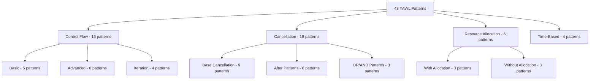

## Control Flow Patterns

### Basic Control Flow (5 patterns)

#### 1. Basic Sequential
**Description**: Simple sequential execution of two tasks.
**Complexity**: Low
**Use Case**: Linear approval processes


```erlang
Config = #{pattern_type => basic_sequential},
{ok, WorkflowId} = yawl_orchestrator:create_workflow(Config).
```

#### 2. Parallel Split
**Description**: Execute multiple tasks in parallel.
**Complexity**: Medium
**Use Case**: Concurrent data processing

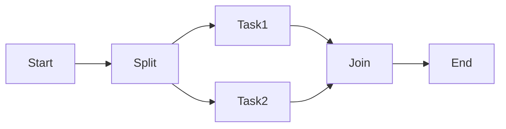

```erlang
Config = #{pattern_type => parallel_split,
           parameters => #{branches => 2}},
{ok, WorkflowId} = yawl_orchestrator:create_workflow(Config).
```

#### 3. Parallel Join
**Description**: Wait for multiple parallel tasks to complete.
**Complexity**: Medium
**Use Case**: Synchronization point

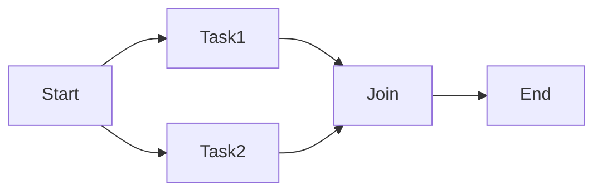

#### 4. Exclusive Choice
**Description**: Choose one path from multiple alternatives.
**Complexity**: Medium
**Use Case**: Conditional branching

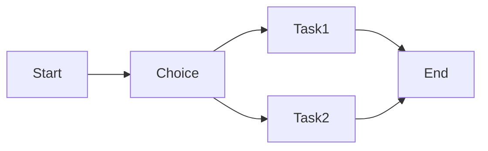

```erlang
Config = #{pattern_type => exclusive_choice,
           parameters => #{conditions => [approved, rejected]}},
{ok, WorkflowId} = yawl_orchestrator:create_workflow(Config).
```

#### 5. Simple Merge
**Description**: Merge multiple paths into one.
**Complexity**: Medium
**Use Case**: Convergence point

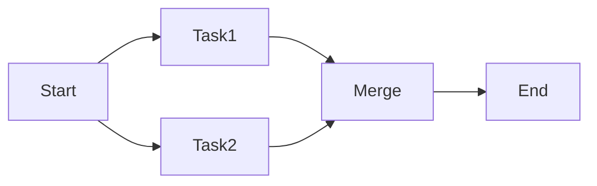

### Advanced Control Flow (6 patterns)

#### 6. Interleaved Parallelism
**Description**: Execute multiple tasks in any order.
**Complexity**: Medium
**Use Case**: Flexible task execution

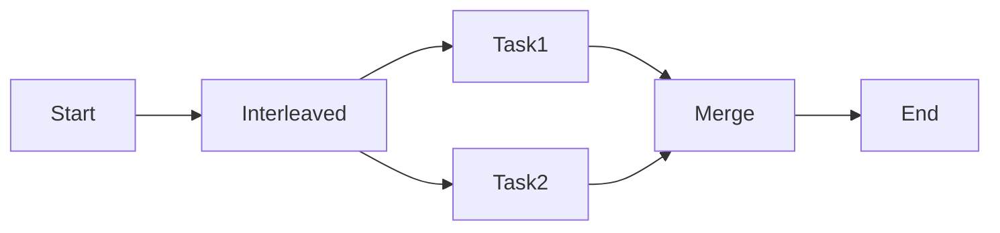

```erlang
Config = #{pattern_type => interleaved_parallelism,
           parameters => #{tasks => [review, approve, notify]}},
{ok, WorkflowId} = yawl_orchestrator:create_workflow(Config).
```

#### 7. Implicit Merge
**Description**: Automatic merge without explicit merge point.
**Complexity**: Medium
**Use Case**: Simple convergence

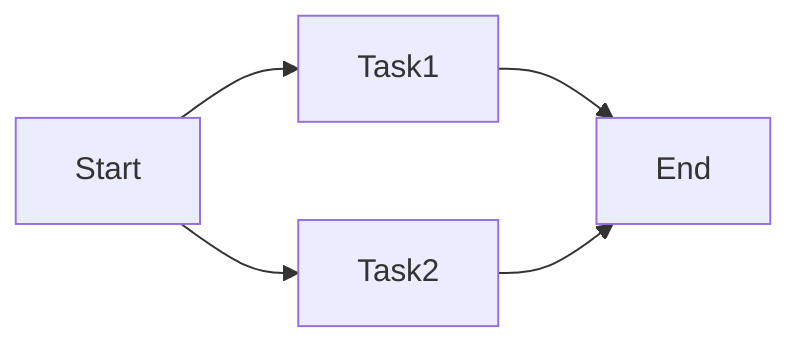

#### 8. Multiple Merge
**Description**: Multiple merge points for complex synchronization.
**Complexity**: High
**Use Case**: Complex workflow orchestration

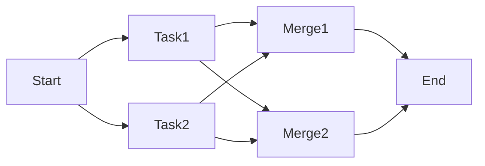

#### 9. Deferred Choice
**Description**: Choose path when task is ready to execute.
**Complexity**: Medium
**Use Case**: Dynamic routing

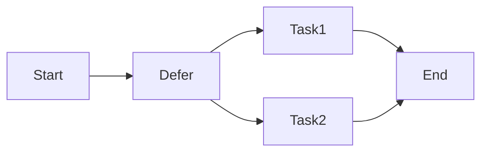

```erlang
Config = #{pattern_type => deferred_choice,
           parameters => #{options => [fast_lane, standard_lane]}},
{ok, WorkflowId} = yawl_orchestrator:create_workflow(Config).
```

#### 10. Interleaved Routing
**Description**: Complex routing with multiple path interleaving.
**Complexity**: High
**Use Case**: Advanced workflow routing

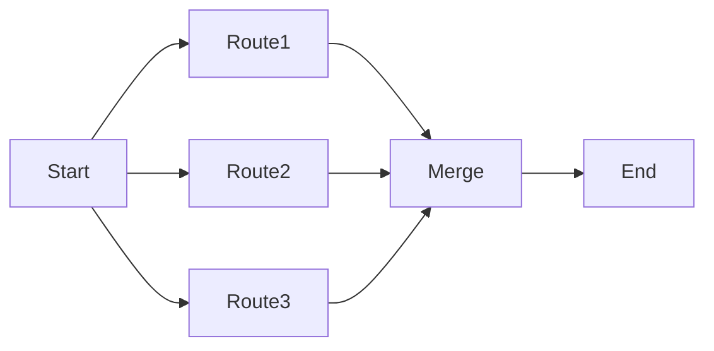

#### 11. Milestone
**Description**: Define and wait for milestone completion.
**Complexity**: Medium
**Use Case**: Key achievement tracking


```erlang
Config = #{pattern_type => milestone,
           parameters => #{milestone_condition => revenue_goal_met}},
{ok, WorkflowId} = yawl_orchestrator:create_workflow(Config).
```

### Iteration Patterns (4 patterns)

#### 12. Iterative Loop
**Description**: Execute task repeatedly while condition is true.
**Complexity**: High
**Use Case**: Data processing loops

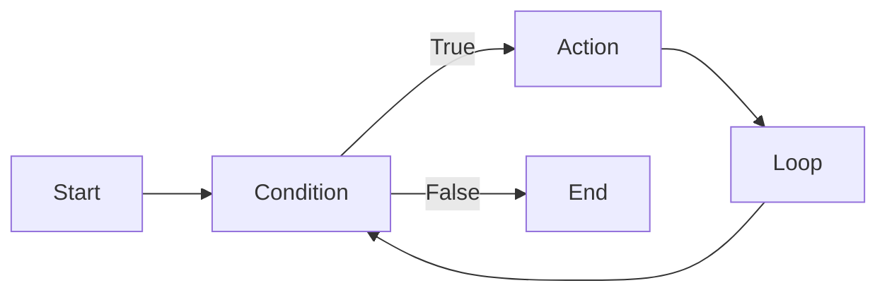

```erlang
Config = #{pattern_type => iterative_loop,
           parameters => #{condition => fun(Data) -> Data > 0 end}},
{ok, WorkflowId} = yawl_orchestrator:create_workflow(Config).
```

#### 13. Multi-Instance
**Description**: Execute task multiple times with different data.
**Complexity**: High
**Use Case**: Batch processing

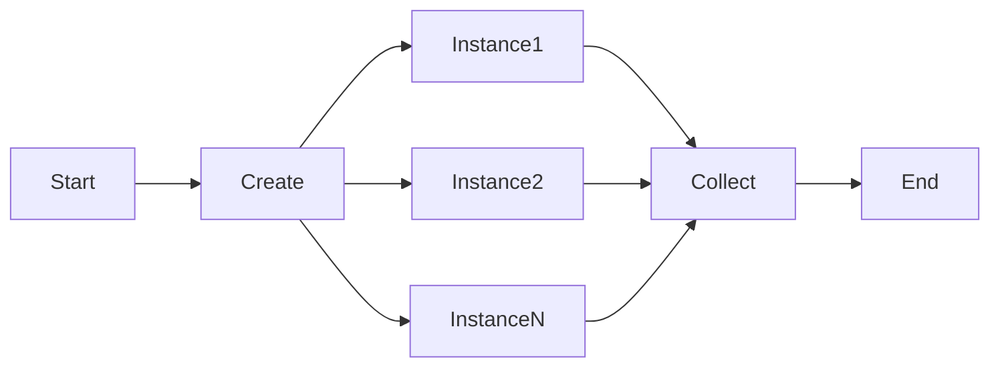

```erlang
Config = #{pattern_type => multi_instance,
           parameters => #{num_instances => 5, data => Items}},
{ok, WorkflowId} = yawl_orchestrator:create_workflow(Config).
```

#### 14. N-Parallel Parallel Split
**Description**: Split into N parallel branches.
**Complexity**: High
**Use Case**: Scalable parallel processing

```erlang
Config = #{pattern_type => n_parallel_split,
           parameters => #{n => 10}},
{ok, WorkflowId} = yawl_orchestrator:create_workflow(Config).
```

#### 15. N-Parallel Parallel Join
**Description**: Join N parallel branches.
**Complexity**: High
**Use Case**: Scalable synchronization

```erlang
Config = #{pattern_type => n_parallel_join,
           parameters => #{n => 10}},
{ok, WorkflowId} = yawl_orchestrator:create_workflow(Config).
```

## Cancellation Patterns

### Base Cancellation (9 patterns)

#### 16. Cancellation
**Description**: Basic workflow cancellation.
**Complexity**: Medium
**Use Case**: Emergency stop

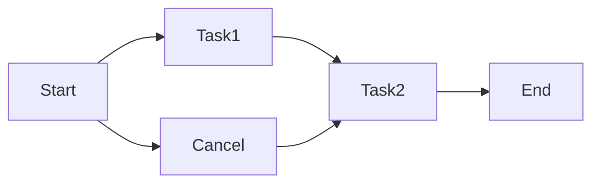

```erlang
Config = #{pattern_type => cancelation,
           parameters => #{cancellation_scope => all}},
{ok, WorkflowId} = yawl_orchestrator:create_workflow(Config).
```

#### 17. Cancellation Block
**Description**: Cancel execution within a block of activities.
**Complexity**: Medium
**Use Case**: Scoped cancellation

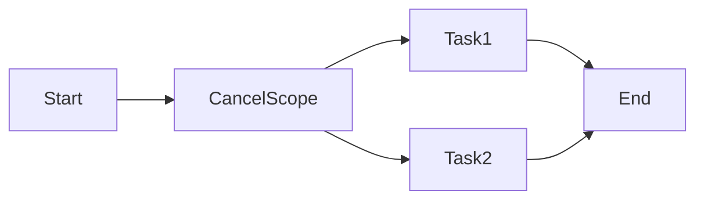

#### 18. Cancellation Scope
**Description**: Cancel within a defined scope.
**Complexity**: Medium
**Use Case**: Nested cancellation

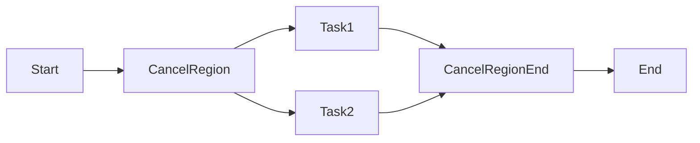

#### 19. Cancellation Thread
**Description**: Cancel a single execution thread.
**Complexity**: Medium
**Use Case**: Thread isolation

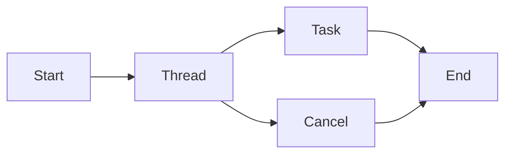

#### 20. Cancellation Subprocess
**Description**: Cancel a subprocess execution.
**Complexity**: Medium
**Use Case**: Subprocess isolation

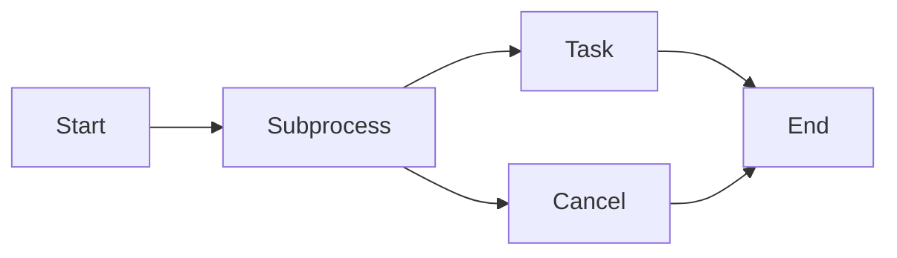

#### 21. Cancellation Multiple Instances
**Description**: Cancel multiple instance executions.
**Complexity**: High
**Use Case**: Batch cancellation


#### 22. Cancellation Point
**Description**: Define explicit cancellation points.
**Complexity**: Medium
**Use Case**: Controlled cancellation

```mermaid
graph LR
    A[Start] --> B[CancelPoint]
    B --> C[Task]
    B --> D[Cancel]
    C --> E[End]
    D --> E
```

#### 23. Cancellation End
**Description**: End of cancellation region.
**Complexity**: Medium
**Use Case**: Region termination

```mermaid
graph LR
    A[Start] --> B[Task]
    B --> C[CancelRegionEnd]
    C --> D[End]
```

#### 24. Cancellation Action
**Description**: Explicit cancellation action.
**Complexity**: Medium
**Use Case**: Programmatic cancellation

```mermaid
graph LR
    A[Start] --> B[CancelTrigger]
    B --> C[Task]
    B --> D[Cancel]
    C --> E[End]
    D --> E
```

### After Patterns (6 patterns)

#### 25. Cancellation Thread After
**Description**: Cancel thread after completion.
**Complexity**: High
**Use Case**: Post-processing cleanup

```erlang
Config = #{pattern_type => 'cancelation_thread_after',
           parameters => #{delay => 5000}},
{ok, WorkflowId} = yawl_orchestrator:create_workflow(Config).
```

#### 26. Cancellation Subprocess After
**Description**: Cancel subprocess after completion.
**Complexity**: High
**Use Case**: Subprocess cleanup

```erlang
Config = #{pattern_type => 'cancelation_subprocess_after',
           parameters => #{delay => 10000}},
{ok, WorkflowId} = yawl_orchestrator:create_workflow(Config).
```

#### 27. Cancellation Multiple Instances After
**Description**: Cancel multiple instances after completion.
**Complexity**: High
**Use Case**: Batch cleanup

```erlang
Config = #{pattern_type => 'cancelation_multiple_instances_after',
           parameters => #{delay => 30000}},
{ok, WorkflowId} = yawl_orchestrator:create_workflow(Config).
```

#### 28. Cancellation Multiple Instances Thread After
**Description**: Cancel multiple instances thread after completion.
**Complexity**: High
**Use Case**: Thread-specific cleanup

```erlang
Config = #{pattern_type => 'cancelation_multiple_instances_thread_after',
           parameters => #{delay => 15000}},
{ok, WorkflowId} = yawl_orchestrator:create_workflow(Config).
```

#### 29. Cancellation Multiple Instances Subprocess After
**Description**: Cancel multiple instances subprocess after completion.
**Complexity**: High
**Use Case**: Subprocess-specific cleanup

```erlang
Config = #{pattern_type => 'cancelation_multiple_instances_subprocess_after',
           parameters => #{delay => 20000}},
{ok, WorkflowId} = yawl_orchestrator:create_workflow(Config).
```

### OR/AND Patterns (3 patterns)

#### 30. Cancellation Thread OR
**Description**: Cancel thread with OR conditions.
**Complexity**: High
**Use Case**: Conditional cancellation

```erlang
Config = #{pattern_type => cancelation_thread_or,
           parameters => #{conditions => [error, timeout]}},
{ok, WorkflowId} = yawl_orchestrator:create_workflow(Config).
```

#### 31. Cancellation Subprocess OR
**Description**: Cancel subprocess with OR conditions.
**Complexity**: High
**Use Case**: Subprocess conditional cancellation

```erlang
Config = #{pattern_type => cancelation_subprocess_or,
           parameters => #{conditions => [failure, deadline]}},
{ok, WorkflowId} = yawl_orchestrator:create_workflow(Config).
```

#### 32. Cancellation Thread AND
**Description**: Cancel thread with AND conditions.
**Complexity**: High
**Use Case**: Strict conditional cancellation

```erlang
Config = #{pattern_type => cancelation_thread_and,
           parameters => #{conditions => [error, timeout]}},
{ok, WorkflowId} = yawl_orchestrator:create_workflow(Config).
```

## Resource Allocation Patterns

### With Allocation (3 patterns)

#### 33. Implicit Merge With Allocation
**Description**: Implicit merge with resource allocation.
**Complexity**: High
**Use Case**: Resource-convergent workflows

```erlang
Config = #{pattern_type => implicit_merge_with_allocation,
           parameters => #{capabilities => [expert]}},
{ok, WorkflowId} = yawl_orchestrator:create_workflow(Config).
```

#### 34. Multiple Merge With Allocation
**Description**: Multiple merge with resource allocation.
**Complexity**: High
**Use Case**: Complex resource orchestration

```erlang
Config = #{pattern_type => multiple_merge_with_allocation,
           parameters => #{capabilities => [specialist]}},
{ok, WorkflowId} = yawl_orchestrator:create_workflow(Config).
```

#### 35. Deferred Choice With Allocation
**Description**: Deferred choice with resource allocation.
**Complexity**: High
**Use Case**: Dynamic resource routing

```erlang
Config = #{pattern_type => deferred_choice_with_allocation,
           parameters => #{options => [junior, senior]}},
{ok, WorkflowId} = yawl_orchestrator:create_workflow(Config).
```

### Without Allocation (3 patterns)

#### 36. Implicit Merge Without Allocation
**Description**: Implicit merge without resource allocation.
**Complexity**: Medium
**Use Case**: Simple convergence

```erlang
Config = #{pattern_type => implicit_merge_without_allocation},
{ok, WorkflowId} = yawl_orchestrator:create_workflow(Config).
```

#### 37. Multiple Merge Without Allocation
**Description**: Multiple merge without resource allocation.
**Complexity**: High
**Use Case**: Complex workflow convergence

```erlang
Config = #{pattern_type => multiple_merge_without_allocation},
{ok, WorkflowId} = yawl_orchestrator:create_workflow(Config).
```

#### 38. Deferred Choice Without Allocation
**Description**: Deferred choice without resource allocation.
**Complexity**: Medium
**Use Case**: Dynamic routing without resources

```erlang
Config = #{pattern_type => deferred_choice_without_allocation},
{ok, WorkflowId} = yawl_orchestrator:create_workflow(Config).
```

## Time-Based Patterns

### Revenue Task Patterns (4 patterns)

#### 39. Timed Trigger
**Description**: Execute task at specific time.
**Use Case**: Scheduled billing, reminders

```erlang
Config = #{pattern_type => timed_trigger,
           parameters => #{trigger_time => <<"2024-12-31T23:59:59Z">>}},
{ok, WorkflowId} = yawl_orchestrator:create_workflow(Config).
```

#### 40. Timeout Pattern
**Description**: Cancel task after timeout.
**Use Case**: Deadline management

```erlang
Config = #{pattern_type => timeout_pattern,
           parameters => #{timeout => 30000}},
{ok, WorkflowId} = yawl_orchestrator:create_workflow(Config).
```

#### 41. Scheduled Execution
**Description**: Execute on schedule with interval.
**Use Case**: Periodic billing, maintenance

```erlang
Config = #{pattern_type => scheduled_execution,
           parameters => #{interval => monthly, day => 1}},
{ok, WorkflowId} = yawl_orchestrator:create_workflow(Config).
```

#### 42. Deadline Pattern
**Description**: Complete by deadline or fail.
**Use Case**: Time-critical processes

```erlang
Config = #{pattern_type => deadline_pattern,
           parameters => #{deadline => <<"2024-12-31T23:59:59Z">>}},
{ok, WorkflowId} = yawl_orchestrator:create_workflow(Config).
```

## Pattern Selection Guide

### By Use Case

| Use Case | Recommended Patterns |
|----------|-------------------|
| **Simple Approval** | Basic Sequential, Exclusive Choice |
| **Parallel Processing** | Parallel Split, Parallel Join |
| **Batch Processing** | Multi-Instance, N-Parallel |
| **Complex Routing** | Deferred Choice, Interleaved Routing |
| **Error Handling** | Cancellation patterns, Timeout |
| **Resource Management** | Resource allocation patterns |
| **Time-Based** | Timed Trigger, Scheduled Execution |

### By Complexity

| Complexity Level | Patterns | Use Case |
|------------------|----------|----------|
| **Simple** | Basic Sequential, Exclusive Choice | Linear processes |
| **Medium** | Parallel Split/Cancellation | Standard workflows |
| **Advanced** | Multi-Instance, OR/AND | Complex orchestration |
| **Expert** | Time-based, Nested | Specialized scenarios |

## Pattern Validation

All patterns are validated before execution:

```erlang
% Validate pattern configuration
{ok, IsValid} = yawl_orchestrator:validate_pattern(PatternType, Config).

% Get pattern information
{ok, PatternInfo} = yawl_orchestrator:get_pattern_info(PatternType).

% Check if pattern has cancellation
IsCancellation = yawl_patterns:is_cancellation_pattern(PatternType).

% Check if pattern uses resources
UsesResources = yawl_patterns:is_resource_pattern(PatternType).
```

---

Next: [A2A Integration](a2a-integration.md) →