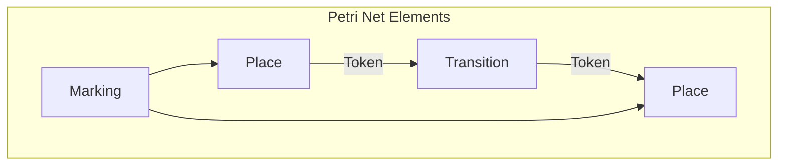
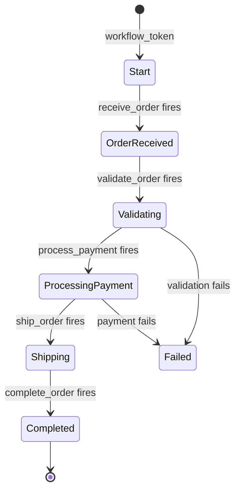
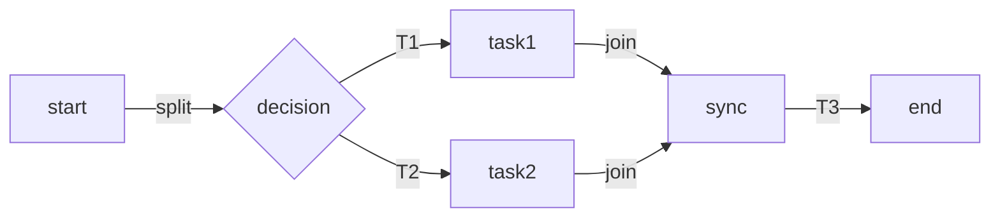
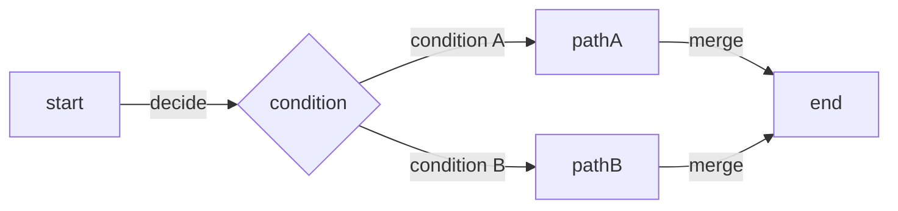

# Petri Net Foundation for YAWL

## Overview

YAWL is built on Petri net theory, providing a formal mathematical foundation for workflow modeling. This document explains Petri net concepts and how they are implemented in YAWL.

## Petri Net Fundamentals

### Basic Components



**Places**: Represent conditions or states in the workflow.
**Transitions**: Represent actions or events that change state.
**Tokens**: Represent flow control or data that moves through the workflow.
**Markings**: The distribution of tokens across places at a given moment.

### Formal Definition

A Petri net is a 5-tuple (P, T, I, O, M) where:

- **P**: A finite set of places
- **T**: A finite set of transitions (P and T are disjoint)
- **I**: Input function (places to transitions)
- **O**: Output function (transitions to places)
- **M**: Marking (token distribution)

```erlang
% Petri net structure in YAWL
-record(pnet, {
    places :: [place()],           % Set of places
    transitions :: [transition()], % Set of transitions
    input_fun :: fun(),            % Input function
    output_fun :: fun(),           % Output function
    marking :: map()              % Current marking
}).
```

## YAWL Petri Net Implementation

### 1. Places in YAWL

Places represent workflow states:

```erlang
% Example places for an order workflow
place_lst() ->
    [
        start,              % Initial state
        order_received,     % Order has been received
        validating,         % Order is being validated
        processing_payment, % Payment is being processed
        shipping,           % Order is being shipped
        completed,          % Order completed successfully
        failed              % Order failed
    ].
```

### 2. Transitions in YAWL

Transitions represent actions or events:

```erlang
% Example transitions for an order workflow
trsn_lst() ->
    [
        receive_order,      % Receive new order
        validate_order,     % Validate order details
        process_payment,    % Process payment
        ship_order,         % Ship the order
        complete_order,     % Mark as complete
        handle_failure      % Handle any failure
    ].
```

### 3. Marking in YAWL

Marking determines which tokens are in which places:

```erlang
% Initial marking - start with one token at 'start'
init_marking(start, _UsrInfo) ->
    [workflow_token];
init_marking(_Place, _UsrInfo) ->
    [].

% Example marking during execution
Marking = #{
    start => [],
    order_received => [{order, OrderData}],
    validating => [],
    processing_payment => [{payment, PaymentData}],
    shipping => [],
    completed => [],
    failed => []
}.
```

### 4. Input/Output Functions

```erlang
% Preset - input places for a transition
preset(receive_order) -> [start];
preset(validate_order) -> [order_received];
preset(process_payment) -> [validating];
preset(ship_order) -> [processing_payment];
preset(complete_order) -> [shipping];
preset(handle_failure) -> [failed].

% Postset - output places for a transition
postset(receive_order) -> [order_received];
postset(validate_order) -> [validating];
postset(process_payment) -> [processing_payment];
postset(ship_order) -> [shipping];
postset(complete_order) -> [completed];
postset(handle_failure) -> [failed].
```

## Petri Net Execution

### Transition Firing Rules

A transition can fire when:
1. It is enabled (all input places have tokens)
2. The firing rule conditions are satisfied

```erlang
% Check if transition is enabled
is_enabled(Transition, Mode, _UsrInfo) ->
    InputPlaces = preset(Transition),
    lists:all(fun(Place) ->
        has_token(Place, Mode)
    end, InputPlaces).

% Check if place has tokens
has_token(Place, Mode) ->
    case maps:get(Place, Mode, []) of
        [] -> false;
        _ -> true
    end.

% Fire the transition
fire(Transition, Mode, UsrInfo) ->
    % Consume tokens from input places
    % Produce tokens in output places
    OutputTokens = execute_transition_logic(Transition, UsrInfo),
    {produce, produce_marking(Transition, OutputTokens)}.
```

### Token Flow Example



## Advanced Petri Net Concepts

### 1. Colored Petri Nets

YAWL extends basic Petri nets with colored tokens:

```erlang
% Colored tokens carry data
-record(token, {
    color :: token_color(),
    data :: map()
}).

-type token_color() :: workflow | order | payment | shipment | completion | error.

% Create colored token
create_workflow_token(Data) ->
    #token{color = workflow, data = Data}.

% Create order token
create_order_token(OrderData) ->
    #token{color = order, data = OrderData}.
```

### 2. Hierarchical Petri Nets

YAWL supports hierarchical workflow composition:

```erlang
% High-level workflow
parent_workflow() ->
    #{
        places => [start, subprocess, end],
        transitions => [start_subprocess, end_subprocess],
        subworkflows => #{
            subprocess => child_workflow_spec()
        }
    }.

% Child workflow specification
child_workflow_spec() ->
    #{
        module => payment_processing_workflow,
        input_places => [payment_init],
        output_places => [payment_complete]
    }.
```

### 3. Timed Petri Nets

YAWL supports time-based transitions:

```erlang
% Timed transition
-record(timed_transition, {
    transition :: transition(),
    delay :: integer(),           % Delay in milliseconds
    absolute_time :: integer()   % Absolute firing time
}).

% Check if timed transition is enabled
is_timed_transition_enabled(TimedTransition, CurrentTime) ->
    case TimedTransition of
        #timed_transition{absolute_time = Time} when Time =< CurrentTime ->
            true;
        #timed_transition{delay = Delay, start_time = Start}
            when Start + Delay =< CurrentTime ->
            true;
        _ ->
            false
    end.
```

### 4. Inhibitor Arcs

YAWL supports inhibitor arcs for complex conditions:

```erlang
% Inhibitor arc - transition fires only when place has NO tokens
-record(inhibitor_arc, {
    place :: place(),
    transition :: transition()
}).

% Check inhibitor condition
check_inhibitor(InhibitorArc, Mode) ->
    Place = InhibitorArc#inhibitor_arc.place,
    not has_token(Place, Mode).
```

## Petri Net Properties

### 1. Boundedness

A Petri net is bounded if there's a maximum number of tokens in any place:

```erlang
% Check if place is bounded
is_bounded(Place, MaxTokens, MarkingHistory) ->
    lists:all(fun(Marking) ->
        TokenCount = length(maps:get(Place, Marking, [])),
        TokenCount =< MaxTokens
    end, MarkingHistory).
```

### 2. Liveness

A Petri net is live if every transition can eventually fire:

```erlang
% Check if transition is live
is_live(Transition, Net) ->
    % Check if transition can fire from some reachable marking
    ReachableMarkings = get_reachable_markings(Net),
    lists:any(fun(Marking) ->
        is_enabled(Transition, Marking, #{})
    end, ReachableMarkings).
```

### 3. Reachability

Determining which states are reachable from the initial state:

```erlang
% Get all reachable markings
get_reachable_markings(Net) ->
    InitialMarking = Net#pnet.marking,
    explore_reachable([InitialMarking], [], Net).

explore_reachable([], Visited, _Net) ->
    lists:reverse(Visited);
explore_reachable([Current | Rest], Visited, Net) ->
    case lists:member(Current, Visited) of
        true ->
            explore_reachable(Rest, Visited, Net);
        false ->
            NextMarkings = fire_all_enabled(Current, Net),
            explore_reachable(NextMarkings ++ Rest, [Current | Visited], Net)
    end.

% Fire all enabled transitions
fire_all_enabled(Marking, Net) ->
    Transitions = Net#pnet.transitions,
    lists:filtermap(fun(Transition) ->
        case is_enabled(Transition, Marking, #{}) of
            true ->
                {ok, fire_transition(Transition, Marking, #{})};
            false ->
                false
        end
    end, Transitions).
```

### 4. Deadlock Detection

Detecting potential deadlocks in the workflow:

```erlang
% Check for potential deadlock
check_deadlock(Net) ->
    CurrentMarking = get_current_marking(Net),
    case fire_all_enabled(CurrentMarking, Net) of
        [] ->
            % No transitions can fire - potential deadlock
            {deadlock, CurrentMarking};
        _ ->
            {ok, no_deadlock}
    end.

% Validate workflow is deadlock-free
validate_deadlock_free(Net) ->
    ReachableMarkings = get_reachable_markings(Net),
    DeadlockMarkings = lists:filter(fun(Marking) ->
        fire_all_enabled(Marking, Net) == []
    end, ReachableMarkings),

    case DeadlockMarkings of
        [] ->
            {ok, deadlock_free};
        _ ->
            {error, potential_deadlocks, DeadlockMarkings}
    end.
```

## YAWL Petri Net Extensions

### 1. Reset Arcs

Reset arcs clear all tokens from a place when transition fires:

```erlang
-record(reset_arc, {
    place :: place(),
    transition :: transition()
}).

% Handle reset arc during firing
handle_reset_arc(ResetArc, Marking) ->
    Place = ResetArc#reset_arc.place,
    Marking#{Place => []}.
```

### 2. Priority Transitions

Transitions with priority levels:

```erlang
-record(priority_transition, {
    transition :: transition(),
    priority :: integer()  % Higher number = higher priority
}).

% Select highest priority enabled transition
select_highest_priority(EnabledTransitions) ->
    lists:max(fun(#priority_transition{priority = P1},
                  #priority_transition{priority = P2}) ->
        P1 >= P2
    end, EnabledTransitions).
```

### 3. Guard Conditions

Transitions can have guard conditions:

```erlang
-record(guarded_transition, {
    transition :: transition(),
    guard :: fun((map()) -> boolean())
}).

% Check if guarded transition is enabled
is_guarded_enabled(GuardedTransition, Mode, UsrInfo) ->
    Guard = GuardedTransition#guarded_transition.guard,
    Transition = GuardedTransition#guarded_transition.transition,

    is_enabled(Transition, Mode, UsrInfo) andalso Guard(UsrInfo).
```

## Analysis and Verification

### 1. State Space Analysis

```erlang
% Build complete state space
build_state_space(Net) ->
    InitialMarking = Net#pnet.marking,
    build_state_space([{InitialMarking, []}], #{}).

build_state_space([], StateSpace) ->
    StateSpace;
build_state_space([{Marking, Path} | Rest], StateSpace) ->
    case maps:is_key(Marking, StateSpace) of
        true ->
            build_state_space(Rest, StateSpace);
        false ->
            NewStateSpace = StateSpace#{Marking => Path},
            NextMarkings = fire_all_enabled(Marking, Net),
            NewPaths = [{M, [Marking | Path]} || M <- NextMarkings],
            build_state_space(NewPaths ++ Rest, NewStateSpace)
    end.
```

### 2. Invariant Checking

```erlang
% Define state invariants
-spec invariant(Marking :: map()) -> boolean().

invariant(Marking) ->
    % Example: at most one order in processing
    ProcessingCount = length(maps:get(processing_payment, Marking, [])),
    ProcessingCount =< 1.
```

### 3. Soundness Verification

YAWL workflows should satisfy soundness properties:

```erlang
% Check workflow soundness
check_soundness(WorkflowDef) ->
    % Option to complete: from any reachable state, can reach completion
    ProperCompletion = check_proper_completion(WorkflowDef),

    % No dead tasks: no transitions that are dead
    NoDeadTasks = check_no_dead_transitions(WorkflowDef),

    % Proper completion: workflow can terminate properly
    Termination = check_termination(WorkflowDef),

    case {ProperCompletion, NoDeadTasks, Termination} of
        {true, true, true} ->
            {ok, sound};
        _ ->
            {error, unsound, #{
                proper_completion => ProperCompletion,
                no_dead_tasks => NoDeadTasks,
                termination => Termination
            }}
    end.
```

## Practical Examples

### 1. Sequential Workflow


```erlang
sequential_workflow() ->
    #{
        places => [start, task1, task2, end],
        transitions => [t1, t2, t3],
        preset => #{
            t1 => [start],
            t2 => [task1],
            t3 => [task2]
        },
        postset => #{
            t1 => [task1],
            t2 => [task2],
            t3 => [end]
        },
        initial_marking => #{start => [token]}
    }.
```

### 2. Parallel Workflow



```erlang
parallel_workflow() ->
    #{
        places => [start, decision, task1, task2, sync, end],
        transitions => [split, t1, t2, join, t3],
        preset => #{
            split => [start],
            t1 => [decision],
            t2 => [decision],
            join => [task1, task2],
            t3 => [sync]
        },
        postset => #{
            split => [decision],
            t1 => [task1],
            t2 => [task2],
            join => [sync],
            t3 => [end]
        },
        initial_marking => #{start => [token]}
    }.
```

### 3. Choice Workflow



```erlang
choice_workflow() ->
    #{
        places => [start, condition, pathA, pathB, end],
        transitions => [decide, chooseA, chooseB, merge],
        preset => #{
            decide => [start],
            chooseA => [condition],
            chooseB => [condition],
            merge => [pathA, pathB]
        },
        postset => #{
            decide => [condition],
            chooseA => [pathA],
            chooseB => [pathB],
            merge => [end]
        },
        guards => #{
            chooseA => fun(Data) -> maps:get(value, Data) > 100 end,
            chooseB => fun(Data) -> maps:get(value, Data) =< 100 end
        },
        initial_marking => #{start => [token]}
    }.
```

## Performance Considerations

### 1. Marking Optimization

```erlang
% Use efficient data structures for marking
-type marking() :: #{place() => [token()]}.

% Optimize token operations
add_token(Place, Token, Marking) ->
    CurrentTokens = maps:get(Place, Marking, []),
    Marking#{Place => [Token | CurrentTokens]}.

remove_token(Place, Token, Marking) ->
    CurrentTokens = maps:get(Place, Marking, []),
    NewTokens = lists:delete(Token, CurrentTokens),
    Marking#{Place => NewTokens}.
```

### 2. Transition Caching

```erlang
% Cache transition information
-record(transition_cache, {
    preset_cache :: #{transition() => [place()]},
    postset_cache :: #{transition() => [place()]},
    guard_cache :: #{transition() -> fun()}
}).

% Build cache once, reuse many times
build_transition_cache(Transitions, PresetFun, PostsetFun) ->
    lists:foldl(fun(T, Cache) ->
        Cache#transition_cache{
            preset_cache = maps:put(T, PresetFun(T), Cache#transition_cache.preset_cache),
            postset_cache = maps:put(T, PostsetFun(T), Cache#transition_cache.postset_cache)
        }
    end, #transition_cache{}, Transitions).
```

---

Next: [State Machines](state-machines.md) ->
