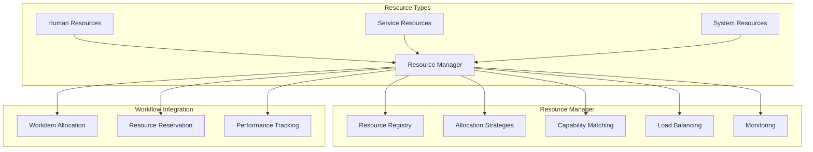

# YAWL Resource Management

The YAWL resource manager provides sophisticated resource allocation capabilities for workflow execution. It manages human resources, services, and system resources with dynamic allocation strategies and comprehensive monitoring.

## Resource Management Overview

The resource manager handles three types of resources:

- **Human Resources**: People with specific capabilities and skills
- **Service Resources**: External systems and APIs
- **System Resources**: Internal services and processes



## Resource Types and Properties

### 1. Resource Types

```erlang
% Resource type definitions
-type resource_type() :: human | service | system.

% Resource status
-type resource_status() :: available | busy | offline | maintenance.

% Resource allocation type
-type resource_allocation_type() :: with_allocation | without_allocation.
```

### 2. Resource Structure

```erlang
% Persistent resource representation
-record(yawl_resource_persist, {
    resource_id :: binary(),         % Unique resource identifier
    resource_type :: resource_type(),% Type classification
    name :: binary(),                % Human-readable name
    capabilities :: [atom()],         % List of capabilities
    attributes :: map(),             % Additional properties
    status :: resource_status(),     % Current availability
    current_load :: integer(),       % Current load/usage
    max_capacity :: integer(),       # Maximum capacity
    last_heartbeat :: integer(),      % Last activity timestamp
    metadata :: map()                % Custom metadata
}).
```

### 3. Resource Capabilities

Resources are defined by their capabilities rather than specific types:

```erlang
% Capability examples
-approval           % Can approve tasks
-review            % Can review workitems
-payment_processing% Can process payments
-data_analysis      % Can analyze data
-technical_support % Can provide technical support
-management        % Can manage workflows
```

## Resource Registration and Management

### 1. Registering Resources

```erlang
% Register basic resource
{ok, ResourceId} = yawl_resource_manager:register_resource(
    <<"john_doe">>,
    human
).

% Register resource with capabilities
{ok, ResourceId} = yawl_resource_manager:register_resource(
    <<"payment_service">>,
    service,
    #{capabilities => [payment_processing, billing]}
).

% Register resource with full configuration
{ok, ResourceId} = yawl_resource_manager:register_resource(
    <<"data_cluster">>,
    system,
    #{
        capabilities => [data_processing, storage],
        max_capacity => 100,
        attributes => #{cpu => 16, memory => 64, location => "us-east-1"},
        metadata => #{owner => "data-team", environment => "production"}
    }
).
```

### 2. Resource Configuration

```erlang
% Update resource status
ok = yawl_resource_manager:update_resource_status(ResourceId, busy).

% Update resource load
ok = yawl_resource_manager:update_resource_load(ResourceId, 75).

% Add capabilities
ok = yawl_resource_manager:add_capability(ResourceId, new_capability).

% Remove capabilities
ok = yawl_resource_manager:remove_capability(ResourceId, old_capability).

% Set resource properties
ResourceProps = #{
    max_capacity => 200,
    attributes => #{priority => high, auto_scaling => true},
    metadata => #{backup => true, maintenance_window => "02:00-04:00"}
},
ok = yawl_resource_manager:update_resource(ResourceId, ResourceProps).
```

### 3. Resource Discovery

```erlang
% List all resources
{ok, AllResources} = yawl_resource_manager:list_resources().

% List resources by type
{ok, HumanResources} = yawl_resource_manager:list_resources_by_type(human).

% Find resources with specific capability
{ok, Approvers} = yawl_resource_manager:find_resources_by_capability(approval).

% Find resources with multiple capabilities (AND)
{ok, Reviewers} = yawl_resource_manager:find_resources_by_capabilities(
    [review, technical_review]
).

% Find available resources
{ok, AvailableResources} = yawl_resource_manager:list_available_resources().
```

## Resource Allocation Strategies

The system supports multiple allocation strategies for different use cases:

### 1. Allocation Strategy Types

```erlang
% Strategy types
-type allocation_strategy() :: round_robin | least_loaded | random.
```

### 2. Strategy Configuration

```erlang
% Set allocation strategy
ok = yawl_resource_manager:set_allocation_strategy(least_loaded).

% Get current strategy
{ok, Strategy} = yawl_resource_manager:get_allocation_strategy().

% Strategy-specific configuration
StrategyConfig = #{
    round_robin => #{resource_groups => [reviewers, approvers]},
    least_loaded => #{load_threshold => 80},
    random => #{seed => random:seed()}
},
ok = yawl_resource_manager:set_strategy_config(StrategyConfig).
```

### 3. Implementation Details

#### Round Robin Strategy

```erlang
% Round robin selection
select_by_round_robin(ResourceIds, Resources, RoundRobinState) ->
    ResourceTypes = lists:usort([R#yawl_resource_persist.resource_type || R <- Resources]),

    select_by_type_round_robin(ResourceTypes, ResourceIds, Resources, RoundRobinState, 1).

select_by_type_round_robin([], _ResourceIds, _Resources, _RoundRobinState, _Depth) ->
    undefined;
select_by_type_round_robin([Type | Rest], ResourceIds, Resources, RoundRobinState, Depth) ->
    TypeResources = get_resources_by_type(Type, ResourceIds, Resources),

    if TypeResources =/= [] ->
        NextIndex = maps:get(Type, RoundRobinState, 0),
        SelectedIndex = NextIndex rem length(TypeResources),
        SelectedId = lists:nth(SelectedIndex + 1, TypeResources),

        UpdateRoundRobin = RoundRobinState#{Type => NextIndex + 1},
        {SelectedId, UpdateRoundRobin};
    true ->
        select_by_type_round_robin(Rest, ResourceIds, Resources, RoundRobinState, Depth + 1)
    end.
```

#### Least Loaded Strategy

```erlang
% Least loaded selection
select_by_least_loaded(ResourceIds, Resources) ->
    AvailableResources = filter_available_resources(ResourceIds, Resources),

    case AvailableResources of
        [] -> undefined;
        _ ->
            % Select resource with minimum load
            lists:min_by(fun(Resource) -> Resource#yawl_resource_persist.current_load end, AvailableResources)
    end.
```

#### Random Strategy

```erlang
% Random selection with bias
select_by_random(ResourceIds, Resources) ->
    AvailableResources = filter_available_resources(ResourceIds, Resources),

    case AvailableResources of
        [] -> hd(Resources); % Fallback
        _ ->
            % Weight random selection by available capacity
            WeightedResources = calculate_weights(AvailableResources),
            select_weighted_random(WeightedResources)
    end.
```

## Resource Allocation Workflow

### 1. Basic Allocation

```erlang
% Allocate resource for workitem
{ok, ResourceId, Resource} = yawl_resource_manager:allocate_resource(
    WorkitemId,
    [capability1, capability2]
).

% Allocate specific resource type
{ok, ResourceId, Resource} = yawl_resource_manager:allocate_resource(
    WorkitemId,
    human,
    [approval]
).

% Allocate with timeout
{ok, ResourceId, Resource} = yawl_resource_manager:allocate_resource(
    WorkitemId,
    [capability1, capability2],
    timeout => 5000
).
```

### 2. Advanced Allocation Scenarios

```erlang
% Allocate with priority
allocate_with_priority(WorkitemId, RequiredCapabilities) ->
    {ok, Resources} = yawl_resource_manager:find_resources_by_capabilities(RequiredCapabilities),
    PrioritizedResources = prioritize_resources(Resources),
    case PrioritizedResources of
        [] -> {error, no_resources_available};
        [Resource | _] ->
            yawl_resource_manager:allocate_resource(WorkitemId, Resource#yawl_resource_persist.resource_id)
    end.

% Allocate with capacity constraints
allocate_with_capacity(WorkitemId, RequiredCapabilities, MaxLoad) ->
    {ok, Resources} = yawl_resource_manager:find_resources_by_capabilities(RequiredCapabilities),
    SuitableResources = lists:filter(fun(R) ->
        R#yawl_resource_persist.current_load < MaxLoad
    end, Resources),

    case SuitableResources of
        [] -> {error, insufficient_capacity};
        _ ->
            {ok, ResourceId, _} = yawl_resource_manager:allocate_resource(
                WorkitemId,
                hd(SuitableResources)#yawl_resource_persist.resource_id
            )
    end.
```

### 3. Resource Release

```erlang
% Release resource allocation
ok = yawl_resource_manager:release_resource(WorkitemId).

% Release specific resource
ok = yawl_resource_manager:release_resource(WorkitemId, ResourceId).

% Release all resources for a workflow
release_workflow_resources(WorkflowId) ->
    {ok, Workitems} = yawl_persistence:list_workitems(WorkflowId),
    lists:foreach(fun(Workitem) ->
        ok = yawl_resource_manager:release_resource(Workitem#yawl_workitem_persist.workitem_id)
    end, Workitems).
```

## Resource Monitoring and Analytics

### 1. Real-time Monitoring

```erlang
% Get resource status
{ok, Resource} = yawl_resource_manager:get_resource(ResourceId).

% Get system-wide resource statistics
Stats = #{
    total_resources => yawl_resource_manager:list_resources(),
    available_resources => yawl_resource_manager:list_available_resources(),
    utilization_rate => calculate_utilization_rate(),
    capacity_remaining => calculate_remaining_capacity()
}.
```

### 2. Performance Metrics

```erlang
% Track allocation efficiency
allocation_metrics() ->
    TotalAllocations = get_total_allocations(),
    SuccessfulAllocations = get_successful_allocations(),
    FailedAllocations = get_failed_allocations(),

    #{
        total => TotalAllocations,
        success_rate => SuccessfulAllocations / TotalAllocations,
        failure_rate => FailedAllocations / TotalAllocations,
        average_allocation_time => get_average_allocation_time()
    }.

% Track resource utilization
utilization_metrics() ->
    Resources = yawl_resource_manager:list_resources(),
    Utilization = lists:map(fun(Resource) ->
        #{
            resource_id => Resource#yawl_resource_persist.resource_id,
            type => Resource#yawl_resource_persist.resource_type,
            current_load => Resource#yawl_resource_persist.current_load,
            max_capacity => Resource#yawl_resource_persist.max_capacity,
            utilization_percentage => (Resource#yawl_resource_persist.current_load /
                                    Resource#yawl_resource_persist.max_capacity) * 100,
            capabilities => Resource#yawl_resource_persist.capabilities
        }
    end, Resources).
```

### 3. Health Checking

```erlang
% Resource health check
check_resource_health(ResourceId) ->
    {ok, Resource} = yawl_resource_manager:get_resource(ResourceId),

    LastHeartbeat = Resource#yawl_resource_persist.last_heartbeat,
    CurrentTime = erlang:monotonic_time(millisecond),
    TimeSinceHeartbeat = CurrentTime - LastHeartbeat,

    HealthStatus = case Resource#yawl_resource_persist.status of
        available when TimeSinceHeartbeat > 60000 -> stale;
        offline -> down;
        maintenance -> under_maintenance;
        _ -> healthy
    end,

    #{
        resource_id => ResourceId,
        health => HealthStatus,
        load => Resource#yawl_resource_persist.current_load,
        capabilities => Resource#yawl_resource_persist.capabilities,
        last_heartbeat => LastHeartbeat
    }.

% Auto-recovery for unhealthy resources
manage_resource_health() ->
    Resources = yawl_resource_manager:list_resources(),
    lists:foreach(fun(Resource) ->
        Health = check_resource_health(Resource#yawl_resource_persist.resource_id),
        case Health#health.health of
            stale -> mark_as_offline(Resource#yawl_resource_persist.resource_id);
            down -> attempt_recovery(Resource#yawl_resource_persist.resource_id);
            _ -> ok
        end
    end, Resources).
```

## Advanced Resource Management

### 1. Resource Pools

```erlang
% Define resource pools
ResourcePools = #{
    reviewers => #{
        type => human,
        capabilities => [review],
        min_capacity => 3,
        max_capacity => 10,
        scaling_strategy => on_demand
    },
    approvers => #{
        type => human,
        capabilities => [approval],
        min_capacity => 2,
        max_capacity => 5,
        scaling_strategy => manual
    },
    processors => #{
        type => system,
        capabilities => [data_processing],
        min_capacity => 5,
        max_capacity => 50,
        scaling_strategy => auto
    }
}.

% Manage resource pools
manage_resource_pools() ->
    lists:foreach(fun({PoolName, PoolConfig}) ->
        ensure_pool_capacity(PoolName, PoolConfig)
    end, maps:to_list(ResourcePools)).
```

### 2. Dynamic Scaling

```erlang
% Auto-scaling based on load
auto_scale_resources(PoolName) ->
    PoolConfig = get_pool_config(PoolName),
    CurrentResources = get_pool_resources(PoolName),
    CurrentLoad = calculate_pool_load(PoolName),

    ScalingDecision = make_scaling_decision(
        PoolConfig, CurrentResources, CurrentLoad
    ),

    execute_scaling_decision(PoolName, ScalingDecision).

make_scaling_decision(PoolConfig, CurrentResources, CurrentLoad) ->
    TargetLoad = TargetLoad = PoolConfig#pool_config.target_utilization / 100,
    CurrentUtilization = CurrentLoad / length(CurrentResources),

    case CurrentUtilization > TargetLoad of
        true when length(CurrentResources) < PoolConfig#pool_config.max_capacity ->
            scale_up;
        false when CurrentUtilization < TargetLoad * 0.8 andalso
                  length(CurrentResources) > PoolConfig#pool_config.min_capacity ->
            scale_down;
        _ -> no_change
    end.
```

### 3. Resource Affinity

```erlang
% Resource affinity rules
AffinityRules = #{
    high_priority_workitems => preferred_resources([expert, senior]),
    low_priority_workitems => preferred_resources([junior, general]),
    geographically_constrained => preferred_resources([regional_east, regional_west])
}.

% Allocate with affinity
allocate_with_affinity(WorkitemId, RequiredCapabilities, AffinityPreference) ->
    {ok, AllResources} = yawl_resource_manager:find_resources_by_capabilities(RequiredCapabilities),
    PreferredResources = get_preferred_resources(AllResources, AffinityPreference),

    case PreferredResources of
        [] -> % Fallback to standard allocation
            yawl_resource_manager:allocate_resource(WorkitemId, RequiredCapabilities);
        _ ->
            % Allocate from preferred resources
            PreferredResource = select_best_from_preferred(PreferredResources),
            yawl_resource_manager:allocate_resource(
                WorkitemId,
                PreferredResource#yawl_resource_persist.resource_id
            )
    end.
```

## Integration with Workflows

### 1. Automatic Resource Assignment

```erlang
% Automatically assign resources to workitems
assign_resources_to_workitems(WorkflowId) ->
    {ok, Workitems} = yawl_persistence:list_workitems(WorkflowId),

    lists:foreach(fun(Workitem) ->
        RequiredCapabilities = extract_capabilities(Workitem),
        case yawl_resource_manager:allocate_resource(
            Workitem#yawl_workitem_persist.workitem_id,
            RequiredCapabilities
        ) of
            {ok, ResourceId, Resource} ->
                % Update workitem with assigned resource
                AssignedWorkitem = Workitem#yawl_workitem_persist{
                    assigned_to = ResourceId,
                    status = allocated
                },
                yawl_persistence:save_workitem(AssignedWorkitem);
            {error, Reason} ->
                % Handle allocation failure
                handle_allocation_failure(Workitem, Reason)
        end
    end, Workitems).
```

### 2. Resource-Based Routing

```erlang
% Route workitems based on resource availability
route_based_on_resources(Workitem, AvailableRoutes) ->
    RouteCapabilities = lists:map(fun(Route) ->
        {Route, get_route_requirements(Route)}
    end, AvailableRoutes),

    SuitableRoutes = lists:filter(fun({Route, Requirements}) ->
        case yawl_resource_manager:find_resources_by_capabilities(Requirements) of
            {ok, []} -> false;
            {ok, _} -> true
        end
    end, RouteCapabilities),

    case SuitableRoutes of
        [] -> {error, no_suitable_routes};
        [{BestRoute, _} | _] -> BestRoute
    end.
```

### 3. Resource Utilization Optimization

```erlang
% Optimize resource utilization across workflows
optimize_resource_utilization() ->
    Workflows = get_active_workflows(),
    ResourceUsage = analyze_resource_usage(Workflows),

    OptimizationStrategy = case get_optimization_mode() of
        cost -> minimize_cost(ResourceUsage);
        performance -> maximize_performance(ResourceUsage);
        balanced -> balanced_optimization(ResourceUsage)
    end,

    apply_optimization_strategy(OptimizationStrategy).

analyze_resource_usage(Workflows) ->
    lists:foldl(fun(Workflow, Acc) ->
        {ok, Workitems} = yawl_persistence:list_workitems(Workflow),
        lists:foldl(fun(Workitem, UsageAcc) ->
            case Workitem#yawl_workitem_persist.assigned_to of
                undefined -> UsageAcc;
                ResourceId ->
                    maps:update_with(ResourceId, fun(Load) -> Load + 1 end, 1, UsageAcc)
            end
        end, Acc, Workitems)
    end, #{}, Workflows).
```

## Configuration and Deployment

### 1. Resource Manager Configuration

```erlang
% Resource manager configuration
ResourceConfig = #{
    max_concurrent_allocations => 1000,
    allocation_timeout => 30000,
    heartbeat_interval => 10000,
    health_check_interval => 30000,
    scaling_enabled => true,
    auto_recovery_enabled => true,
    monitoring_enabled => true
},

% Apply configuration
lists:foreach(fun({Key, Value}) ->
    application:set_env(yawl, resource_manager_config, ResourceConfig#{Key => Value})
end, maps:to_list(ResourceConfig)).
```

### 2. Resource Template Definition

```erlang
% Define resource templates
ResourceTemplates = #{
    senior_reviewer => #{
        type => human,
        capabilities => [review, approval],
        max_capacity => 1,
        attributes => #{level => senior, department => quality},
        metadata => #{shift => day, overtime => false}
    },
    payment_gateway => #{
        type => service,
        capabilities => [payment_processing, refund],
        max_capacity => 1000,
        attributes => {provider, stripe},
        metadata => {api_version, v2}
    },
    data_cluster => #{
        type => system,
        capabilities => [data_processing, storage],
        max_capacity => 100,
        attributes => {nodes, 10},
        metadata => {environment, production}
    }
},

% Create resources from templates
create_resources_from_templates() ->
    lists:foreach(fun({TemplateName, Template}) ->
        create_resource_from_template(TemplateName, Template)
    end, maps:to_list(ResourceTemplates)).
```

## Troubleshooting

### 1. Common Issues

**Resource Allocation Failures:**
```erlang
% Debug allocation failures
debug_allocation_failure(WorkitemId, RequiredCapabilities) ->
    % Check available resources
    {ok, AvailableResources} = yawl_resource_manager:find_resources_by_capabilities(RequiredCapabilities),

    % Check resource capacity
    CapacityCheck = lists:map(fun(Resource) ->
        #{
            id => Resource#yawl_resource_persist.resource_id,
            load => Resource#yawl_resource_persist.current_load,
            capacity => Resource#yawl_resource_persist.max_capacity
        }
    end, AvailableResources),

    % Check resource availability
    AvailabilityCheck = lists:map(fun(Resource) ->
        case Resource#yawl_resource_persist.status of
            available -> true;
            _ -> false
        end
    end, AvailableResources),

    {CapacityCheck, AvailabilityCheck}.
```

**Resource Performance Issues:**
```erlang
% Monitor resource performance
monitor_resource_performance() ->
    Resources = yawl_resource_manager:list_resources(),

    lists:foreach(fun(Resource) ->
        PerformanceMetrics = #{
            resource_id => Resource#yawl_resource_persist.resource_id,
            allocation_rate => get_allocation_rate(Resource),
            success_rate => get_success_rate(Resource),
            average_completion_time => get_average_completion_time(Resource),
            error_rate => get_error_rate(Resource)
        },

        case is_performance_degraded(PerformanceMetrics) of
            true ->
                alert_performance_degradation(Resource, PerformanceMetrics);
            false ->
                ok
        end
    end, Resources).
```

### 2. Health Check Tools

```erlang
% Comprehensive resource health check
comprehensive_health_check() ->
    Resources = yawl_resource_manager:list_resources(),
    HealthReports = lists:map(fun(Resource) ->
        #{
            resource_id => Resource#yawl_resource_persist.resource_id,
            type => Resource#yawl_resource_persist.resource_type,
            status => Resource#yawl_resource_persist.status,
            load => Resource#yawl_resource_persist.current_load,
            capacity => Resource#yawl_resource_persist.max_capacity,
            utilization => (Resource#yawl_resource_persist.current_load /
                           Resource#yawl_resource_persist.max_capacity) * 100,
            capabilities => Resource#yawl_resource_persist.capabilities,
            last_heartbeat => Resource#yawl_resource_persist.last_heartbeat,
            health_score => calculate_health_score(Resource)
        }
    end, Resources),

    HealthSummary = analyze_health_report(HealthReports),
    {HealthReports, HealthSummary}.
```

### 3. Optimization Tools

```erlang
% Resource utilization analysis
analyze_utilization() ->
    Resources = yawl_resource_manager:list_resources(),

    UtilizationBuckets = #{
        overutilized => [],
        optimal => [],
        underutilized => [],
        idle => []
    },

    CategorizedResources = lists:foldl(fun(Resource, Buckets) ->
        Utilization = Resource#yawl_resource_persist.current_load /
                     Resource#yawl_resource_persist.max_capacity,

        case Utilization of
            U when U > 0.9 ->
                Buckets#{overutilized => [Resource | Buckets.overutilized]};
            U when U > 0.6 andalso U =< 0.9 ->
                Buckets#{optimal => [Resource | Buckets.optimal]};
            U when U > 0.1 andalso U =< 0.6 ->
                Buckets#{underutilized => [Resource | Buckets.underutilized]};
            _ ->
                Buckets#{idle => [Resource | Buckets.idle]}
        end
    end, UtilizationBuckets, Resources),

    generate_optimization_report(CategorizedResources).
```

---

Next: [State Management](state-management.md) →