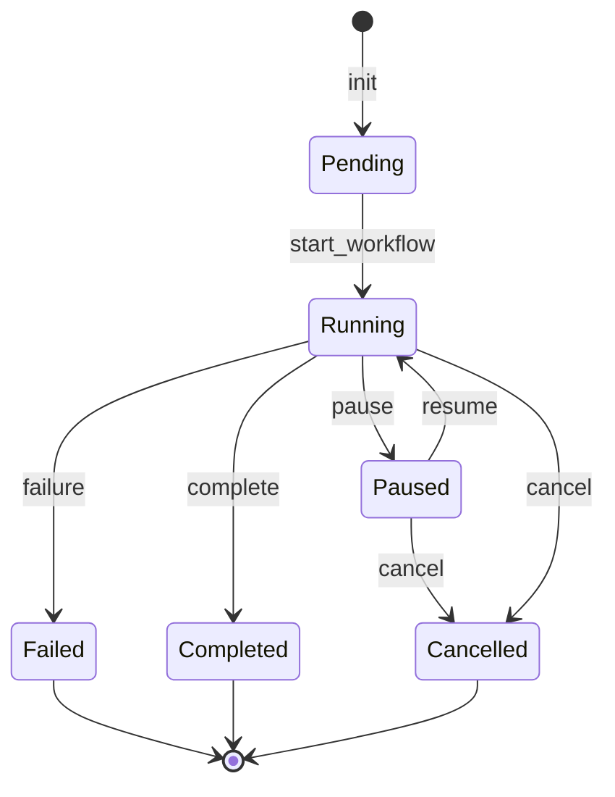

# State Machine Behavior in YAWL

## Overview

YAWL workflow instances are implemented using Erlang's `gen_statem` behavior, providing robust state machine management with proper OTP supervision, state transitions, and event handling.

## gen_statem Fundamentals

### Why gen_statem?

`gen_statem` (state machine) is preferred over `gen_server` for workflows because:

1. **Explicit State Handling**: States are first-class citizens
2. **State Transition Safety**: Erlang/OTP guarantees valid state transitions
3. **Event-Driven**: Natural fit for workflow event processing
4. **Timeout Support**: Built-in support for state timeouts
5. **Code Loading**: Hot code swapping during state changes

### Basic Structure

```erlang
-module(yawl_workflow_instance).
-behaviour(gen_statem).

%% gen_statem callbacks
-export([
    callback_mode/0,
    init/1,
    terminate/3,
    code_change/4,
    format_status/2
]).

%% State callbacks
-export([
    pending/3,
    running/3,
    paused/3,
    completed/3,
    failed/3
]).
```

## YAWL State Machine States

### State Definitions

```erlang
%% Workflow states
-type workflow_state() :: pending | running | paused | completed | failed | cancelled.

%% State data
-record(state_data, {
    workflow_id :: binary(),
    pattern_type :: atom(),
    marking :: map(),
    current_place :: atom() | undefined,
    start_time :: integer(),
    end_time :: integer() | undefined,
    result :: term() | undefined,
    error :: term() | undefined,
    retry_count :: integer(),
    parent_pid :: pid() | undefined,
    subscribers :: [pid()]
}).
```

### State Transition Diagram



## Callback Implementation

### 1. Callback Mode

```erlang
%% Use state_functions mode for explicit state handling
callback_mode() -> state_functions.
```

### 2. Initialization

```erlang
%% Initialize the state machine
init(Args) ->
    WorkflowId = maps:get(workflow_id, Args),
    PatternType = maps_get(pattern_type, Args),
    InitialMarking = maps:get(initial_marking, Args),

    StateData = #state_data{
        workflow_id = WorkflowId,
        pattern_type = PatternType,
        marking = InitialMarking,
        current_place = undefined,
        start_time = erlang:monotonic_time(millisecond),
        retry_count = 0,
        subscribers = []
    },

    %% Start in pending state
    {ok, pending, StateData}.
```

### 3. State Handlers

Each state handles specific events:

```erlang
%% PENDING STATE
pending({start_workflow, UsrInfo}, _From, StateData) ->
    case validate_start(StateData) of
        {ok, ValidatedState} ->
            %% Transition to running state
            NewStateData = ValidatedState#state_data{
                current_place = get_initial_place(StateData#state_data.pattern_type)
            },
            {next_state, running, NewStateData, [{state_timeout, get_timeout()}]};
        {error, Reason} ->
            {next_state, failed, StateData#state_data{error = Reason}}
    end;

pending(Event, _From, StateData) ->
    handle_unknown_event(Event, pending, StateData).

%% RUNNING STATE
running({complete_workitem, WorkitemId, Result}, _From, StateData) ->
    case handle_workitem_completion(WorkitemId, Result, StateData) of
        {ok, NewStateData} ->
            case check_workflow_complete(NewStateData) of
                complete ->
                    {next_state, completed, NewStateData#state_data{
                        end_time = erlang:monotonic_time(millisecond)
                    }};
                continue ->
                    {keep_state, NewStateData, [{state_timeout, get_timeout()}]};
                {error, Reason} ->
                    {next_state, failed, NewStateData#state_data{error = Reason}}
            end;
        {error, Reason} ->
            {keep_state, StateData, [{state_timeout, get_timeout()}]}
    end;

running(pause, _From, StateData) ->
    {next_state, paused, StateData};

running(Event, _From, StateData) ->
    handle_unknown_event(Event, running, StateData).

%% PAUSED STATE
paused(resume, _From, StateData) ->
    {next_state, running, StateData, [{state_timeout, get_timeout()}]};

paused(Event, _From, StateData) ->
    handle_unknown_event(Event, paused, StateData).

%% COMPLETED STATE
completed({get_result, _Request}, _From, StateData) ->
    {reply, {ok, StateData#state_data.result}, completed, StateData};

completed(Event, _From, StateData) ->
    handle_unknown_event(Event, completed, StateData).

%% FAILED STATE
failed({get_error, _Request}, _From, StateData) ->
    {reply, {ok, StateData#state_data.error}, failed, StateData};

failed({retry, _Request}, _From, StateData) ->
    case StateData#state_data.retry_count < ?MAX_RETRIES of
        true ->
            NewStateData = StateData#state_data{
                retry_count = StateData#state_data.retry_count + 1,
                error = undefined
            },
            {next_state, pending, NewStateData};
        false ->
            {keep_state, StateData}
    end;

failed(Event, _From, StateData) ->
    handle_unknown_event(Event, failed, StateData).
```

### 4. Common Event Handler

```erlang
%% Handle unknown events in any state
handle_unknown_event(Event, State, StateData) ->
    ?LOG_ERROR("Unknown event ~p in state ~p", [Event, State]),
    {keep_state, StateData}.
```

### 5. Timeout Handling

```erlang
%% Handle state timeouts
handle_timeout(State, StateData) ->
    case State of
        running ->
            %% Check for stuck workflows
            case is_workflow_stuck(StateData) of
                true ->
                    {next_state, failed, StateData#state_data{error = timeout}};
                false ->
                    {keep_state, StateData, [{state_timeout, get_timeout()}]}
            end;
        _ ->
            {keep_state, StateData}
    end.

%% State timeout callback
handle_sync_event(timeout, _From, State, StateData) ->
    handle_timeout(State, StateData);
```

### 6. Termination

```erlang
%% Clean up when state machine terminates
terminate(Reason, _State, _StateData) ->
    ?LOG_INFO("Workflow instance terminating: ~p", [Reason]),
    case Reason of
        normal ->
            ok;
        shutdown ->
            ok;
        {error, Error} ->
            ?LOG_ERROR("Workflow instance error: ~p", [Error]),
            ok
    end.
```

### 7. Code Change

```erlang
%% Handle hot code swapping
code_change(_OldVsn, State, StateData, _Extra) ->
    {ok, State, StateData}.
```

### 8. Format Status

```erlang
%% Format status for debugging and monitoring
format_status(Opt, [_PDB, State, StateData]) ->
    [
        {data, [
            {state, State},
            {workflow_id, StateData#state_data.workflow_id},
            {pattern_type, StateData#state_data.pattern_type},
            {current_place, StateData#state_data.current_place},
            {retry_count, StateData#state_data.retry_count},
            {duration, erlang:monotonic_time(millisecond) - StateData#state_data.start_time}
        ]}
        | case Opt of
            terminate -> [{terminate_reason, StateData#state_data.error}];
            _ -> []
        end
    ].
```

## Event Processing

### Synchronous Events

```erlang
%% Synchronous call - wait for reply
sync_get_status(WorkflowInstancePid) ->
    gen_statem:call(WorkflowInstancePid, get_status).

%% Handle synchronous events
running({get_status, _Request}, _From, StateData) ->
    Status = #{
        state => running,
        workflow_id => StateData#state_data.workflow_id,
        current_place => StateData#state_data.current_place,
        marking => StateData#state_data.marking,
        duration => erlang:monotonic_time(millisecond) - StateData#state_data.start_time
    },
    {reply, {ok, Status}, running, StateData, [{state_timeout, get_timeout()}]}.
```

### Asynchronous Events

```erlang
%% Asynchronous cast - no reply
cast_complete_workitem(WorkflowInstancePid, WorkitemId, Result) ->
    gen_statem:cast(WorkflowInstancePid, {complete_workitem, WorkitemId, Result}).

%% Handle asynchronous events
handle_cast({complete_workitem, WorkitemId, Result}, State, StateData) ->
    case handle_workitem_completion(WorkitemId, Result, StateData) of
        {ok, NewStateData} ->
            {keep_state, NewStateData, [{state_timeout, get_timeout()}]};
        {error, Reason} ->
            {next_state, failed, NewStateData#state_data{error = Reason}}
    end.
```

### All-State Events

```erlang
%% Handle events in any state
handle_sync_event(get_state_data, _From, State, StateData) ->
    {reply, {ok, StateData}, State, StateData}.

handle_info({'DOWN', _MonitorRef, process, Pid, Reason}, State, StateData) ->
    %% Handle monitored process death
    case Pid of
        StateData#state_data.parent_pid ->
            {next_state, failed, StateData#state_data{error = {parent_died, Reason}}};
        _ ->
            {keep_state, StateData}
    end.
```

## State Transition Validation

### Pre-Transition Hooks

```erlang
%% Validate before state transition
validate_state_transition(FromState, ToState, StateData) ->
    ValidTransitions = #{
        pending => [running, failed, cancelled],
        running => [paused, completed, failed, cancelled],
        paused => [running, cancelled],
        completed => [],
        failed => [pending],  % Can retry
        cancelled => []
    },

    AllowedStates = maps:get(FromState, ValidTransitions, []),

    case lists:member(ToState, AllowedStates) of
        true ->
            {ok, valid};
        false ->
            {error, {invalid_transition, FromState, ToState}}
    end.
```

### Post-Transition Hooks

```erlang
%% Actions after state transition
post_state_transition(OldState, NewState, StateData) ->
    case NewState of
        completed ->
            notify_completion(StateData),
            publish_workflow_event(completed, StateData);
        failed ->
            notify_failure(StateData),
            publish_workflow_event(failed, StateData);
        cancelled ->
            notify_cancellation(StateData),
            publish_workflow_event(cancelled, StateData);
        _ ->
            ok
    end.
```

## Petri Net Integration

### State to Place Mapping

```erlain
%% Map gen_statem states to Petri net places
state_to_place(pending) -> initial;
state_to_place(running) -> executing;
state_to_place(paused) -> waiting;
state_to_place(completed) -> final;
state_to_place(failed) -> error;
state_to_place(cancelled) -> aborted.

%% Get current place from marking
get_current_place(Marking) ->
    case lists:flatten(maps:fold(fun(Place, Tokens, Acc) ->
        case Tokens of
            [] -> Acc;
            _ -> [Place | Acc]
        end
    end, [], Marking)) of
        [Place] -> Place;
        [] -> undefined;
        Multiple -> multiple_places_error(Multiple)
    end.
```

### Transition Execution

```erlang
%% Execute Petri net transition in state machine
execute_transition(TransitionId, StateData) ->
    PatternModule = get_pattern_module(StateData#state_data.pattern_type),

    %% Execute the transition
    case PatternModule:fire(
        TransitionId,
        StateData#state_data.marking,
        StateData#state_data
    ) of
        {produce, NewMarking} ->
            %% Update marking
            NewStateData = StateData#state_data{marking = NewMarking},
            {ok, NewStateData};
        abort ->
            %% Transition aborted
            {ok, StateData};
        {error, Reason} ->
            %% Transition failed
            {error, Reason}
    end.
```

## Error Handling and Recovery

### Error States

```erlang
%% Enter error state
enter_error_state(Reason, State, StateData) ->
    ErrorData = StateData#state_data{
        error = Reason,
        end_time = erlang:monotonic_time(millisecond)
    },

    case Reason of
        timeout ->
            {next_state, failed, ErrorData};
        {workitem_failed, _WorkitemId} ->
            case should_retry(StateData) of
                true ->
                    {next_state, pending, StateData#state_data{
                        retry_count = StateData#state_data.retry_count + 1
                    }};
                false ->
                    {next_state, failed, ErrorData}
            end;
        _ ->
            {next_state, failed, ErrorData}
    end.
```

### Recovery Mechanisms

```erlang
%% Check if workflow can be recovered
is_recoverable(StateData) ->
    case StateData#state_data.error of
        timeout ->
            false;
        {workitem_failed, _WorkitemId} when StateData#state_data.retry_count < ?MAX_RETRIES ->
            true;
        _ ->
            false
    end.

%% Recover from error
recover_workflow(StateData) ->
    case is_recoverable(StateData) of
        true ->
            %% Reset to pending for retry
            RecoveredData = StateData#state_data{
                error = undefined,
                retry_count = 0
            },
            {ok, RecoveredData};
        false ->
            {error, unrecoverable}
    end.
```

## Monitoring and Observability

### State Metrics

```erlang
%% Get state metrics
get_state_metrics(State, StateData) ->
    Now = erlang:monotonic_time(millisecond),
    Duration = Now - StateData#state_data.start_time,

    #{
        state => State,
        workflow_id => StateData#state_data.workflow_id,
        pattern_type => StateData#state_data.pattern_type,
        current_place => StateData#state_data.current_place,
        duration_ms => Duration,
        retry_count => StateData#state_data.retry_count,
        has_error => StateData#state_data.error =/= undefined
    }.
```

### Event Publishing

```erlang
%% Publish state change event
publish_state_change(OldState, NewState, StateData) ->
    Event = #{
        workflow_id => StateData#state_data.workflow_id,
        event_type => state_changed,
        from_state => OldState,
        to_state => NewState,
        timestamp => erlang:monotonic_time(millisecond),
        data => get_state_metrics(NewState, StateData)
    },
    yawl_event_bridge:publish_event(
        StateData#state_data.workflow_id,
        Event
    ).
```

## Testing State Machines

### Property-Based Testing

```erlang
%% Property: state transitions are valid
prop_state_transitions_valid() ->
    ?FORALL({WorkflowDef, Events}, gen_workflow_and_events(),
        begin
            {ok, Pid} = start_workflow_instance(WorkflowDef),
            Result = execute_events(Pid, Events),
            kill_workflow_instance(Pid),
            ?assert(is_valid_state_sequence(Result)),
            true
        end
    ).

%% Check if state sequence is valid
is_valid_state_sequence(StateSequence) ->
    ValidTransitions = get_valid_transitions(),
    lists:all(fun({From, To}) ->
        Valid = maps:get(From, ValidTransitions, []),
        lists:member(To, Valid)
    end, get_state_transitions(StateSequence)).
```

### Model-Based Testing

```erlang
%% Model-based state machine test
model_test() ->
    Model = #{
        states => [pending, running, paused, completed, failed, cancelled],
        transitions => [
            {pending, running},
            {running, paused},
            {running, completed},
            {running, failed},
            {running, cancelled},
            {paused, running},
            {paused, cancelled},
            {failed, pending}
        ]
    },

    proper:module(?MODULE, [{model, Model}]).
```

## Best Practices

### 1. Keep State Functions Small

```erlang
%% Good: Focused state handler
running({complete_workitem, Id, Result}, _From, StateData) ->
    NewStateData = update_marking(Id, Result, StateData),
    {next_state, check_completion(NewStateData)};

%% Avoid: Large monolithic handlers
running(_Event, _From, StateData) ->
    case complex_logic(StateData) of
        %% 100 lines of nested logic
    end.
```

### 2. Use Pattern Matching

```erlang
%% Good: Clear pattern matching
handle_event({complete_workitem, Id, Result}, State, StateData) ->
    ...
handle_event({start_workitem, Id}, State, StateData) ->
    ...
handle_event(Unknown, State, StateData) ->
    handle_unknown_event(Unknown, State, StateData).

%% Avoid: Complex conditionals
handle_event(Event, State, StateData) ->
    case element(1, Event) of
        complete_workitem ->
            ...
        start_workitem ->
            ...
        _ ->
            ...
    end.
```

### 3. Document State Invariants

```erlang
%% State invariants
%% - pending: workflow is created but not started
%% - running: workflow is actively executing
%% - paused: workflow is temporarily suspended
%% - completed: workflow finished successfully
%% - failed: workflow encountered non-recoverable error
%% - cancelled: workflow was cancelled before completion
```

---

Next: [Resource Allocation](resource-allocation.md) ->
