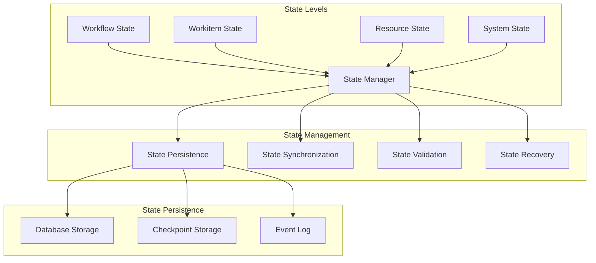
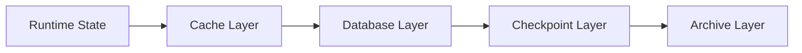

# YAWL State Management

The YAWL state management system provides comprehensive workflow state tracking and lifecycle management. It maintains consistent state information across workflow instances, workitems, and resources while ensuring reliability and recoverability.

## State Management Overview

YAWL manages state at multiple levels:

1. **Workflow State**: High-level workflow execution state
2. **Workitem State**: Individual task execution state
3. **Resource State**: Resource availability and allocation state
4. **System State**: Infrastructure and monitoring state



## State Types and Structure

### 1. Workflow State

```erlang
% Workflow execution state
-record(yawl_workflow, {
    workflow_id :: binary(),              % Unique workflow identifier
    pattern_type :: atom(),               % YAWL pattern type
    status :: workflow_status(),          % Current execution state
    config :: yawl_workflow_config(),      % Workflow configuration
    marking :: #{place() => [token()]},  % Petri net marking
    current_place :: place() | undefined, % Current active place
    start_time :: integer(),              % Execution start time
    end_time :: integer() | undefined,    % Execution end time
    result :: term() | undefined,         % Final result
    metadata :: map()                    % Additional metadata
}).

% Workflow configuration
-record(yawl_workflow_config, {
    pattern_type :: atom(),               % Pattern type
    parameters :: map(),                 % Pattern parameters
    timeout :: integer(),                % Execution timeout
    metadata :: map()                    % Custom configuration
}).

% Workflow status types
-type workflow_status() ::
    pending | running | completed | failed | cancelled | paused | waiting.
```

### 2. Workitem State

```erlang
% Workitem execution state
-record(yawl_workitem, {
    workitem_id :: binary(),              % Unique workitem identifier
    workflow_id :: binary(),              % Parent workflow ID
    task_name :: binary(),                % Task name/identifier
    status :: workitem_status(),          % Current workitem state
    assigned_to :: binary() | undefined,  % Assigned resource
    data :: map(),                        % Task data/parameters
    created_at :: integer(),              % Creation timestamp
    started_at :: integer() | undefined,  % Start timestamp
    completed_at :: integer() | undefined, % Completion timestamp
    error :: term() | undefined,         % Error information
    retries :: integer(),                % Retry count
    timeout :: integer(),                % Task timeout
    metadata :: map()                     % Additional metadata
}).

% Workitem status types
-type workitem_status() ::
    pending | allocated | started | completed | failed | cancelled | timeout.
```

### 3. Resource State

```erlang
% Resource state information
-record(yawl_resource, {
    resource_id :: binary(),              % Resource identifier
    resource_type :: resource_type(),     % Resource classification
    name :: binary(),                     % Human-readable name
    capabilities :: [atom()],              % Available capabilities
    attributes :: map(),                  % Resource properties
    status :: resource_status(),          % Current availability
    current_load :: integer(),           % Current load/usage
    max_capacity :: integer(),           % Maximum capacity
    last_heartbeat :: integer(),          % Last activity timestamp
    allocated_to :: [binary()],           % Currently allocated workitems
    metadata :: map()                     % Additional metadata
}).

% Resource status types
-type resource_status() ::
    available | busy | offline | maintenance | decommissioned.
```

### 4. State Collections

```erlang
% Workflow collection state
-record(state, {
    workflows = #{},                      % workflow_id => workflow
    workflow_instances = #{},             % workflow_id => {pid, monitor_ref}
    pattern_cache = #{},                  % pattern_type => pattern_def
    subscribers = #{},                    % workflow_id => [pid]
    resources = #{},                     % resource_id => resource
    allocations = #{},                   % workitem_id => resource_id
    statistics = #{}                     % Performance metrics
}).
```

## State Persistence

### 1. Persistence Strategy

YAWL uses a multi-layered persistence strategy:



### 2. Database Schema

```erlang
% Workflow persistence
-record(yawl_workflow_persist, {
    workflow_id :: binary(),              % Primary key
    spec_id :: binary(),                  % Specification ID
    pattern_type :: atom(),               % Pattern type
    status :: workflow_status(),          % Execution status
    marking :: #{place() => [token()]},  % Petri net marking
    current_place :: place() | undefined, % Current active place
    data :: map(),                        % Workflow data
    created_at :: integer(),              % Creation timestamp
    updated_at :: integer(),              % Last update timestamp
    completed_at :: integer() | undefined % Completion timestamp
}).

% Workitem persistence
-record(yawl_workitem_persist, {
    workitem_id :: binary(),              % Primary key
    workflow_id :: binary(),              % Foreign key
    task_name :: binary(),                % Task identifier
    status :: workitem_status(),          % Task status
    assigned_to :: binary() | undefined,  % Assigned resource
    data :: map(),                        % Task data
    created_at :: integer(),              % Creation timestamp
    started_at :: integer() | undefined,  % Start timestamp
    completed_at :: integer() | undefined, % Completion timestamp
    error :: term() | undefined,          % Error information
    retries :: integer(),                % Retry count
    metadata :: map()                     % Additional metadata
}).

% Resource persistence
-record(yawl_resource_persist, {
    resource_id :: binary(),              % Primary key
    resource_type :: resource_type(),     % Resource type
    name :: binary(),                     % Resource name
    capabilities :: [atom()],              % Capabilities
    attributes :: map(),                  % Properties
    status :: resource_status(),          % Availability
    current_load :: integer(),           % Current load
    max_capacity :: integer(),           % Maximum capacity
    last_heartbeat :: integer(),          % Last heartbeat
    allocated_to :: [binary()],           % Allocated workitems
    metadata :: map()                     % Additional metadata
}).
```

### 3. Persistence Operations

```erlang
% Workflow persistence operations
save_workflow(Workflow) ->
    PersistWorkflow = workflow_to_persist(Workflow),
    yawl_persistence:save_workflow(PersistWorkflow).

load_workflow(WorkflowId) ->
    case yawl_persistence:load_workflow(WorkflowId) of
        {ok, PersistWorkflow} ->
            persist_to_workflow(PersistWorkflow);
        {error, not_found} ->
            {error, workflow_not_found}
    end.

% Workitem persistence operations
save_workitem(Workitem) ->
    PersistWorkitem = workitem_to_persist(Workitem),
    yawl_persistence:save_workitem(PersistWorkitem).

% Batch operations for performance
batch_save_workitems(Workitems) ->
    PersistWorkitems = lists:map(fun workitem_to_persist/1, Workitems),
    yawl_persistence:batch_save_workitems(PersistWorkitems).
```

## State Synchronization

### 1. State Consistency

```erlang
% Ensure state consistency across components
synchronize_workflow_state(WorkflowId) ->
    % Load workflow from persistence
    case load_workflow(WorkflowId) of
        {ok, Workflow} ->
            % Get current instance state
            case get_workflow_instance(WorkflowId) of
                {ok, InstancePid} ->
                    % Update instance with persisted state
                    update_instance_state(InstancePid, Workflow);
                {error, not_found} ->
                    % Create new instance if needed
                    recreate_workflow_instance(Workflow)
            end;
        {error, Reason} ->
            {error, Reason}
    end.

% Check state consistency
check_state_consistency(WorkflowId) ->
    % Compare workflow state
    WorkflowState = get_workflow_state(WorkflowId),
    InstanceState = get_instance_state(WorkflowId),
    WorkitemStates = get_workitem_states(WorkflowId),

    % Validate consistency
    ValidationResult = validate_states_consistent(
        WorkflowState, InstanceState, WorkitemStates
    ),

    case ValidationResult of
        {consistent, _} -> ok;
        {inconsistent, Issues} ->
            {error, {state_inconsistency, Issues}}
    end.
```

### 2. State Events

```erlang
% State change events
generate_state_event(WorkflowId, StateChange, Details) ->
    Event = #yawl_state_event{
        event_id = generate_event_id(),
        workflow_id = WorkflowId,
        timestamp = erlang:monotonic_time(millisecond),
        state_change = StateChange,
        details = Details,
        previous_state = get_current_state(WorkflowId),
        new_state = get_new_state(StateChange, Details)
    },

    % Publish state change event
    publish_state_event(Event),

    % Persist state change
    save_state_event(Event),

    Event.

% Handle state events
handle_state_event(Event) ->
    WorkflowId = Event#yawl_state_event.workflow_id,
    StateChange = Event#yawl_state_event.state_change,

    case StateChange of
        workflow_started ->
            handle_workflow_started(WorkflowId, Event);
        workflow_completed ->
            handle_workflow_completed(WorkflowId, Event);
        workitem_created ->
            handle_workitem_created(WorkflowId, Event);
        workitem_completed ->
            handle_workitem_completed(WorkflowId, Event);
        _ ->
            handle_generic_state_change(WorkflowId, Event)
    end.
```

## State Recovery

### 1. Checkpoint System

```erlang
% Create checkpoint
create_checkpoint(WorkflowId) ->
    CheckpointId = generate_checkpoint_id(WorkflowId),

    % Capture current state
    WorkflowState = get_workflow_state(WorkflowId),
    WorkitemStates = get_workitem_states(WorkflowId),
    ResourceStates = get_allocated_resources(WorkflowId),

    Checkpoint = #yawl_checkpoint{
        checkpoint_id = CheckpointId,
        workflow_id = WorkflowId,
        workflow_state = WorkflowState,
        workitem_states = WorkitemStates,
        resource_states = ResourceStates,
        created_at = erlang:monotonic_time(millisecond),
        metadata = #{type => manual}
    },

    % Save checkpoint
    case yawl_persistence:save_checkpoint(Checkpoint) of
        ok ->
            notify_checkpoint_created(WorkflowId, CheckpointId),
            {ok, CheckpointId};
        {error, Reason} ->
            {error, Reason}
    end.

% Restore from checkpoint
restore_from_checkpoint(WorkflowId, CheckpointId) ->
    case yawl_persistence:load_checkpoint(CheckpointId) of
        {ok, Checkpoint} ->
            % Validate checkpoint belongs to workflow
            case Checkpoint#yawl_checkpoint.workflow_id of
                WorkflowId ->
                    perform_checkpoint_restore(WorkflowId, Checkpoint);
                _ ->
                    {error, checkpoint_mismatch}
            end;
        {error, Reason} ->
            {error, Reason}
    end.

% Perform actual restore
perform_checkpoint_restore(WorkflowId, Checkpoint) ->
    % Stop current workflow instance
    case stop_workflow_instance(WorkflowId) of
        ok ->
            % Restore workflow state
            restore_workflow_state(WorkflowId, Checkpoint#yawl_checkpoint.workflow_state),

            % Restore workitem states
            lists:foreach(fun(WorkitemState) ->
                restore_workitem_state(WorkitemState)
            end, Checkpoint#yawl_checkpoint.workitem_states),

            % Restore resource allocations
            lists:foreach(fun(ResourceState) ->
                restore_resource_allocation(ResourceState)
            end, Checkpoint#yawl_checkpoint.resource_states),

            % Restart workflow instance
            restart_workflow_instance(WorkflowId),

            notify_checkpoint_restored(WorkflowId, CheckpointId);
        {error, Reason} ->
            {error, Reason}
    end.
```

### 2. Recovery Strategies

```erlang
% Automatic recovery
handle_failure_recovery(WorkflowId, FailureType, FailureDetails) ->
    RecoveryStrategy = get_recovery_strategy(FailureType),

    case RecoveryStrategy of
        restart ->
            restart_workflow(WorkflowId);
        retry ->
            retry_failed_tasks(WorkflowId);
        restore ->
            restore_latest_checkpoint(WorkflowId);
        compensate ->
            execute_compensation(WorkflowId, FailureDetails);
        escalate ->
            escalate_to_manual(WorkflowId, FailureDetails)
    end.

% Retry failed workitems
retry_failed_workitems(WorkflowId) ->
    {ok, FailedWorkitems} = get_failed_workitems(WorkflowId),

    lists:foreach(fun(Workitem) ->
        RetryConfig = get_retry_config(Workitem),
        case should_retry(Workitem, RetryConfig) of
            true ->
                retry_workitem(Workitem);
            false ->
                mark_as_terminal_failure(Workitem)
        end
    end, FailedWorkitems).
```

### 3. State Validation

```erlang
% Validate workflow state integrity
validate_workflow_state(WorkflowId) ->
    % Check workflow structure
    Workflow = get_workflow(WorkflowId),
    case validate_workflow_structure(Workflow) of
        {ok, _} ->
            % Check workitem consistency
            Workitems = get_workitems(WorkflowId),
            case validate_workitem_consistency(Workitems) of
                {ok, _} ->
                    % Check resource consistency
                    Resources = get_allocated_resources(WorkflowId),
                    case validate_resource_consistency(Resources) of
                        {ok, _} ->
                            {ok, state_valid};
                        {error, ResourceIssues} ->
                            {error, resource_consistency_failed, ResourceIssues}
                    end;
                {error, WorkitemIssues} ->
                    {error, workitem_consistency_failed, WorkitemIssues}
            end;
        {error, StructureIssues} ->
            {error, workflow_structure_invalid, StructureIssues}
    end.

% Validate state transitions
validate_state_transition(CurrentState, NewState, Context) ->
    ValidTransitions = get_valid_transitions(CurrentState),

    case lists:member(NewState, ValidTransitions) of
        true ->
            validate_transition_context(CurrentState, NewState, Context);
        false ->
            {error, invalid_state_transition,
             {from, CurrentState}, {to, NewState}}
    end.
```

## State Management APIs

### 1. Workflow State APIs

```erlang
% Get workflow state
get_workflow_state(WorkflowId) ->
    case yawl_orchestrator:get_status(WorkflowId) of
        {ok, Status} ->
            {ok, #{
                workflow_id => WorkflowId,
                status => Status,
                created_at => get_workflow_created(WorkflowId),
                updated_at => get_workflow_updated(WorkflowId),
                workitem_count => get_workitem_count(WorkflowId)
            }};
        {error, Reason} ->
            {error, Reason}
    end.

% Update workflow state
update_workflow_state(WorkflowId, NewState, Context) ->
    case validate_state_transition(get_current_state(WorkflowId), NewState, Context) of
        {ok, _} ->
            do_update_workflow_state(WorkflowId, NewState, Context);
        {error, Reason} ->
            {error, Reason}
    end.
```

### 2. Workitem State APIs

```erlang
% Get workitem state
get_workitem_state(WorkitemId) ->
    case yawl_persistence:load_workitem(WorkitemId) of
        {ok, Workitem} ->
            {ok, #{
                workitem_id => WorkitemId,
                workflow_id => Workitem#yawl_workitem_persist.workflow_id,
                task_name => Workitem#yawl_workitem_persist.task_name,
                status => Workitem#yawl_workitem_persist.status,
                assigned_to => Workitem#yawl_workitem_persist.assigned_to,
                created_at => Workitem#yawl_workitem_persist.created_at,
                started_at => Workitem#yawl_workitem_persist.started_at,
                completed_at => Workitem#yawl_workitem_persist.completed_at,
                error => Workitem#yawl_workitem_persist.error,
                retries => Workitem#yawl_workitem_persist.retries
            }};
        {error, Reason} ->
            {error, Reason}
    end.

% Update workitem state
update_workitem_state(WorkitemId, NewStatus, Data) ->
    WorkitemUpdate = #{
        workitem_id => WorkitemId,
        new_status => NewStatus,
        data => Data,
        timestamp => erlang:monotonic_time(millisecond)
    },

    case validate_workitem_transition(get_current_workitem_status(WorkitemId), NewStatus) of
        valid ->
            do_update_workitem_state(WorkitemUpdate);
        {invalid, Reason} ->
            {error, Reason}
    end.
```

### 3. Resource State APIs

```erlang
% Get resource state
get_resource_state(ResourceId) ->
    case yawl_resource_manager:get_resource(ResourceId) of
        {ok, Resource} ->
            {ok, #{
                resource_id => ResourceId,
                resource_type => Resource#yawl_resource_persist.resource_type,
                name => Resource#yawl_resource_persist.name,
                capabilities => Resource#yawl_resource_persist.capabilities,
                status => Resource#yawl_resource_persist.status,
                current_load => Resource#yawl_resource_persist.current_load,
                max_capacity => Resource#yawl_resource_persist.max_capacity,
                utilization => calculate_utilization(Resource),
                allocated_workitems => Resource#yawl_resource_persist.allocated_to,
                last_heartbeat => Resource#yawl_resource_persist.last_heartbeat
            }};
        {error, Reason} ->
            {error, Reason}
    end.

% Update resource state
update_resource_state(ResourceId, NewStatus, Load) ->
    ResourceUpdate = #{
        resource_id => ResourceId,
        new_status => NewStatus,
        new_load => Load,
        timestamp => erlang:monotonic_time(millisecond)
    },

    case validate_resource_transition(get_current_resource_status(ResourceId), NewStatus) of
        valid ->
            do_update_resource_state(ResourceUpdate);
        {invalid, Reason} ->
            {error, Reason}
    end.
```

## State Monitoring and Analytics

### 1. State Metrics

```erlang
% Collect state metrics
collect_state_metrics() ->
    Workflows = get_all_workflows(),
    Workitems = get_all_workitems(),
    Resources = get_all_resources(),

    Metrics = #{
        workflow_metrics => calculate_workflow_metrics(Workflows),
        workitem_metrics => calculate_workitem_metrics(Workitems),
        resource_metrics => calculate_resource_metrics(Resources),
        system_metrics => calculate_system_metrics()
    },

    Metrics.

% Calculate workflow metrics
calculate_workflow_metrics(Workflows) ->
    lists:foldl(fun(Workflow, Acc) ->
        Status = Workflow#yawl_workflow.status,
        maps:update_with(Status, fun(List) -> [Workflow | List] end, [Workflow], Acc)
    end, #{}, Workflows).
```

### 2. State Visualization

```ermaid
graph TB
    subgraph "State Visualization"
        A[Current State] --> B[State Dashboard]
        B --> C[Workflow Timeline]
        B --> D[Workitem Flow]
        B --> E[Resource Utilization]
        B --> F[System Health]
    end

    subgraph "State History"
        A --> G[State Transitions]
        G --> H[Checkpoint History]
        G --> I[Event Log]
    end
```

### 3. State Analytics

```erlang
% Analyze state patterns
analyze_state_patterns() ->
    StateHistory = get_state_history(),

    % Identify common patterns
    CommonPatterns = identify_common_patterns(StateHistory),

    % Detect anomalies
    Anomalies = detect_state_anomalies(StateHistory),

    % Generate insights
    Insights = generate_state_insights(CommonPatterns, Anomalies),

    #{patterns => CommonPatterns, anomalies => Anomalies, insights => Insights}.

% Performance optimization
optimize_state_management() ->
    % Cache frequently accessed states
    optimize_caching_strategy(),

    % Batch state operations
    implement_batch_operations(),

    % Compress state data
    implement_data_compression(),

    % Partition state data
    implement_data_partitioning().
```

## State Management Configuration

### 1. Configuration Options

```erlang
% State management configuration
StateConfig = #{
    persistence => #{
        enabled => true,
        backend => ets, % ets | mnesia | database
        batch_size => 100,
        flush_interval => 5000,
        compression => true,
        encryption => false
    },

    checkpoint => #{
        enabled => true,
        interval => 30000,
        max_checkpoints => 10,
        retention_days => 7,
        auto_cleanup => true
    },

    recovery => #{
        enabled => true,
        max_retries => 3,
        retry_delay => 1000,
        escalate_timeout => 30000,
        manual_intervention => false
    },

    monitoring => #{
        enabled => true,
        interval => 10000,
        alert_thresholds => #{
            workflow_failures => 10,
            workitem_failures => 50,
            resource_failures => 5
        },
        metrics_retention => 86400000 % 24 hours
    }
},

% Apply configuration
apply_state_configuration(StateConfig).
```

### 2. Performance Tuning

```erlang
% High-performance configuration
HighPerfConfig = #{
    persistence => #{
        backend => ets,
        batch_size => 1000,
        flush_interval => 1000,
        async_operations => true,
        parallel_writes => true
    },
    checkpoint => #{
        interval => 5000,
        max_checkpoints => 5,
        compressed => true
    }
},

% High-reliability configuration
HighReliabilityConfig = #{
    persistence => #{
        backend => mnesia,
        replication => true,
        sync_writes => true,
        checksums => true
    },
    checkpoint => #{
        interval => 10000,
        max_checkpoints => 20,
        verify_integrity => true
    }
}.
```

## Troubleshooting

### 1. State Consistency Issues

```erlang
% Detect and fix state inconsistencies
fix_state_inconsistencies() ->
    Workflows = get_all_workflows(),

    lists:foreach(fun(Workflow) ->
        WorkflowId = Workflow#yawl_workflow.workflow_id,
        case check_state_consistency(WorkflowId) of
            {consistent, _} -> ok;
            {inconsistent, Issues} ->
                fix_workflow_inconsistency(WorkflowId, Issues)
        end
    end, Workflows).

% Manual state repair
manual_state_repair(WorkflowId) ->
    % Get current state
    CurrentState = get_current_state(WorkflowId),

    % Get expected state
    ExpectedState = calculate_expected_state(WorkflowId),

    % Repair discrepancies
    Repairs = identify_discrepancies(CurrentState, ExpectedState),

    % Apply repairs
    lists:foreach(fun(Repair) ->
        apply_state_repair(Repair)
    end, Repairs).
```

### 2. Performance Issues

```erlang
% Diagnose state management performance
diagnose_performance() ->
    % Check persistence performance
    PersistenceMetrics = measure_persistence_performance(),

    % Check checkpoint performance
    CheckpointMetrics = measure_checkpoint_performance(),

    % Check synchronization performance
    SyncMetrics = measure_synchronization_performance(),

    % Generate performance report
    PerformanceReport = generate_performance_report(
        PersistenceMetrics, CheckpointMetrics, SyncMetrics
    ),

    PerformanceReport.

% Optimize state access patterns
optimize_state_access() ->
    % Analyze access patterns
    AccessPatterns = analyze_access_patterns(),

    % Create optimized indexes
    create_optimized_indexes(AccessPatterns),

    % Implement caching strategies
    implement_caching_strategies(AccessPatterns),

    % Optimize data layout
    optimize_data_layout(AccessPatterns).
```

### 3. Recovery Testing

```erlang
% Test recovery procedures
test_recovery_scenarios() ->
    TestScenarios = [
        {normal_shutdown, fun test_normal_shutdown/0},
        {crash_failure, fun test_crash_failure/0},
        {data_corruption, fun test_data_corruption/0},
        {network_partition, fun test_network_partition/0},
        {resource_unavailable, fun test_resource_unavailable/0}
    ],

    lists:foreach(fun({Scenario, TestFun}) ->
        case run_recovery_test(TestFun) of
            {ok, Result} ->
                io:format("Test ~p passed: ~p~n", [Scenario, Result]);
            {error, Reason} ->
                io:format("Test ~p failed: ~p~n", [Scenario, Reason])
        end
    end, TestScenarios).
```

## Advanced State Management

### 1. Distributed State

```erlang
% Distributed state management
setup_distributed_state() ->
    % Configure clustering
    ClusteringConfig = #{
        nodes => [node() | nodes()],
        replication_factor => 2,
        sync_mode => eventual,
        conflict_resolution => last_write_wins
    },

    % Initialize distributed state
    initialize_distributed_state(ClusteringConfig).

% Handle state synchronization
synchronize_distributed_state() ->
    % Get state from all nodes
    NodeStates = lists:map(fun(Node) ->
        {Node, get_remote_state(Node)}
    end, [node() | nodes()]),

    % Resolve conflicts
    ResolvedState = resolve_conflicts(NodeStates),

    % Update local state
    update_local_state(ResolvedState).
```

### 2. State Eventsourcing

```erlang
% Event-sourced state management
start_eventsourcing() ->
    % Configure event store
    EventStoreConfig = #{
        backend => rocksdb,
        retention => forever,
        compression => true,
        indexing => true
    },

    initialize_event_store(EventStoreConfig).

% Apply events to state
apply_event(Event, CurrentState) ->
    EventHandlers = get_event_handlers(),

    lists:foldl(fun(Handler, State) ->
        Handler:Event:State
    end, CurrentState, EventHandlers).

% Rebuild state from events
rebuild_state(WorkflowId) ->
    % Get event stream
    EventStream = get_event_stream(WorkflowId),

    % Apply events in order
    lists:foldl(fun(Event, State) ->
        apply_event(Event, State)
    end, initial_state(), EventStream).
```

### 3. State Machine Integration

```ermaid
graph TB
    subgraph "State Machine"
        A[Initial] --> B{Guard 1}
        B -->|Condition 1| C[State 1]
        B -->|Condition 2| D[State 2]
        C --> E{Guard 2}
        D --> E
        E -->|Success| F[Final]
        E -->|Failure| G[Error]
    end

    subgraph "YAWL Integration"
        B --> H[YAWL Pattern]
        E --> H
        H --> I[Execute Workflow]
    end

### 4. State Contracts

```erlang
% Define state contracts
define_state_contracts() ->
    #{
        workflow_state => #{
            valid_transitions => #{
                pending => [running],
                running => [completed, failed, cancelled, paused],
                paused => [running, cancelled],
                completed => [],
                failed => [],
                cancelled => []
            },
            required_fields => [workflow_id, status, created_at],
            optional_fields => [result, end_time, metadata]
        },
        workitem_state => #{
            valid_transitions => #{
                pending => [allocated],
                allocated => [started, cancelled],
                started => [completed, failed, timeout],
                completed => [],
                failed => [],
                cancelled => [],
                timeout => []
            },
            required_fields => [workitem_id, workflow_id, task_name, status, created_at],
            optional_fields => [assigned_to, started_at, completed_at, error, retries]
        }
    }.

% Validate state contracts
validate_state_contract(StateType, State) ->
    Contracts = define_state_contracts(),
    Contract = maps:get(StateType, Contracts, #{}),

    % Validate required fields
    RequiredFields = maps:get(required_fields, Contract, []),
    MissingFields = lists:filter(fun(Field) ->
        not maps:is_key(Field, State)
    end, RequiredFields),

    case MissingFields of
        [] ->
            validate_transitions(StateType, State, Contract);
        _ ->
            {error, missing_required_fields, MissingFields}
    end.
```

---

This comprehensive documentation covers all aspects of YAWL state management, from basic concepts to advanced features. The system provides robust state tracking, persistence, recovery, and monitoring capabilities for reliable workflow execution.