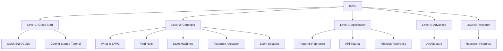

# YAWL Implementation Documentation

Welcome to the comprehensive documentation for the pure Erlang YAWL (Yet Another Workflow Language) implementation in A2A. This documentation follows a **progressive disclosure architecture** - start at your level and dive deeper as needed.

## Progressive Levels

### Level 1: Quick Start (5 minutes)
For: New users who want to see YAWL working immediately
- [Quick Start](quickstart.md) - Get running in 5 minutes
- [Getting Started Tutorial](tutorials/getting-started.md) - Your first workflow

### Level 2: Concepts Understanding (30 minutes)
For: Developers who need to understand how YAWL works
- [What is YAWL?](concepts/what-is-yawl.md) - Introduction and motivation
- [Petri Nets](concepts/petri-nets.md) - Mathematical foundation
- [State Machines](concepts/state-machines.md) - gen_statem behavior
- [Resource Allocation](concepts/resource-allocation.md) - Capability-based allocation
- [Event Systems](concepts/event-systems.md) - Observer pattern events

### Level 3: Practical Application (1-2 hours)
For: Developers building real workflows
- [Patterns Reference](reference/patterns.md) - All 43 workflow patterns
- [REST API Tutorial](tutorials/api-usage.md) - API usage with examples
- [Erlang API Reference](reference/erlang-api.md) - Complete module reference
- [Modules Reference](reference/modules.md) - Core modules documentation

### Level 4: Advanced Features (2-4 hours)
For: Architects and power users
- [Architecture](architecture.md) - System architecture and design
- [XES Logging](reference/xes-logging.md) - Process mining integration
- [Testing Tutorial](tutorials/testing.md) - HotCI testing framework
- [Configuration](reference/configuration.md) - Advanced configuration

### Level 5: Specialized Topics (4+ hours)
For: Researchers and specialists
- [Research Features](research/) - Advanced analysis capabilities
- [Business Workflows](business/) - Production workflow examples
- [Migration Guides](migration/) - Platform migration

## Quick Links by User Type

### For Application Developers
- [Getting Started](tutorials/getting-started.md)
- [REST API Tutorial](tutorials/api-usage.md)
- [Patterns Reference](reference/patterns.md)
- [Business Workflows](business/)

### For System Architects
- [Architecture](architecture.md)
- [Module Boundaries](module-boundaries.md)
- [Supervision Tree](supervision-tree.md)
- [Configuration](reference/configuration.md)

### For Researchers
- [Research Overview](research/overview.md)
- [Reachability Analysis](research/reachability.md)
- [Partial Order Discovery](research/partial-order.md)
- [LLM Validation](research/llm-validation.md)

### For QA Engineers
- [Testing Tutorial](tutorials/testing.md)
- [Error Codes](reference/error-codes.md)
- [XES Logging](reference/xes-logging.md)

## Overview

The A2A YAWL implementation is a complete, production-grade workflow engine written in pure Erlang. It supports:

- **43 Workflow Patterns** - From basic sequences to complex multi-instance patterns
- **REST API** - 50+ endpoints for workflow management
- **Research Features** - O(P²+T²) reachability, partial order discovery, LLM validation
- **Business Workflows** - 6 complete business workflow examples
- **Persistent Storage** - XES/OCEL logging with configurable backends
- **Event Streaming** - Real-time workflow events via WebSockets
- **Resource Management** - Advanced resource allocation and deallocation

## What's New

- **Pure Erlang Implementation** - No external dependencies, native OTP integration
- **Performance Optimized** - Leverages BEAM concurrency and fault tolerance
- **Research Ready** - Implements cutting-edge algorithms from van der Aalst 2025-2026 papers
- **Business Ready** - 6 complete business workflow examples
- **Developer Friendly** - Comprehensive tutorials and API reference

## Quick Start Commands

```bash
# Start the YAWL server
cd /Users/sac/A2A/erlang/a2a_erl
rebar3 shell

# Create a workflow
curl -X POST http://localhost:8081/api/workflows \
  -H "Content-Type: application/json" \
  -d '{"pattern": "sequential", "name": "my-first-workflow"}'

# Execute workflow
curl -X POST http://localhost:8081/api/workflows/{id}/execute

# Get workflow status
curl http://localhost:8081/api/workflows/{id}/status
```

## Complete Documentation Index

### Concepts (Level 2)
- [What is YAWL?](concepts/what-is-yawl.md) - Introduction to YAWL
- [Pattern Categories](concepts/pattern-categories.md) - All 43 patterns explained
- [Petri Nets](concepts/petri-nets.md) - Mathematical foundation with code
- [State Machines](concepts/state-machines.md) - gen_statem implementation
- [Resource Allocation](concepts/resource-allocation.md) - Capability-based allocation
- [Event Systems](concepts/event-systems.md) - Observer pattern events
- [A2A Integration](concepts/a2a-integration.md) - System integration
- [State Management](concepts/state-management.md) - Workflow lifecycle states

### Tutorials (Levels 1-4)
- [Getting Started](tutorials/getting-started.md) - 5-minute quick start
- [API Usage](tutorials/api-usage.md) - REST API tutorial with examples
- [Patterns Deep Dive](tutorials/patterns-deep-dive.md) - Master workflow patterns
- [Testing](tutorials/testing.md) - HotCI testing framework
- [Erlang Introduction](tutorials/erlang-intro.md) - Erlang for YAWL developers
- [Environment Setup](tutorials/setup.md) - Development environment setup
- [First Workflow](tutorials/first-workflow.md) - Hello World in YAWL

### Reference (Levels 3-4)
- [Patterns](reference/patterns.md) - Complete 43-pattern reference
- [REST API](reference/rest-api.md) - REST API endpoints reference
- [Erlang API](reference/erlang-api.md) - Complete Erlang module API
- [XES Logging](reference/xes-logging.md) - Event logging for process mining
- [Configuration](reference/configuration.md) - Configuration options
- [Error Codes](reference/error-codes.md) - Error handling reference
- [Modules](reference/modules.md) - Core module documentation

### API Documentation (Level 3)
- [API Overview](api/overview.md) - REST API fundamentals
- [Workflow Endpoints](api/workflow-endpoints.md) - Workflow management endpoints
- [Research Endpoints](api/research-endpoints.md) - Research module endpoints

### Patterns (Level 2-3)
- [Basic Patterns](patterns/basic-patterns.md) - 7 fundamental patterns
- [Advanced Patterns](patterns/advanced-patterns.md) - 6 complex patterns

### Business Workflows (Level 3-5)
- [Overview](business/overview.md) - Business workflow concepts
- [Ordering](business/ordering.md) - Purchase order workflow
- [Payment](business/payment.md) - Payment processing workflow
- [Carrier Appointment](business/carrier-appointment.md) - Logistics scheduling
- [Freight Transit](business/freight-transit.md) - Shipping tracking
- [Freight Delivered](business/freight-delivered.md) - Delivery confirmation
- [Order Fulfillment](business/order-fulfillment.md) - End-to-end orchestration

### Research Features (Level 5)
- [Overview](research/overview.md) - Research capabilities overview
- [Reachability](research/reachability.md) - O(P²+T²) state space exploration
- [Partial Order](research/partial-order.md) - Process structure discovery
- [LLM Validation](research/llm-validation.md) - AI-assisted verification
- [OCPM](research/ocpm.md) - Object-centric process mining
- [CPN](research/cpn.md) - Colored Petri Nets

### Migration (Level 4-5)
- [Python Deprecation](migration/python-deprecation.md) - Python bridge removal
- [Cowboy 2.x Migration](migration/cowboy-2.x-migration.md) - Cowboy upgrade guide
- [HotCI Adoption](migration/hotci-adoption.md) - Testing framework adoption

## Documentation Architecture



## Need Help?

- **Documentation Issues**: [GitHub Issues](https://github.com/your-org/a2a/issues)
- **Technical Support**: [Community Forum](https://forum.a2a-project.org)
- **Discussions**: [GitHub Discussions](https://github.com/your-org/a2a/discussions)

---

*This documentation is part of the A2A project. For more information, visit [project homepage](../).*
