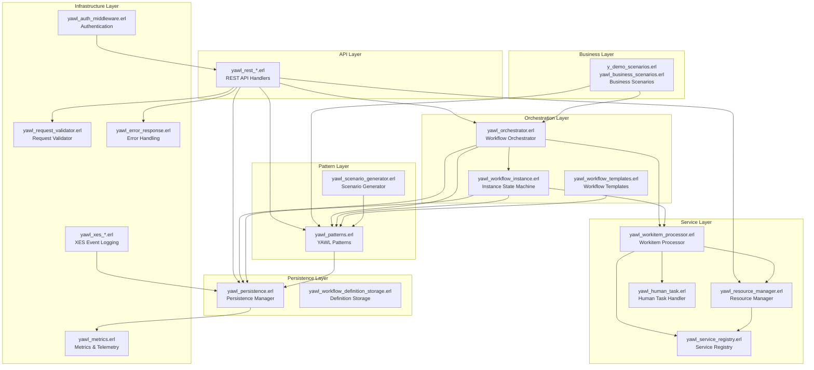
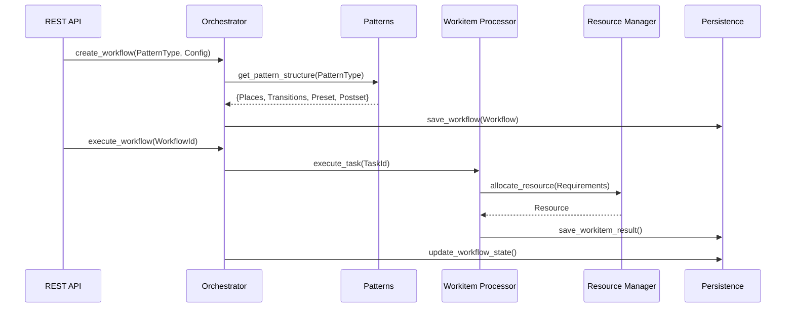

# YAWL Module Boundaries and Architecture

This document defines the architectural boundaries between modules in the YAWL (Yet Another Workflow Language) implementation. It establishes clear layers, allowed dependencies, and module responsibilities.

## Architecture Overview



## Module Layers

### Layer 1: API Layer (REST Interfaces)

**Purpose**: HTTP request handling, routing, and response formatting.

| Module | Responsibility | Dependencies |
|--------|---------------|--------------|
| `yawl_rest.erl` | Main REST router, route definitions | All handlers |
| `yawl_rest_handler.erl` | Workflow CRUD operations | orchestrator, persistence |
| `yawl_rest_pattern_handler.erl` | Pattern information endpoints | patterns |
| `yawl_rest_definition_handler.erl` | Workflow definition management | definition_storage |
| `yawl_rest_workitem_handler.erl` | Workitem operations | workitem_processor |
| `yawl_rest_resource_handler.erl` | Resource management | resource_manager |
| `yawl_rest_task_handler.erl` | Task operations | workitem_processor |
| `yawl_rest_service_handler.erl` | Service registry endpoints | service_registry |
| `yawl_rest_metrics_handler.erl` | Metrics and telemetry | metrics |
| `yawl_rest_template_handler.erl` | Workflow templates | workflow_templates |
| `yawl_rest_cpn_handler.erl` | Colored Petri Net endpoints | cpn |
| `yawl_rest_ocpm_handler.erl` | Object-centric PM endpoints | ocpm |
| `yawl_rest_reachability_handler.erl` | Reachability analysis | reachability |
| `yawl_rest_llm_handler.erl` | LLM validation endpoints | llm_validator |
| `yawl_rest_hitl_handler.erl` | Human-in-the-loop endpoints | human_task |
| `yawl_rest_xes_handler.erl` | XES event export | xes_adapter |

**Allowed Dependencies**: Orchestration Layer, Service Layer, Infrastructure Layer
**Forbidden Dependencies**: Must NOT depend on Business Layer

### Layer 2: Business Layer (Domain Scenarios)

**Purpose**: Business-domain specific workflow scenarios and use cases.

| Module | Responsibility | Dependencies |
|--------|---------------|--------------|
| `y_demo_scenarios.erl` | Demo scenario definitions | orchestrator, patterns |
| `yawl_business_scenarios.erl` | Business domain scenarios | orchestrator, patterns |

**Allowed Dependencies**: Orchestration Layer, Pattern Layer
**Forbidden Dependencies**: API Layer, Persistence Layer (direct access)

### Layer 3: Orchestration Layer (Workflow Management)

**Purpose**: Workflow lifecycle management, coordination, and instance management.

| Module | Responsibility | Dependencies |
|--------|---------------|--------------|
| `yawl_orchestrator.erl` | Central workflow orchestration | patterns, persistence, workitem_processor |
| `yawl_workflow_instance.erl` | Individual workflow state machine | patterns, persistence, workitem_processor |
| `yawl_workflow_instance_sup.erl` | Instance supervisor | workflow_instance |
| `yawl_workflow_templates.erl` | Reusable workflow templates | patterns |

**Allowed Dependencies**: Pattern Layer, Service Layer, Persistence Layer
**Forbidden Dependencies**: API Layer, Business Layer

### Layer 4: Pattern Layer (Workflow Patterns)

**Purpose**: YAWL workflow pattern implementations (43 patterns).

| Module | Responsibility | Dependencies |
|--------|---------------|--------------|
| `yawl_patterns.erl` | All 43 YAWL pattern implementations | persistence |
| `yawl_scenario_generator.erl` | Test scenario generation | patterns |

**Allowed Dependencies**: Persistence Layer (for saving test results)
**Forbidden Dependencies**: API Layer, Orchestration Layer, Business Layer

### Layer 5: Service Layer (Business Services)

**Purpose**: Workflow execution services and resource management.

| Module | Responsibility | Dependencies |
|--------|---------------|--------------|
| `yawl_workitem_processor.erl` | Workitem execution engine | resource_manager, service_registry, human_task |
| `yawl_resource_manager.erl` | Resource allocation and management | service_registry |
| `yawl_service_registry.erl` | External service registration/health | persistence |
| `yawl_human_task.erl` | Human task management | persistence |

**Allowed Dependencies**: Persistence Layer, Infrastructure Layer
**Forbidden Dependencies**: API Layer, Orchestration Layer

### Layer 6: Persistence Layer (Data Storage)

**Purpose**: Data persistence and retrieval using Mnesia.

| Module | Responsibility | Dependencies |
|--------|---------------|--------------|
| `yawl_persistence.erl` | Mnesia persistence manager | - |
| `yawl_workflow_definition_storage.erl` | Workflow definition storage | persistence |

**Allowed Dependencies**: Infrastructure Layer (for metrics/logging)
**Forbidden Dependencies**: API Layer, Orchestration Layer, Business Layer, Service Layer

### Layer 7: Infrastructure Layer (Cross-cutting Concerns)

**Purpose**: Metrics, validation, error handling, authentication, logging.

| Module | Responsibility | Dependencies |
|--------|---------------|--------------|
| `yawl_metrics.erl` | Metrics collection and reporting | - |
| `yawl_request_validator.erl` | Request validation schemas | validation_schema |
| `yawl_validation_schema.erl` | JSON schema definitions | - |
| `yawl_error_response.erl` | Error response formatting | error_codes |
| `yawl_error_codes.erl` | Standard error code definitions | - |
| `yawl_error_recovery.erl` | Error recovery strategies | - |
| `yawl_auth_middleware.erl` | Authentication/authorization | - |
| `yawl_xes_adapter.erl` | XES event format adapter | xes_logger |
| `yawl_xes_logger.erl` | XES event logging | persistence |
| `yawl_xes_formatter.erl` | XES format utilities | - |
| `yawl_workflow_xes.erl` | Workflow XES integration | xes_adapter |
| `yawl_sse.erl` | Server-Sent Events support | - |
| `yawl_sse_hitl.erl` | Human-in-the-loop SSE | human_task |
| `yawl_retry.erl` | Retry logic | - |
| `yawl_timeout.erl` | Timeout handling | - |
| `yawl_shutdown.erl` | Graceful shutdown | - |
| `yawl_health_handler.erl` | Health check endpoints | metrics |

### Layer 8: Advanced Research Features

**Purpose**: Advanced process mining and analysis features based on recent research.

| Module | Responsibility | Dependencies |
|--------|---------------|--------------|
| `yawl_cpn.erl` | Colored Petri Net implementation | patterns |
| `yawl_ocpm.erl` | Object-centric process mining | persistence |
| `yawl_object_centric_xes.erl` | OCPM XES format | ocpm |
| `yawl_partial_order.erl` | Partial order analysis | persistence |
| `yawl_reachability.erl` | Reachability analysis | cpn |
| `yawl_post_dominance.erl` | Post-dominance analysis | patterns |
| `yawl_llm_validator.erl` | LLM-based workflow validation | patterns |
| `yawl_concurrency_analyzer.erl` | Concurrency analysis | patterns |
| `yawl_model_comparison.erl` | Model comparison utilities | - |
| `yawl_combinatoric_test.erl` | Combinatoric testing | scenario_generator |
| `yawl_simulation.erl` | Workflow simulation | patterns |
| `yawl_claude_headless.erl` | Claude API integration | - |

## Dependency Rules

### Upward Dependencies (Lower layers depend on higher layers)

```
API Layer -> Orchestration Layer -> Pattern Layer -> Service Layer -> Persistence Layer
                                                                  -> Infrastructure Layer
```

### Allowed Dependency Patterns

1. **API Layer** may depend on:
   - Orchestration Layer (for workflow operations)
   - Pattern Layer (for pattern information)
   - Service Layer (for resource information)
   - Infrastructure Layer (validation, error handling)

2. **Orchestration Layer** may depend on:
   - Pattern Layer (pattern execution)
   - Service Layer (workitem processing)
   - Persistence Layer (state saving)
   - Infrastructure Layer (metrics, validation)

3. **Pattern Layer** may depend on:
   - Persistence Layer (for test results only)

4. **Service Layer** may depend on:
   - Persistence Layer
   - Infrastructure Layer

5. **Business Layer** may depend on:
   - Orchestration Layer (to execute workflows)
   - Pattern Layer (to select patterns)

### Forbidden Dependency Patterns

1. **NO circular dependencies** between any modules
2. **Persistence Layer** must NOT depend on any higher layer
3. **Infrastructure Layer** should have minimal dependencies (mostly standalone)
4. **Pattern Layer** must NOT depend on Orchestration Layer

## Module Naming Conventions

| Prefix | Purpose | Examples |
|--------|---------|----------|
| `yawl_rest_*` | REST API handlers | rest_handler, rest_pattern_handler |
| `yawl_*_handler` | Request handlers | (deprecated, use rest_*) |
| `y_demo_*` | Demo/example code | demo_scenarios |
| `y_combinator_*` | Research/combinatoric | combinator_demo |
| `yawl_patterns` | Pattern implementations | patterns.erl |
| `yawl_*_storage` | Storage modules | workflow_definition_storage |
| `yawl_*_manager` | Resource/service managers | resource_manager |
| `yawl_*_processor` | Processing engines | workitem_processor |

## Data Flow



## Migration Path

### Phase 1: Immediate Actions
1. Create missing documentation for all modules
2. Remove circular dependencies if any exist
3. Standardize module headers with Edoc tags

### Phase 2: Refactoring
1. Move misplaced functions to appropriate layers
2. Extract common utilities to Infrastructure Layer
3. Consolidate duplicate functionality

### Phase 3: Enhancement
1. Add circuit breakers for service calls
2. Implement proper observability
3. Add comprehensive module tests

## Appendix: Complete Module List

### Core Workflow (30 modules)
- `yawl_orchestrator.erl`
- `yawl_workflow_instance.erl`
- `yawl_workflow_instance_sup.erl`
- `yawl_patterns.erl`
- `yawl_scenario_generator.erl`
- `yawl_workflow_templates.erl`
- `yawl_business_scenarios.erl`
- `y_demo_scenarios.erl`

### REST API (17 modules)
- `yawl_rest.erl`
- `yawl_rest_handler.erl`
- `yawl_rest_pattern_handler.erl`
- `yawl_rest_definition_handler.erl`
- `yawl_rest_workitem_handler.erl`
- `yawl_rest_resource_handler.erl`
- `yawl_rest_task_handler.erl`
- `yawl_rest_service_handler.erl`
- `yawl_rest_metrics_handler.erl`
- `yawl_rest_template_handler.erl`
- `yawl_rest_cpn_handler.erl`
- `yawl_rest_ocpm_handler.erl`
- `yawl_rest_reachability_handler.erl`
- `yawl_rest_llm_handler.erl`
- `yawl_rest_hitl_handler.erl`
- `yawl_rest_xes_handler.erl`

### Services (4 modules)
- `yawl_workitem_processor.erl`
- `yawl_resource_manager.erl`
- `yawl_service_registry.erl`
- `yawl_human_task.erl`

### Persistence (2 modules)
- `yawl_persistence.erl`
- `yawl_workflow_definition_storage.erl`

### Infrastructure (15+ modules)
- `yawl_metrics.erl`
- `yawl_request_validator.erl`
- `yawl_validation_schema.erl`
- `yawl_error_response.erl`
- `yawl_error_codes.erl`
- `yawl_error_recovery.erl`
- `yawl_auth_middleware.erl`
- `yawl_xes_adapter.erl`
- `yawl_xes_logger.erl`
- `yawl_xes_formatter.erl`
- `yawl_workflow_xes.erl`
- `yawl_sse.erl`
- `yawl_sse_hitl.erl`
- `yawl_retry.erl`
- `yawl_timeout.erl`
- `yawl_shutdown.erl`

### Research Features (12+ modules)
- `yawl_cpn.erl`
- `yawl_ocpm.erl`
- `yawl_object_centric_xes.erl`
- `yawl_partial_order.erl`
- `yawl_reachability.erl`
- `yawl_post_dominance.erl`
- `yawl_llm_validator.erl`
- `yawl_concurrency_analyzer.erl`
- `yawl_model_comparison.erl`
- `yawl_combinatoric_test.erl`
- `yawl_simulation.erl`
- `yawl_claude_headless.erl`

### Integration (3+ modules)
- `yawl_a2a_bridge.erl`
- `yawl_a2a_events.erl`
- `yawl_a2a_resource_integration.erl`
- `yawl_event_bridge.erl`
