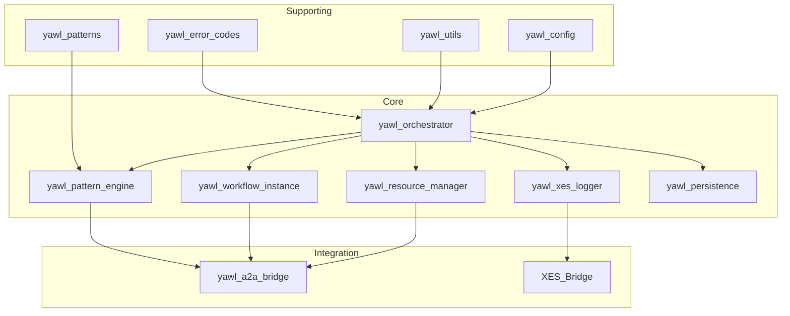

# YAWL Erlang Modules Reference

Complete API reference for all YAWL Erlang modules.

## Core Modules

### yawl_orchestrator

Main workflow orchestrator module.

**Primary Functions:**

```erlang
%% Workflow lifecycle
yawl_orchestrator:create_workflow(Config) -> {ok, WorkflowId} | {error, Reason}
yawl_orchestrator:execute_workflow(WorkflowId) -> {ok, Status} | {error, Reason}
yawl_orchestrator:get_status(WorkflowId) -> {ok, Status} | {error, workflow_not_found}
yawl_orchestrator:pause_workflow(WorkflowId) -> {ok, ok} | {error, Reason}
yawl_orchestrator:resume_workflow(WorkflowId) -> {ok, ok} | {error, Reason}
yawl_orchestrator:cancel_workflow(WorkflowId) -> {ok, ok} | {error, Reason}
yawl_orchestrator:cleanup_workflow(WorkflowId) -> ok | {error, Reason}

%% Workitem management
yawl_orchestrator:complete_workitem(WorkflowId, TaskId, Result) -> ok | {error, Reason}
yawl_orchestrator:get_workflow_instance(WorkflowId) -> {ok, Pid} | {error, workflow_instance_not_found}
yawl_orchestrator:get_workflow_result(WorkflowId) -> {ok, Result} | {error, workflow_not_completed}

%% Pattern management
yawl_orchestrator:list_patterns() -> [PatternType]
yawl_orchestrator:validate_pattern(PatternType, Config) -> {ok, valid} | {error, Reason}
yawl_orchestrator:get_pattern_info(PatternType) -> {ok, PatternInfo} | {error, pattern_not_found}
yawl_orchestrator:list_workflows() -> {ok, [WorkflowId]}

%% Subscription management
yawl_orchestrator:subscribe_to_workflow(WorkflowId, SubscriberPid) -> {ok, ok} | {error, Reason}
yawl_orchestrator:unsubscribe_from_workflow(WorkflowId, SubscriberPid) -> {ok, ok} | {error, Reason}
```

**State:**
```erlang
-record(state, {
    workflows = #{},                     % workflow_id => workflow
    workflow_instances = #{},                % workflow_id => {pid, monitor_ref}
    pattern_cache = #{},                   % pattern_type => pattern_def
    subscribers = #{},                    % workflow_id => [pid]
    config = #{},                        % system configuration
    statistics = #{}                     % performance metrics
}).
```

### yawl_pattern_engine

Pattern execution engine using Petri net semantics.

**Primary Functions:**

```erlang
%% Pattern execution
yawl_pattern_engine:execute_pattern(PatternType, Config) -> {ok, Result} | {error, Reason}
yawl_pattern_engine:get_current_marking(WorkflowId) -> {ok, Marking} | {error, Reason}
yawl_pattern_engine:is_transition_enabled(Transition, Marking) -> boolean()
yawl_pattern_engine:fire_transition(Transition, Marking) -> {ok, NewMarking} | abort

%% Petri net callbacks
yawl_pattern_engine:place_lst() -> [Place]
yawl_pattern_engine:trsn_lst() -> [Transition]
yawl_pattern_engine:init_marking(Place, UsrInfo) -> [Token]
yawl_pattern_engine:preset(Transition) -> [Place]
yawl_pattern_engine:postset(Transition) -> [Place]
yawl_pattern_engine:is_enabled(Transition, Marking, UsrInfo) -> boolean()
yawl_pattern_engine:fire(Transition, Marking, UsrInfo) -> {produce, NewMarking} | abort
yawl_pattern_engine:trigger(Place, Token, UsrInfo) -> pass | drop
```

**Pattern Definitions:**

```erlang
%% Basic Sequential Pattern
basic_sequential_place_lst() ->
    [start, task1, task2, completed].
basic_sequential_trsn_lst() ->
    [start_task1, start_task2, start_completed].
basic_sequential_init_marking(start, _UsrInfo) -> [workflow_token].
basic_sequential_init_marking(_, _UsrInfo) -> [].
basic_sequential_preset(start_task1) -> [start].
basic_sequential_preset(start_task2) -> [task1].
basic_sequential_preset(start_completed) -> [task2].
basic_sequential_postset(start_task1) -> [task1].
basic_sequential_postset(start_task2) -> [task2].
basic_sequential_postset(start_completed) -> [completed].
basic_sequential_is_enabled(start_task1, Mode, _) -> has_token(start, Mode).
basic_sequential_is_enabled(start_task2, Mode, _) -> has_token(task1, Mode).
basic_sequential_is_enabled(start_completed, Mode, _) -> has_token(task2, Mode).
basic_sequential_fire(start_task1, _, _) -> {produce, #{task1 => [task1_token]}}.
basic_sequential_fire(start_task2, _, _) -> {produce, #{task2 => [task2_token]}}.
basic_sequential_fire(start_completed, _, _) -> {produce, #{completed => [completed_token]}}.
basic_sequential_trigger(_, _, _) -> pass.
```

### yawl_resource_manager

Resource allocation and management.

**Primary Functions:**

```erlang
%% Resource registration
yawl_resource_manager:register_resource(ResourceId, Type, Config) -> {ok, ResourceId} | {error, Reason}
yawl_resource_manager:list_resources() -> {ok, [Resource]}
yawl_resource_manager:list_resources_by_type(Type) -> {ok, [Resource]}
yawl_resource_manager:list_available_resources() -> {ok, [Resource]}

%% Resource discovery
yawl_resource_manager:find_resources_by_capability(Capability) -> {ok, [Resource]}
yawl_resource_manager:find_resources_by_capabilities(Capabilities) -> {ok, [Resource]}

%% Allocation
yawl_resource_manager:allocate_resource(WorkitemId, Capabilities) -> {ok, ResourceId, Allocation}
yawl_resource_manager:allocate_resource(WorkitemId, Type, Capabilities) -> {ok, ResourceId, Allocation}
yawl_resource_manager:release_resource(WorkitemId) -> ok | {error, Reason}
yawl_resource_manager:release_resource(WorkitemId, ResourceId) -> ok | {error, Reason}

%% Resource management
yawl_resource_manager:update_resource_status(ResourceId, Status) -> ok
yawl_resource_manager:add_capability(ResourceId, Capability) -> ok
yawl_resource_manager:remove_capability(ResourceId, Capability) -> ok
yawl_resource_manager:update_resource_load(ResourceId, Load) -> ok

%% Allocation strategy
yawl_resource_manager:set_allocation_strategy(Strategy) -> ok
yawl_resource_manager:get_allocation_strategy() -> {ok, Strategy}
```

**Resource Types:**
```erlang
-type resource_type() :: human | service | system.
-type resource_status() :: available | busy | offline | maintenance.
-type allocation_strategy() :: round_robin | least_loaded | random.
```

### yawl_xes_logger

XES event logging for process mining.

**Primary Functions:**

```erlang
%% Log management
yawl_xes_logger:start_link() -> {ok, Pid} | {error, term()}
yawl_xes_logger:new_log() -> {ok, LogId}
yawl_xes_logger:new_log(Metadata) -> {ok, LogId}
yawl_xes_logger:get_log(LogId) -> {ok, Log} | {error, not_found}
yawl_xes_logger:delete_log(LogId) -> ok | {error, not_found}

%% Event logging
yawl_xes_logger:log_pattern_start(LogId, PatternType, PatternId) -> ok
yawl_xes_logger:log_pattern_complete(LogId, PatternType, PatternId, Result) -> ok
yawl_xes_logger:log_workitem_start(LogId, WorkitemId, TaskId) -> ok
yawl_xes_logger:log_workitem_complete(LogId, WorkitemId, TaskId, Result) -> ok
yawl_xes_logger:log_case_start(LogId, CaseId) -> ok
yawl_xes_logger:log_case_complete(LogId, CaseId, Stats) -> ok

%% Generic logging
yawl_xes_logger:log_event(LogId, ConceptName, LifecycleTransition, Data) -> ok
yawl_xes_logger:log_event(LogId, ConceptName, LifecycleTransition, Data, CaseId) -> ok

%% Export
yawl_xes_logger:export_xes(LogId) -> {ok, FilePath} | {error, Reason}
yawl_xes_logger:export_xes(LogId, OutputDir) -> {ok, FilePath} | {error, Reason}
yawl_xes_logger:export_xes_to_string(LogId) -> {ok, XESString} | {error, Reason}
```

**XES Event Structure:**
```erlang
-record(xes_log, {
    log_id :: binary(),
    trace_id :: binary(),
    started_at :: integer(),
    events :: [xes_event()],
    metadata :: map()
}).

-record(xes_event, {
    event_id :: binary(),
    timestamp :: integer(),
    case_id :: binary() | undefined,
    concept :: map(),
    lifecycle :: map(),
    data :: map()
}).
```

### yawl_persistence

Data persistence layer using Mnesia.

**Primary Functions:**

```erlang
%% Database management
yawl_persistence:create_schema() -> ok | {error, term()}
yawl_persistence:create_tables() -> ok | {error, term()}
yawl_persistence:wait_for_tables() -> ok | {timeout, [atom()]} | {error, term()}
yawl_persistence:backup_tables(Destination) -> ok | {error, term()}

%% Workflow persistence
yawl_persistence:save_workflow(Workflow) -> ok | {error, Reason}
yawl_persistence:load_workflow(WorkflowId) -> {ok, Workflow} | {error, not_found}
yawl_persistence:delete_workflow(WorkflowId) -> ok | {error, Reason}
yawl_persistence:list_workflows() -> {ok, [Workflow]}
yawl_persistence:list_workflows_by_status(Status) -> {ok, [Workflow]}

%% Workitem persistence
yawl_persistence:save_workitem(Workitem) -> ok | {error, Reason}
yawl_persistence:load_workitem(WorkitemId) -> {ok, Workitem} | {error, not_found}
yawl_persistence:delete_workitem(WorkitemId) -> ok | {error, Reason}
yawl_persistence:list_workitems(WorkflowId) -> {ok, [Workitem]}
yawl_persistence:update_workitem_status(WorkitemId, Status) -> ok | {error, Reason}

%% Resource persistence
yawl_persistence:save_resource(Resource) -> ok | {error, Reason}
yawl_persistence:load_resource(ResourceId) -> {ok, Resource} | {error, not_found}
yawl_persistence:delete_resource(ResourceId) -> ok | {error, Reason}
yawl_persistence:list_resources() -> {ok, [Resource]}
yawl_persistence:list_resources_by_type(Type) -> {ok, [Resource]}

%% Checkpoint and recovery
yawl_persistence:save_checkpoint(WorkflowId, Checkpoint) -> ok | {error, Reason}
yawl_persistence:load_latest_checkpoint(WorkflowId) -> {ok, Checkpoint} | {error, not_found}
yawl_persistence:restore_from_checkpoint(WorkflowId, CheckpointId) -> {ok, CheckpointState} | {error, Reason}
yawl_persistence:cleanup_old_checkpoints(WorkflowId, KeepCount) -> {ok, DeletedCount} | {error, Reason}
```

**Persistence Records:**
```erlang
-record(yawl_workflow_persist, {
    workflow_id :: binary(),
    spec_id :: binary(),
    pattern_type :: atom(),
    status :: atom(),
    marking :: #{place() => [token()]},
    current_place :: atom() | undefined,
    data :: map(),
    created_at :: integer(),
    updated_at :: integer()
}).

-record(yawl_workitem_persist, {
    workitem_id :: binary(),
    workflow_id :: binary(),
    task_name :: binary(),
    status :: atom(),
    data :: map(),
    allocated_to :: binary() | undefined,
    created_at :: integer(),
    completed_at :: integer() | undefined
}).

-record(yawl_resource_persist, {
    resource_id :: binary(),
    resource_type :: atom(),
    name :: binary(),
    capabilities :: [atom()],
    status :: atom(),
    current_load :: integer(),
    max_capacity :: integer()
}).
```

### yawl_a2a_bridge

Integration bridge between YAWL and A2A tasks.

**Primary Functions:**

```erlang
%% Workflow creation from A2A task
yawl_a2a_bridge:create_workflow_from_a2a_task(TaskId, PatternType) -> {ok, WorkflowId} | {error, Reason}

%% A2A task from workitem
yawl_a2a_bridge:create_a2a_task_from_workitem(Workitem) -> {ok, TaskId, TaskPid}
yawl_a2a_bridge:create_a2a_task_from_workitem(Workitem, Options) -> {ok, TaskId, TaskPid}

%% State synchronization
yawl_a2a_bridge:sync_workitem_to_a2a_task(WorkitemId, TaskId) -> ok
yawl_a2a_bridge:complete_workitem_from_a2a_task(TaskId, Result) -> ok

%% Resource integration
yawl_a2a_bridge:allocate_resource_for_task(TaskId, Capabilities) -> {ok, ResourceId}
yawl_a2a_bridge:release_resource_for_task(TaskId, ResourceId) -> ok

%% Event integration
yawl_a2a_bridge:subscribe_to_a2a_events(SubscriberPid) -> {ok, Ref}
yawl_a2a_bridge:unsubscribe_from_a2a_events(Ref) -> ok
```

**Mapping Functions:**
```erlang
%% YAWL to A2A state mapping
yawl_state_to_a2a(pending) -> ?TASK_STATE_SUBMITTED.
yawl_state_to_a2a(running) -> ?TASK_STATE_WORKING.
yawl_state_to_a2a(completed) -> ?TASK_STATE_COMPLETED.
yawl_state_to_a2a(failed) -> ?TASK_STATE_FAILED.
yawl_state_to_a2a(cancelled) -> ?TASK_STATE_CANCELED.

%% A2A to YAWL state mapping
map_a2a_state_to_yawl(?TASK_STATE_SUBMITTED) -> pending.
map_a2a_state_to_yawl(?TASK_STATE_WORKING) -> running.
map_a2a_state_to_yawl(?TASK_STATE_COMPLETED) -> completed.
map_a2a_state_to_yawl(?TASK_STATE_FAILED) -> failed.
map_a2a_state_to_yawl(?TASK_STATE_CANCELED) -> cancelled.
```

### yawl_workflow_instance

Workflow instance supervisor and process.

**Primary Functions:**

```erlang
%% Instance management
yawl_workflow_instance:start_link(WorkflowId, PatternDef, Config) -> {ok, Pid}
yawl_workflow_instance:stop(InstanceId) -> ok

%% Execution control
yawl_workflow_instance:pause(InstanceId) -> ok
yawl_workflow_instance:resume(InstanceId) -> ok
yawl_workflow_instance:cancel(InstanceId) -> ok

%% State queries
yawl_workflow_instance:get_state(InstanceId) -> {ok, State}
yawl_workflow_instance:get_marking(InstanceId) -> {ok, Marking}

%% Workitem handling
yawl_workflow_instance:complete_workitem(InstanceId, WorkitemId, Result) -> ok
yawl_workflow_instance:fail_workitem(InstanceId, WorkitemId, Error) -> ok
```

**State Machine States:**
```erlang
-type instance_state() :: initializing | executing | paused | completing | cancelling | terminated.
```

### yawl_patterns

Pattern definitions and validation.

**Primary Functions:**

```erlang
%% Pattern information
yawl_patterns:list_patterns() -> [PatternType]
yawl_patterns:get_pattern_info(PatternType) -> {ok, PatternInfo} | {error, pattern_not_found}
yawl_patterns:is_cancellation_pattern(PatternType) -> boolean()
yawl_patterns:is_resource_pattern(PatternType) -> boolean()

%% Pattern validation
yawl_patterns:validate_pattern(PatternType, Config) -> {ok, valid} | {error, Reason}

%% Pattern categorization
yawl_patterns:get_category(PatternType) -> {ok, Category} | {error, unknown_pattern}
yawl_patterns:get_complexity(PatternType) -> {ok, Complexity} | {error, unknown_pattern}
```

**Pattern Categories:**
```erlang
-type pattern_category() ::
    control_flow | control_flow_advanced | control_flow_iteration |
    cancellation | cancellation_after | cancellation_or_and | resource_allocation
    time_based.

-type complexity_level() :: low | medium | high | expert.
```

### yawl_error_codes

Centralized error handling.

**Primary Functions:**

```erlang
%% Error information
yawl_error_codes:error_info(ErrorCode) -> ErrorInfo
yawl_error_codes:error_code(ErrorCode) -> ErrorCode
yawl_error_codes:http_status(ErrorCode) -> pos_integer()
yawl_error_codes:error_message(ErrorCode) -> binary()
yawl_error_codes:error_category(ErrorCode) -> error_category()

%% Error formatting
yawl_error_codes:format_error(ErrorCode) -> map()
yawl_error_codes:format_error(ErrorCode, Details) -> map()
yawl_error_codes:format_error(ErrorCode, Message, Details) -> map()

%% Error management
yawl_error_codes:all_error_codes() -> [error_code()]
yawl_error_codes:errors_by_category(Category) -> [error_code()]
yawl_error_codes:is_client_error(ErrorCode) -> boolean()
yawl_error_codes:is_server_error(ErrorCode) -> boolean()
```

**Error Categories:**
```erlang
-type error_category() ::
    validation | authentication | authorization | not_found
  | conflict | rate_limit | server_error | service_unavailable.
```

### yawl_rest_api

REST API web server using Cowboy.

**Primary Functions:**

```erlang
%% Server lifecycle
yawl_rest_api:start_link() -> {ok, Pid} | {error, term()}
yawl_rest_api:stop() -> ok

%% Request handling
yawl_rest_api:handle_request(Method, Path, Headers, Body) -> Response

%% Route handlers
yawl_rest_api:handle_workflows(Method, Path, Headers, Body) -> Response
yawl_rest_api:handle_patterns(Method, Path, Headers, Body) -> Response
yawl_rest_api:handle_resources(Method, Path, Headers, Body) -> Response
```

**API Routes:**
```
GET    /api/health
GET    /api/version
GET    /api/metrics

GET    /api/workflows
POST   /api/workflows
GET    /api/workflows/{id}
POST   /api/workflows/{id}/execute
POST   /api/workflows/{id}/pause
POST   /api/workflows/{id}/resume
POST   /api/workflows/{id}/cancel
DELETE /api/workflows/{id}

GET    /api/workflows/{id}/status
GET    /api/workflows/{id}/details
GET    /api/workflows/{id}/tasks
GET    /api/workflows/{id}/tasks/{task_id}
POST   /api/workflows/{id}/tasks/{task_id}/complete
POST   /api/workflows/{id}/tasks/{task_id}/fail
DELETE /api/workflows/{id}/tasks/{task_id}

GET    /api/patterns
GET    /api/patterns/{pattern}
POST   /api/patterns/{pattern}/validate

GET    /api/resources
POST   /api/resources
GET    /api/resources/{id}
PUT    /api/resources/{id}
DELETE /api/resources/{id}
GET    /api/resources/metrics

GET    /api/workflows/{id}/events
GET    /api/workflows/{id}/metrics
GET    /api/workflows/{id}/xes
POST   /api/workflows/{id}/xes/export
WS     /api/workflows/{id}/events/stream
```

## Utility Modules

### yawl_utils

Common utility functions.

**Primary Functions:**

```erlang
%% ID generation
yawl_utils:generate_id(Prefix) -> Binary
yawl_utils:generate_workflow_id() -> Binary
yawl_utils:generate_workitem_id() -> Binary

%% Time utilities
yawl_utils:timestamp_to_iso(Timestamp) -> Binary
yawl_utils:iso_to_timestamp(ISOString) -> integer()

%% Data transformation
yawl_utils:proplist_to_map(Proplist) -> map()
yawl_utils:map_to_proplist(Map) -> Proplist

%% Validation
yawl_utils:validate_required_fields(Data, RequiredFields) -> ok | {error, {missing, Fields}}
yawl_utils:validate_format(Data, FormatSpec) -> ok | {error, {invalid_format, Expected}}
```

### yawl_config

Configuration management.

**Primary Functions:**

```erlang
%% Configuration access
yawl_config:get(Key, Default) -> Value
yawl_config:get_all() -> map()
yawl_config:set(Key, Value) -> ok

%% Pattern-specific config
yawl_config:get_pattern_config(PatternType) -> {ok, Config}
yawl_config:set_pattern_config(PatternType, Config) -> ok

%% Resource config
yawl_config:get_resource_config() -> {ok, Config}
yawl_config:get_allocation_strategy() -> {ok, Strategy}
yawl_config:set_allocation_strategy(Strategy) -> ok
```

**Default Configuration:**
```erlang
#{
    %% Workflow limits
    max_concurrent_workflows => 100,
    default_timeout => 30000,

    %% Pattern cache
    enable_pattern_cache => true,
    pattern_cache_size => 1000,

    %% XES logging
    enable_xes => true,
    xes_output_dir => "xes_logs",

    %% Persistence
    persistence_backend => mnesia,
    enable_persistence => true,

    %% Metrics
    enable_metrics => true,
    metrics_interval => 10000
}.
```

## Module Index

| Module | Description |
|--------|-------------|
| `yawl_orchestrator` | Main workflow orchestrator |
| `yawl_pattern_engine` | Pattern execution engine |
| `yawl_workflow_instance` | Workflow instance supervisor |
| `yawl_resource_manager` | Resource allocation |
| `yawl_xes_logger` | XES event logging |
| `yawl_persistence` | Data persistence |
| `yawl_a2a_bridge` | A2A integration bridge |
| `yawl_rest_api` | REST API web server |
| `yawl_patterns` | Pattern definitions |
| `yawl_error_codes` | Error handling |
| `yawl_utils` | Utility functions |
| `yawl_config` | Configuration management |
| `yawl_composite_workflow` | Composite workflow support |

## Module Dependencies



---

Next: [Configuration](configuration.md) | [Error Codes](error-codes.md) | [XES Logging](xes-logging.md)
