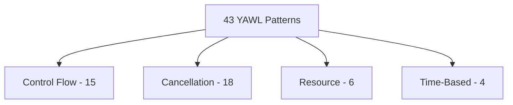

# YAWL Patterns Reference

Complete reference for all 43 YAWL workflow patterns.

## Pattern Categories



## Quick Reference Table

| # | Pattern | Category | Complexity |
|---|--------|----------|------------|
| 1 | Basic Sequential | Control Flow | Low |
| 2 | Parallel Split | Control Flow | Medium |
| 3 | Parallel Join | Control Flow | Medium |
| 4 | Exclusive Choice | Control Flow | Medium |
| 5 | Simple Merge | Control Flow | Medium |
| 6 | Interleaved Parallelism | Control Flow | Medium |
| 7 | Implicit Merge | Control Flow | Medium |
| 8 | Multiple Merge | Control Flow | High |
| 9 | Deferred Choice | Control Flow | Medium |
| 10 | Interleaved Routing | Control Flow | High |
| 11 | Milestone | Control Flow | Medium |
| 12 | Iterative Loop | Control Flow | High |
| 13 | Multi-Instance | Control Flow | High |
| 14 | N-Parallel Split | Control Flow | High |
| 15 | N-Parallel Join | Control Flow | High |
| 16 | Cancellation | Cancellation | Medium |
| 17 | Cancellation Block | Cancellation | Medium |
| 18 | Cancellation Scope | Cancellation | Medium |
| 19 | Cancellation Thread | Cancellation | Medium |
| 20 | Cancellation Subprocess | Cancellation | Medium |
| 21 | Cancellation Multiple Instances | Cancellation | High |
| 22 | Cancellation Point | Cancellation | Medium |
| 23 | Cancellation End | Cancellation | Medium |
| 24 | Cancellation Action | Cancellation | Medium |
| 25 | Cancellation Thread After | Cancellation | High |
| 26 | Cancellation Subprocess After | Cancellation | High |
| 27 | Cancellation Multiple Instances After | Cancellation | High |
| 28 | Cancellation Multiple Instances Thread After | Cancellation | High |
| 29 | Cancellation Multiple Instances Subprocess After | Cancellation | High |
| 30 | Cancellation Thread OR | Cancellation | High |
| 31 | Cancellation Subprocess OR | Cancellation | High |
| 32 | Cancellation Thread AND | Cancellation | High |
| 33 | Implicit Merge With Allocation | Resource | High |
| 34 | Multiple Merge With Allocation | Resource | High |
| 35 | Deferred Choice With Allocation | Resource | High |
| 36 | Implicit Merge Without Allocation | Resource | Medium |
| 37 | Multiple Merge Without Allocation | Resource | High |
| 38 | Deferred Choice Without Allocation | Resource | Medium |
| 39 | Timed Trigger | Time | Medium |
| 40 | Timeout Pattern | Time | Medium |
| 41 | Scheduled Execution | Time | Medium |
| 42 | Deadline Pattern | Time | High |
| 43 | Revenue Task | Time | Medium |

## Control Flow Patterns

### Basic Patterns

#### 1. Basic Sequential

**ID**: `sequential`

**Description**: Execute tasks in sequence, one after another.

**Petri Net**:
```
 Places: [start, task1, task2, end]
 Transitions: [t1, t2, t3]
 Edges: start -t1-> task1 -t2-> task2 -t3-> end
```

**Example**:
```erlang
Config = #{
    pattern_type => sequential,
    name => "order_processing",
    steps => ["validate_order", "process_payment", "ship_order"]
},
{ok, WorkflowId} = yawl_orchestrator:create_workflow(Config).
```

#### 2. Parallel Split

**ID**: `parallel_split`

**Description**: Execute multiple tasks simultaneously.

**Petri Net**:
```
 Places: [start, split, a, b, sync, end]
 Transitions: [split, ta, tb, sync]
 Edges: start -split-> split, split-ta-> a, split-tb-> b, a-sync-> sync, b-sync-> sync, sync-end-> end
```

**Example**:
```erlang
Config = #{
    pattern_type => parallel_split,
    name => "parallel_checks",
    parameters => #{
        branches => 3,
        tasks => [
            #{task => inventory_check, capabilities => [inventory]},
            #{task => credit_check, capabilities => [credit]},
            #{task => fraud_check, capabilities => [fraud]}
        ]
    }
}.
```

#### 3. Parallel Join

**ID**: `parallel_join`

**Description**: Wait for multiple parallel branches to complete.

**Example**:
```erlang
Config = #{
    pattern_type => parallel_join,
    name => "sync_results",
    parameters => #{
        required_branches => 3
    }
}.
```

#### 4. Exclusive Choice

**ID**: `exclusive_choice`

**Description**: Choose one path based on conditions.

**Example**:
```erlang
Config = #{
    pattern_type => exclusive_choice,
    name => "amount_based_routing",
    parameters => #{
        conditions => [
            #{name => low_cost, threshold => 100},
            #{name => medium_cost, threshold => 1000}
        ]
    }
}.
```

#### 5. Simple Merge

**ID**: `simple_merge`

**Description**: Merge multiple paths into one.

**Example**:
```erlang
Config = #{
    pattern_type => simple_merge,
    name => "merge_paths",
    parameters => #{
        input_count => 3
    }
}.
```

### Advanced Patterns

#### 6. Interleaved Parallelism

**ID**: `interleaved_parallelism`

**Description**: Execute multiple tasks in any order.

**Example**:
```erlang
Config = #{
    pattern_type => interleaved_parallelism,
    name => "flexible_order",
    parameters => #{
        tasks => [task_a, task_b, task_c],
        allow_concurrent => true
    }
}.
```

#### 7. Deferred Choice

**ID**: `deferred_choice`

**Description**: Defer path selection until execution time.

**Example**:
```erlang
Config = #{
    pattern_type => deferred_choice,
    name => "runtime_decision",
    parameters => #{
        options => [fast_lane, standard_lane]
    }
}.
```

#### 8. Milestone

**ID**: `milestone`

**Description**: Wait for milestone before proceeding.

**Example**:
```erlang
Config = #{
    pattern_type => milestone,
    name => "gate_keep",
    parameters => #{
        milestone_condition => fun(Data) ->
            maps:get(revenue, Data, 0) > 10000
        end
    }
}.
```

### Iteration Patterns

#### 12. Iterative Loop

**ID**: `iterative_loop`

**Description**: Repeat execution until condition is met.

**Example**:
```erlang
Config = #{
    pattern_type => iterative_loop,
    name => "retry_loop",
    parameters => #{
        condition => fun(Data) -> maps:get(count, Data) < 3 end,
        max_iterations => 10
    }
}.
```

#### 13. Multi-Instance

**ID**: `multi_instance`

**Description**: Execute task multiple times for different data.

**Example**:
```erlang
Config = #{
    pattern_type => multi_instance,
    name => "batch_processing",
    parameters => #{
        num_instances => 5,
        data => [1, 2, 3, 4, 5],
        parallel => true
    }
}.
```

## Cancellation Patterns

### Base Cancellation Patterns

#### 16. Cancellation

**ID**: `cancellation`

**Description**: Cancel workflow execution.

**Example**:
```erlang
Config = #{
    pattern_type => cancellation,
    name => "emergency_stop",
    parameters => #{
        cancellation_scope => all
    }
}.
```

#### 17. Cancellation Block

**ID**: `cancellation_block`

**Description**: Cancel within a block of activities.

**Example**:
```erlang
Config = #{
    pattern_type => cancellation_block,
    name => "scoped_cancellation",
    parameters => #{
        block_tasks => [task1, task2, task3]
    }
}.
```

#### 18. Cancellation Scope

**ID**: `cancellation_scope`

**Description**: Cancel within a defined scope.

**Example**:
```erlang
Config = #{
    pattern_type => cancellation_scope,
    name => "nested_cancellation",
    parameters => #{
        scope_tasks => [outer_task, inner_task]
    }
}.
```

#### 19. Cancellation Thread

**ID**: `cancellation_thread`

**Description**: Cancel a single execution thread.

**Example**:
```erlang
Config = #{
    pattern_type => cancellation_thread,
    name => "thread_cancellation",
    parameters => #{
        thread_id => "thread_1"
    }
}.
```

#### 20. Cancellation Subprocess

**ID**: `cancellation_subprocess`

**Description**: Cancel a subprocess.

**Example**:
```erlang
Config = #{
    pattern_type => cancellation_subprocess,
    name => "subprocess_cancellation",
    parameters => #{
        subprocess_id => "sub_1"
    }
}.
```

#### 21. Cancellation Multiple Instances

**ID**: `cancellation_multiple_instances`

**Description**: Cancel multiple instance executions.

**Example**:
```erlang
Config = #{
    pattern_type => cancellation_multiple_instances,
    name => "batch_cancellation",
    parameters => #{
        instance_ids => ["inst_1", "inst_2", "inst_3"]
    }
}.
```

### After Patterns

#### 25. Cancellation Thread After

**ID**: `cancellation_thread_after`

**Description**: Cancel thread after completion.

**Example**:
```erlang
Config = #{
    pattern_type => cancellation_thread_after,
    name => "cleanup_after_thread",
    parameters => #{
        delay => 5000
    }
}.
```

#### 27. Cancellation Multiple Instances After

**ID**: `cancellation_multiple_instances_after`

**Description**: Cancel multiple instances after completion.

**Example**:
```erlang
Config = #{
    pattern_type => cancellation_multiple_instances_after,
    name => "cleanup_after_batch",
    parameters => #{
        delay => 10000,
        instance_ids => ["inst_1", "inst_2"]
    }
}.
```

### OR/AND Patterns

#### 30. Cancellation Thread OR

**ID**: `cancellation_thread_or`

**Description**: Cancel thread with OR conditions.

**Example**:
```erlang
Config = #{
    pattern_type => cancellation_thread_or,
    name => "conditional_cancellation",
    parameters => #{
        conditions => [error, timeout],
        operator => or
    }
}.
```

#### 32. Cancellation Thread AND

**ID**: `cancellation_thread_and`

**Description**: Cancel thread with AND conditions.

**Example**:
```erlang
Config = #{
    pattern_type => cancellation_thread_and,
    name => "strict_cancellation",
    parameters => #{
        conditions => [error, timeout],
        operator => and
    }
}.
```

## Resource Allocation Patterns

### With Allocation Patterns

#### 33. Implicit Merge With Allocation

**ID**: `implicit_merge_with_allocation`

**Description**: Implicit merge with resource allocation.

**Example**:
```erlang
Config = #{
    pattern_type => implicit_merge_with_allocation,
    name => "resource_merge",
    parameters => #{
        capabilities => [review, approval]
    }
}.
```

#### 34. Multiple Merge With Allocation

**ID**: `multiple_merge_with_allocation`

**Description**: Multiple merge with resource allocation.

**Example**:
```erlang
Config = #{
    pattern_type => multiple_merge_with_allocation,
    name => "multi_merge_resources",
    parameters => #{
        merge_count => 3,
        required_capabilities => [[review], [approval], [technical]]
    }
}.
```

#### 35. Deferred Choice With Allocation

**ID**: `deferred_choice_with_allocation`

**Description**: Deferred choice with resource allocation.

**Example**:
```erlang
Config = #{
    pattern_type => deferred_choice_with_allocation,
    name => "deferred_resource_choice",
    parameters => #{
        options => [
            #{capabilities => [junior], priority => low},
            #{capabilities => [senior], priority => high}
        ]
    }
}.
```

### Without Allocation Patterns

#### 36. Implicit Merge Without Allocation

**ID**: `implicit_merge_without_allocation`

**Example**:
```erlang
Config = #{
    pattern_type => implicit_merge_without_allocation,
    name => "simple_merge_no_resource"
}.
```

#### 37. Multiple Merge Without Allocation

**ID**: `multiple_merge_without_allocation`

**Example**:
```erlang
Config = #{
    pattern_type => multiple_merge_without_allocation,
    name => "multi_merge_no_resource"
}.
```

#### 38. Deferred Choice Without Allocation

**ID**: `deferred_choice_without_allocation`

**Example**:
```erlang
Config = #{
    pattern_type => deferred_choice_without_allocation,
    name => "deferred_choice_no_resource"
}.
```

## Time-Based Patterns

#### 39. Timed Trigger

**ID**: `timed_trigger`

**Description**: Execute task at specific time.

**Example**:
```erlang
Config = #{
    pattern_type => timed_trigger,
    name => "scheduled_task",
    parameters => #{
        trigger_time => "2024-12-31T23:59:59Z"
    }
}.
```

#### 40. Timeout Pattern

**ID**: `timeout_pattern`

**Description**: Cancel task after timeout.

**Example**:
```erlang
Config = #{
    pattern_type => timeout_pattern,
    name => "with_timeout",
    parameters => #{
        timeout => 30000
    }
}.
```

#### 41. Scheduled Execution

**ID**: `scheduled_execution`

**Description**: Execute on schedule.

**Example**:
```erlang
Config = #{
    pattern_type => scheduled_execution,
    name => "daily_report",
    parameters => #{
        schedule => "daily 09:00",
        timezone => "UTC"
    }
}.
```

#### 42. Deadline Pattern

**ID**: `deadline_pattern`

**Description**: Complete by deadline or fail.

**Example**:
```erlang
Config = #{
    pattern_type => deadline_pattern,
    name => "deadline_driven",
    parameters => #{
        deadline => "2024-12-31T23:59:59Z"
    }
}.
```

## Pattern Usage Examples

### Order Fulfillment Workflow

```erlang
%% Order fulfillment combining multiple patterns
OrderFulfillmentConfig = #{
    workflow_id => order_fulfillment,
    pattern_sequence => [
        # Step 1: Validate order (Sequential)
        #{
            pattern_type => sequential,
            tasks => [validate_order, check_inventory]
        },
        # Step 2: Route based on amount (Exclusive Choice)
        #{
            pattern_type => exclusive_choice,
            name => amount_routing,
            parameters => #{
                conditions => [
                    #{name => low_value, amount => 100},
                    #{name => medium_value, amount => 1000}
                ]
            }
        },
        # Step 3: Process in parallel (Parallel Split)
        #{
            pattern_type => parallel_split,
            name => concurrent_processing,
            parameters => #{
                branches => [
                    #{task => payment_processing, timeout => 30000},
                    #{task => shipping, timeout => 60000},
                    #{task => notification, timeout => 10000}
                ]
            }
        },
        # Step 4: Complete (Synchronization)
        #{
            pattern_type => parallel_join,
            name => sync_results
        }
    ]
}.
```

### Multi-Agent Workflow

```erlang
%% Multi-agent coordination workflow
MultiAgentConfig = #{
    workflow_id => multi_agent_collaboration,
    pattern_type => interleaved_parallelism,
    name => "agent_collaboration",
    parameters => #{
        tasks = [
            #{task => data_entry, agent_type => data_entry},
            #{task => review, agent_type => reviewer},
            #{task => approval, agent_type => approver}
        ]
    }
}.
```

### Batch Processing Workflow

```erlang
%% Batch processing with multi-instance
BatchConfig = #{
    workflow_id => batch_processing,
    pattern_type => multi_instance,
    name => "process_batch",
    parameters => #{
        num_instances => length(BatchItems),
        data => BatchItems,
        parallel => true,
        completion_condition => all
    }
}.
```

### Error Handling Workflow

```erlang
%% Workflow with error handling
ErrorHandlingConfig = #{
    workflow_id => error_handling,
    pattern_type => cancellation_scope,
    name => "with_error_handling",
    parameters => #{
        scope_tasks => [main_task, error_handler],
        error_conditions => [
            #{type => timeout, action => cancel},
            #{type => validation_error, action => retry}
        ]
    }
}.
```

## Pattern Selection Guide

### By Use Case

| Use Case | Recommended Patterns |
|----------|-------------------|
| Simple Approval | Basic Sequential, Exclusive Choice |
| Parallel Processing | Parallel Split, Parallel Join |
| Batch Processing | Multi-Instance, N-Parallel |
| Error Handling | Cancellation patterns, Timeout |
| Resource Management | Resource allocation patterns |
| Time-Based | Timed Trigger, Scheduled Execution |

### By Complexity

| Complexity | Patterns | Description |
|------------|----------|-------------|
| Simple | Basic Sequential, Exclusive Choice, Simple Merge | Linear processes |
| Medium | Parallel Split/Join, Cancellation, Time-based | Standard workflows |
| Advanced | Multi-Instance, Deferred Choice, Resource | Complex orchestration |
| Expert | Time-based + Cancellation, Multiple Merge | Specialized scenarios |

## Pattern Validation

All patterns are validated before execution:

```erlang
%% Validate pattern configuration
validate_pattern(PatternType, Config) ->
    case yawl_patterns:get_pattern_info(PatternType) of
        {ok, _} ->
            validate_parameters(PatternType, Config);
        {error, Reason} ->
            {error, Reason}
    end.

validate_parameters(PatternType, Config) ->
    RequiredParams = yawl_patterns:get_required_parameters(PatternType),
    ProvidedParams = maps:get(parameters, Config, #{}),
    RequiredParamNames = [maps:get(name, Param, undefined) || Param || undefined ||
                                lists:member(name, ProvidedParams) || Param =:= undefined
     || Param =:= undefined || Param =:= undefined
     || Param =:= undefined
    end,
    MissingParams = [P || undefined || Pname || <<"parameter_", N>>]
                     || N <- lists:seq(1, length(RequiredParamNames)),
    case MissingParams of
        [] -> {ok, valid};
        _ -> {error, {missing_parameters, MissingParams}}
    end.
```

---

Next: [Modules Reference](modules.md) | [Back to Reference](reference/)
