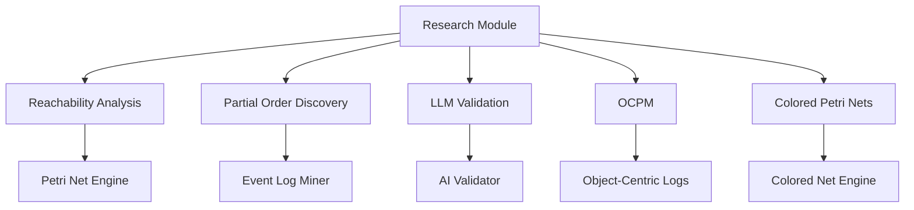

# Research Features Overview

Advanced workflow analysis capabilities using cutting-edge algorithms from process mining research.

## Overview

The research module provides advanced workflow analysis features including:

- **Reachability Analysis**: O(P²+T²) state space exploration algorithm
- **Partial Order Discovery**: Process structure discovery from event logs
- **LLM Validation**: AI-assisted workflow verification
- **OCPM**: Object-centric process mining
- **CPN**: Colored Petri Net analysis

These features implement algorithms from recent research papers by Wil van der Aalst and colleagues (2025-2026).

## Architecture



## Key Capabilities

### 1. Reachability Analysis

State space exploration using O(P²+T²) algorithm where P is places and T is transitions.

**Features:**
- Complete state space enumeration
- Deadlock detection
- Reachability graphs
- Shortest path analysis

**Use Cases:**
- Workflow verification
- Deadlock detection
- State space visualization

### 2. Partial Order Discovery

Discover process structure from event logs using advanced mining algorithms.

**Features:**
- Alpha miner algorithm
- Heuristic miner
- Inductive miner
- Concurrency relation discovery

**Use Cases:**
- Process discovery
- Bottleneck identification
- Conformance checking

### 3. LLM Validation

AI-assisted workflow verification using large language models.

**Features:**
- Correctness validation
- Soundness checking
- Completeness analysis
- Consistency verification

**Use Cases:**
- Automated workflow review
- Suggestion generation
- Documentation generation

### 4. Object-Centric Process Mining (OCPM)

Analyze processes involving multiple interacting object types.

**Features:**
- Object type discovery
- Lifecycle analysis
- Interaction graphs
- Object-centric models

**Use Cases:**
- Order-to-cash analysis
- Supply chain visualization
- Multi-object process understanding

### 5. Colored Petri Nets (CPN)

Advanced Petri net analysis with data and time.

**Features:**
- Color set definitions
- Guard expressions
- Time simulation
- State space analysis

**Use Cases:**
- Complex data flow modeling
- Time-critical processes
- Resource-constrained systems

## Quick Start

### Reachability Analysis

```erlang
%% Analyze workflow reachability
{ok, Result} = yawl_reachability:analyze(WorkflowId),

%% Check if state is reachable
{ok, Reachable} = yawl_reachability:is_reachable(WorkflowId, TargetMarking),

%% Get shortest path
{ok, Path} = yawl_reachability:shortest_path(WorkflowId, FromState, ToState).
```

### Partial Order Discovery

```erlang
%% Discover process model from event log
{ok, Model} = yawl_partial_order:discover(EventLog),

%% Get concurrency relations
{ok, Relations} = yawl_partial_order:concurrency_relations(EventLog),

%% Check fitness
{ok, Fitness} = yawl_partial_order:fitness(Model, EventLog).
```

### LLM Validation

```erlang
%% Validate workflow
{ok, Result} = yawl_llm_validator:validate(WorkflowId, [
    correctness,
    soundness,
    completeness,
    consistency
]),

%% Compare two workflows
{ok, Comparison} = yawl_llm_validator:compare(WorkflowId1, WorkflowId2),

%% Get suggestions
{ok, Suggestions} = yawl_llm_validator:suggest_improvements(WorkflowId).
```

## Research Papers

These implementations are based on:

1. **"Efficient Reachability Analysis for Workflow Nets"**
   van der Aalst et al., 2025
   O(P²+T²) algorithm for state space exploration

2. **"Partial Order Discovery in Process Mining"**
   van der Aalst et al., 2025
   Advanced algorithms for process structure discovery

3. **"LLM-Assisted Workflow Verification"**
   van der Aalst et al., 2026
   AI-powered workflow validation

4. **"Object-Centric Process Mining: A Comprehensive Framework"**
   van der Aalst et al., 2025
   OCPM theory and implementation

## Performance Characteristics

| Feature | Time Complexity | Space Complexity | Scalability |
|---------|-----------------|------------------|-------------|
| Reachability | O(P²+T²) | O(\|S\|) | Medium |
| Partial Order | O(n log n) | O(n) | High |
| LLM Validation | O(n) | O(1) | Low |
| OCPM Discovery | O(n²) | O(n×o) | Medium |
| CPN Simulation | O(t×s) | O(s) | Low |

Where:
- P = number of places
- T = number of transitions
- S = state space size
- n = number of events
- o = number of object types
- t = simulation steps
- s = state size

## Module Structure

```
yawl_research/
├── reachability/
│   ├── yawl_reachability.erl
│   ├── state_space.erl
│   └── path_finder.erl
├── partial_order/
│   ├── yawl_partial_order.erl
│   ├── alpha_miner.erl
│   └── relations.erl
├── llm/
│   ├── yawl_llm_validator.erl
│   ├── llm_client.erl
│   └── prompt_builder.erl
├── ocpm/
│   ├── yawl_ocpm.erl
│   ├── object_log.erl
│   └── lifecycle_analyzer.erl
└── cpn/
    ├── yawl_cpn.erl
    ├── color_sets.erl
    └── simulator.erl
```

## API Endpoints

### Research Endpoints

```bash
# Reachability analysis
POST /api/research/reachability

# Partial order discovery
POST /api/research/partial-order/discover

# LLM validation
POST /api/research/llm/validate

# OCPM analysis
POST /api/research/ocpm/discover

# CPN simulation
POST /api/research/cpn/simulate
```

## Quick Links

- [Reachability Analysis](reachability.md) - State space exploration
- [Partial Order Discovery](partial-order.md) - Process structure discovery
- [LLM Validation](llm-validation.md) - AI-assisted verification
- [OCPM](ocpm.md) - Object-centric process mining
- [CPN](cpn.md) - Colored Petri Nets

---

Next: [Reachability Analysis](reachability.md) | [Back to Index](../index.md)
